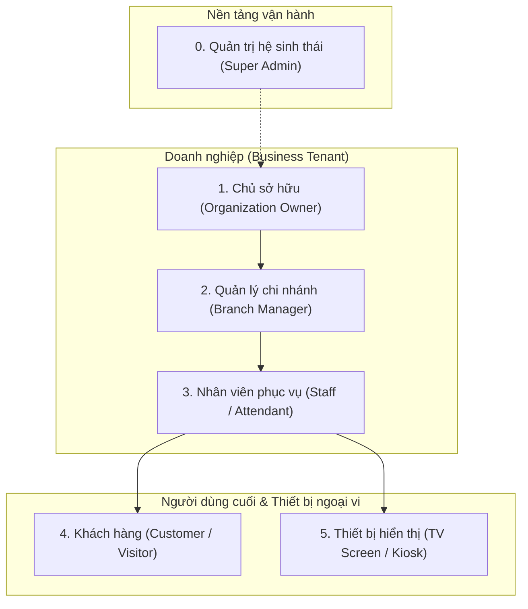
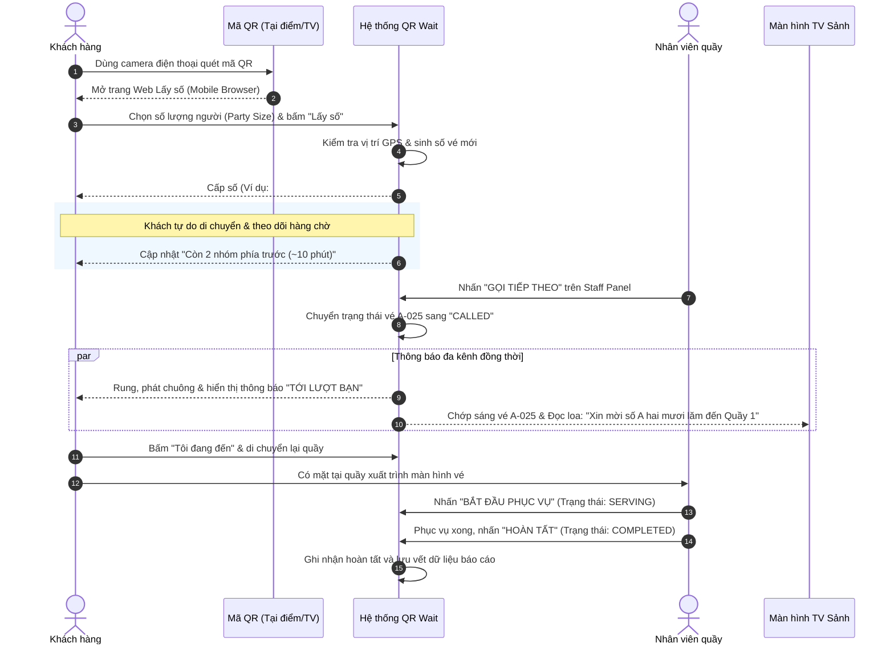
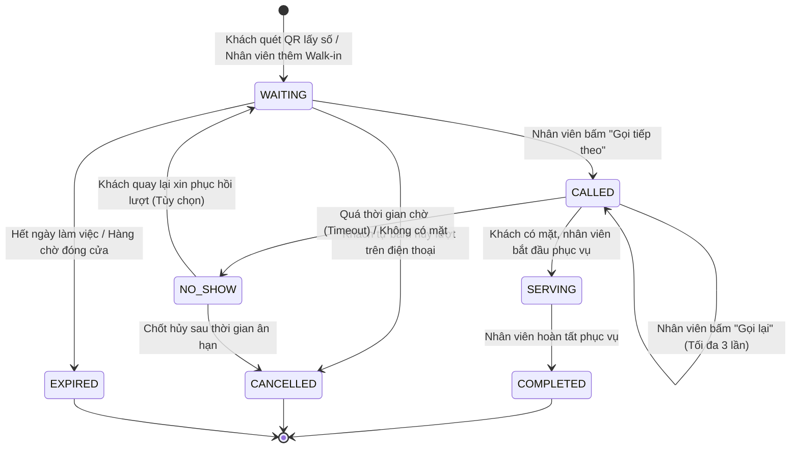

# TÀI LIỆU YÊU CẦU KINH DOANH (BUSINESS REQUIREMENTS DOCUMENT - BRD)
## DỰ ÁN: HỆ THỐNG QUẢN LÝ HÀNG ĐỢI ẢO THÔNG MINH (QR WAIT)

---

## 1. DOCUMENT INFORMATION (THÔNG TIN TÀI LIỆU)

| Thuộc tính | Chi tiết |
| :--- | :--- |
| **Tên tài liệu** | Business Requirements Document (BRD) - Hệ thống Quản lý Hàng đợi Ảo QR Wait |
| **Mã tài liệu** | BRD-QRWAIT-01 |
| **Dự án** | Nền tảng Quản lý Hàng đợi & Lượt chờ thông minh qua QR Code (SaaS QR Wait) |
| **Phiên bản** | 1.1 (Cập nhật loại bỏ phân hệ Gói cước & Nạp lượt) |
| **Ngày tạo** | 23/11/2026 |
| **Tác giả** | Senior Business Analyst (BA) |
| **Trạng thái** | Chờ phê duyệt (Pending Approval) |
| **Sản phẩm tham chiếu** | QR Wait (`https://qrwait.app/vi/`) |
| **Đối tượng độc giả** | Product Owner, Project Manager, Solution Architect, UI/UX Designer, Tech Lead |

### Lịch sử thay đổi (Revision History)

| Phiên bản | Ngày | Tác giả | Tóm tắt thay đổi |
| :--- | :--- | :--- | :--- |
| **1.0** | 23/11/2026 | Senior BA | Khởi tạo tài liệu BRD hoàn chỉnh dựa trên nghiên cứu sản phẩm QR Wait (`qrwait.app`), phân tích nghiệp vụ SaaS, cấu trúc phạm vi 3 giai đoạn và đặc tả yêu cầu kinh doanh. |
| **1.1** | 23/11/2026 | Senior BA | Loại bỏ hoàn toàn phân hệ Quản lý Gói cước & Nạp lượt (Billing & Ticket Packs) theo yêu cầu của Product Owner; chuyển sang Out of Scope; tối ưu hóa phạm vi tập trung 100% vào nghiệp vụ vận hành hàng đợi. |

---

## 2. EXECUTIVE SUMMARY (TÓM TẮT DỰ ÁN)

Hệ thống **QR Wait** là một giải pháp chuyển đổi số cho trải nghiệm xếp hàng và chờ đợi, được xây dựng theo mô hình SaaS (Software-as-a-Service) đa tổ chức (Multi-tenant). Nền tảng cho phép các doanh nghiệp thuộc nhiều ngành nghề (F&B, Y tế/Phòng khám, Bán lẻ, Dịch vụ hành chính, Vui chơi giải trí, v.v.) số hóa toàn diện quy trình lấy số thứ tự và điều phối lượt phục vụ mà không cần đầu tư phần cứng chuyên dụng tốn kém (như máy in số nhiệt, máy rung pager thẻ chip).

Khách hàng tham gia hàng đợi bằng cách quét mã QR thông qua camera điện thoại thông minh, không cần tải ứng dụng, không cần tạo tài khoản hay cung cấp thông tin cá nhân (SĐT, Email). Khách hàng có thể theo dõi vị trí thực tế, số nhóm đang chờ phía trước, thời gian ước tính, nhận thông báo đẩy trực tiếp (Live Tracking, Live Activities trên iOS / thông báo Lock Screen) và tự do di chuyển trong khi chờ đợi.

Về phía doanh nghiệp, nhân viên và quản lý có thể điều phối hàng chờ với thao tác 1 chạm (gọi số, bắt đầu phục vụ, đánh dấu vắng mặt, hoàn tất, thêm khách vãng lai không có smartphone), đồng thời hỗ trợ màn hình TV Display công cộng phát loa tự động (Text-to-Speech) và tính năng chống gian lận vị trí (Dynamic QR / Geolocation). Hệ thống tập trung tối đa vào tính khả dụng, đơn giản hóa trải nghiệm và tối ưu hóa hiệu suất vận hành tại điểm bán mà không áp đặt giới hạn lượt vé hay phân hệ thanh toán phức tạp, giúp doanh nghiệp dễ dàng triển khai và sử dụng ngay lập tức.

---

## 3. BUSINESS BACKGROUND (BỐI CẢNH KINH DOANH)

### 3.1. Thực trạng ngành dịch vụ truyền thống
Xếp hàng là một trong những điểm chạm (touchpoint) gây ức chế nhất trong hành trình trải nghiệm của khách hàng tại các cơ sở kinh doanh dịch vụ. 
1. **Xếp hàng vật lý (Physical Line):** Buộc khách hàng phải đứng chen chúc trong không gian chật hẹp, dễ phát sinh tranh chấp thứ tự, gây ngột ngạt và làm giảm giá trị cảm nhận về dịch vụ.
2. **Hệ thống Pager/Thẻ rung (Restaurant Buzzer):** Chi phí thiết bị ban đầu cao ($500 - $2.000/bộ), chi phí thay thế do thất lạc hoặc rơi vỡ lớn, bán kính hoạt động bị giới hạn (thường dưới 100m - 150m), phải bảo trì pin sạc hàng ngày.
3. **Máy in phiếu số thứ tự cơ học (Kiosk Paper Ticket):** Tốn giấy in nhiệt định kỳ, dễ kẹt giấy, khách hàng vẫn phải ngồi dán mắt vào bảng điện tử treo tường và không biết chính xác khi nào tới lượt nếu có việc cần ra ngoài.
4. **Các ứng dụng đặt chỗ truyền thống:** Đòi hỏi khách hàng phải tải ứng dụng dung lượng lớn, đăng ký tài khoản, xác thực số điện thoại/OTP, dẫn đến tâm lý e ngại bị lộ thông tin cá nhân và tiếp thị làm phiền (spam SMS/Call).

### 3.2. Xu hướng thị trường và cơ hội
- **Hành vi người dùng di động:** Hơn 85% người tiêu dùng đã quen thuộc với việc quét mã QR sau đại dịch. Khách hàng mong muốn trải nghiệm "Scan-and-Go" nhanh chóng, bảo vệ quyền riêng tư.
- **Nhu cầu tinh gọn vận hành của doanh nghiệp:** Các cửa hàng vừa và nhỏ (SMBs) cũng như chuỗi thương hiệu lớn đều muốn cắt giảm chi phí đầu tư thiết bị phần cứng cồng kềnh, ưu tiên các giải pháp chạy trực tiếp trên trình duyệt hoặc thiết bị di động có sẵn.

---

## 4. BUSINESS PROBLEM & OPPORTUNITY (VẤN ĐỀ & CƠ HỘI KINH DOANH)

### 4.1. Vấn đề kinh doanh (Business Problems)
- **Tỷ lệ khách hàng rời bỏ do chờ lâu (Customer Walk-out):** Khách hàng nhìn thấy hàng dài chờ đợi sẽ có xu hướng bỏ đi sang đối thủ cạnh tranh nếu không ước lượng được thời gian chờ.
- **Áp lực và sai sót của nhân viên:** Nhân viên phải liên tục ghi sổ tay, cầm loa gọi tên hoặc tìm kiếm khách hàng trong đám đông, dễ nhầm lẫn thứ tự và gây căng thẳng giờ cao điểm.
- **Rào cản thiết bị và chi phí phần cứng cồng kềnh:** Các hệ thống quản lý hàng đợi truyền thống đòi hỏi thiết bị chuyên dụng đắt đỏ, phức tạp trong bảo trì và vận hành.
- **Gian lận xếp hàng từ xa (Remote Line Jumping):** Khách hàng chụp ảnh mã QR tĩnh mang về nhà hoặc gửi cho người khác quét từ xa để lấy số trước, làm sai lệch thứ tự phục vụ và ảnh hưởng đến khách hàng có mặt tại quán.

### 4.2. Cơ hội kinh doanh (Business Opportunities)
- **Dẫn đầu phân khúc hàng đợi không chạm - tôn trọng quyền riêng tư (Zero-Friction & Privacy-First):** Tiếp cận tệp khách hàng dị ứng với việc chia sẻ số điện thoại cá nhân.
- **Mô hình triển khai tinh gọn (Zero Overhead Deployment):** Cung cấp giải pháp sẵn sàng sử dụng tức thì, không rào cản chi phí phần cứng hay phân hệ thanh toán phức tạp, giúp doanh nghiệp tập trung 100% vào nâng cao chất lượng phục vụ.
- **Khả năng mở rộng đa ngành (Vertical Flexibility):** Ứng dụng từ F&B (xếp bàn theo quy mô nhóm), Y tế (phòng khám chuyên khoa), Bán lẻ/Dịch vụ hậu mãi, Bãi biển/Khu thể thao (thuê giường nằm/dụng cụ), đến Cơ quan công quyền.

---

## 5. BUSINESS OBJECTIVES (MỤC TIÊU KINH DOANH)

1. **Về phía trải nghiệm khách hàng:**
   - Giảm 100% nhu cầu cài đặt ứng dụng bắt buộc; thời gian lấy số hoàn tất dưới **10 giây**.
   - Giảm thiểu tỷ lệ bỏ hàng đợi (Abandonment Rate) ít nhất **35%** nhờ cơ chế hiển thị thời gian chờ thực tế và thông báo chủ động.
2. **Về phía vận hành doanh nghiệp:**
   - Cắt giảm **100%** chi phí đầu tư phần cứng chuyên dụng (máy in phiếu số, máy rung pager).
   - Tối ưu hóa thời gian xử lý lượt khách của nhân viên: Thao tác gọi số và chuyển trạng thái chỉ cần **1 chạm** (One-tap action), giảm thiểu 40% thời gian điều phối thủ công.
   - Ngăn chặn triệt để tình trạng lấy số ảo/từ xa thông qua cơ chế Dynamic QR Code xoay vòng và Geolocation Radius.
3. **Về mục tiêu sản phẩm hệ thống:**
   - Đạt độ sẵn sàng phục vụ đa doanh nghiệp (Multi-tenant), hỗ trợ đa chi nhánh và đa hàng chờ độc lập trên cùng một tài khoản tổ chức.
   - Hệ thống vận hành không giới hạn số lượt vé chờ, đảm bảo độ ổn định cao và sẵn sàng đáp ứng lưu lượng truy cập lớn trong các khung giờ cao điểm.

---

## 6. STAKEHOLDERS (CÁC BÊN LIÊN QUAN)

| Bên liên quan | Vai trò & Trách nhiệm chính | Mối quan tâm cốt lõi |
| :--- | :--- | :--- |
| **Product Owner (PO)** | Định hướng tầm nhìn sản phẩm, phê duyệt phạm vi nghiệp vụ và lộ trình phát triển. | Giá trị thương mại, tính cạnh tranh so với QR Wait, độ hài lòng của khách hàng và ROI. |
| **Business Analyst (BA)** | Phân tích chi tiết quy trình nghiệp vụ, quy tắc nghiệp vụ, viết tài liệu BRD/SRS. | Tính chính xác của luồng nghiệp vụ, không sót yêu cầu, tính khả thi vận hành. |
| **System Architect / Tech Lead** | Thiết kế kiến trúc giải pháp, lựa chọn công nghệ, đảm bảo tính mở rộng và an toàn. | Khả năng đáp ứng thời gian thực (Real-time latency), tải cao giờ cao điểm, tính bảo mật. |
| **UI/UX Designer** | Thiết kế giao diện trực quan, trải nghiệm người dùng trên Mobile Web, Desktop & TV. | Trải nghiệm tối giản, trực quan, thân thiện cho cả khách hàng cao tuổi và nhân viên thao tác nhanh. |
| **Development & QA Team** | Hiện thực hóa sản phẩm thành phần mềm và kiểm thử chất lượng theo tiêu chí chấp nhận. | Yêu cầu rõ ràng, tiêu chí nghiệm thu rõ ràng, luồng ngoại lệ được xử lý đầy đủ. |
| **Doanh nghiệp khách hàng (Tenant B2B)** | Các chủ cơ sở kinh doanh F&B, phòng khám, bán lẻ, sự kiện sử dụng phần mềm. | Chi phí hợp lý, dễ triển khai không cần đào tạo phức tạp, vận hành mượt mà không lỗi. |
| **Người dùng cuối (End-Consumer)** | Khách đến sử dụng dịch vụ tại cơ sở của Tenant. | Lấy số nhanh, không bị làm phiền thông tin cá nhân, thông báo gọi số chính xác, kịp thời. |

---

## 7. USER ROLES AND RESPONSIBILITIES (VAI TRÒ & TRÁCH NHIỆM NGƯỜI DÙNG)

Hệ thống định nghĩa 5 nhóm vai trò thực tế tương đồng với sản phẩm tham chiếu QR Wait:

### 7.1. Chủ sở hữu tổ chức (Organization Owner)
- **Định danh:** Người đăng ký tài khoản doanh nghiệp ban đầu.
- **Quyền hạn & Trách nhiệm:**
  - Sở hữu cao nhất trong phạm vi doanh nghiệp/tổ chức.
  - Quản lý thông tin tổ chức, thêm/sửa/xóa các chi nhánh (Branches) và các hàng chờ (Queues).
  - Cấu hình nhân sự, phân quyền vai trò cho Quản lý chi nhánh và Nhân viên.
  - Cấu hình thương hiệu (Brand settings) và tùy biến hiển thị.
  - Xem toàn bộ báo cáo phân tích tổng quan của toàn bộ tổ chức.

### 7.2. Quản lý chi nhánh (Branch Manager)
- **Định danh:** Quản lý tại một hoặc nhiều địa điểm cụ thể được phân công.
- **Quyền hạn & Trách nhiệm:**
  - Thiết lập cấu hình hàng chờ tại chi nhánh (tên hàng chờ, prefix vé số, thời gian phục vụ dự kiến, giới hạn khách/nhóm).
  - Tạo và in ấn mã QR (Static QR Poster) hoặc thiết lập thiết bị chạy Dynamic QR Code.
  - Cấu hình quầy phục vụ (Counters/Desks), âm thanh thông báo và chế độ hiển thị TV Display.
  - Giám sát luồng phục vụ thời gian thực tại chi nhánh; xem báo cáo năng suất nhân viên và giờ cao điểm tại chi nhánh.

### 7.3. Nhân viên quầy / Nhân viên điều phối (Staff / Attendant)
- **Định danh:** Nhân viên trực tiếp vận hành tại các quầy dịch vụ hoặc cửa đón tiếp.
- **Quyền hạn & Trách nhiệm:**
  - Đăng nhập vào bảng điều khiển nhân viên (Staff Panel) trên điện thoại, máy tính bảng hoặc máy tính POS.
  - Thực hiện gọi số tiếp theo (Call Next), gọi lại (Recall), bắt đầu phục vụ (Start Serving), hoàn tất phục vụ (Complete) hoặc chuyển trạng thái vắng mặt (Mark No-Show).
  - Tiếp nhận và thêm thủ công khách vãng lai (Manual Walk-in) không có điện thoại thông minh hoặc khách ưu tiên.
  - Điều chỉnh chuyển nhóm khách sang hàng chờ hoặc quầy khác khi có sự cố.

### 7.4. Khách hàng (Customer / Visitor)
- **Định danh:** Người dùng vãng lai đến sử dụng dịch vụ.
- **Quyền hạn & Trách nhiệm:**
  - Quét mã QR tại điểm kinh doanh, chọn số lượng người trong nhóm (Group Size), nhập tên/ghi chú (nếu bật cấu hình).
  - Theo dõi màn hình chờ trực tiếp (Live Tracking) với số thứ tự, số người đang chờ, thời gian chờ dự tính.
  - Nhận chuông báo, rung hoặc thông báo trên màn hình khóa/Live Activity khi được gọi.
  - Tự hủy lượt chờ (Leave Queue / Cancel) nếu thay đổi kế hoạch.
  - Xác nhận "Tôi đang có mặt / Đang tới" khi được nhân viên gọi số.

### 7.5. Màn hình thông báo công cộng (TV Display / Audio Station)
- **Định danh:** Thiết bị Smart TV hoặc màn hình nối TV Box chạy trình duyệt tại sảnh chờ.
- **Quyền hạn & Trách nhiệm:**
  - Hiển thị danh sách các số đang được phục vụ tại từng quầy tương ứng.
  - Hiển thị danh sách các số chuẩn bị tới lượt.
  - Tự động phát âm thanh chuông "Ding Dong" và đọc số bằng giọng nói nhân tạo (Text-to-Speech) đa ngôn ngữ khi nhân viên nhấn gọi số.
  - Hiển thị mã QR động (Dynamic QR Code) xoay vòng để khách tại sảnh quét lấy số trực tiếp từ màn hình TV.

---

## 8. PRODUCT OVERVIEW & UI/UX ANALYSIS (TỔNG QUAN SẢN PHẨM & GIAO DIỆN)

### 8.1. Bố cục & Phong cách thiết kế tổng thể
- **Triết lý thiết kế:** Tối giản (Minimalist), Tập trung vào tác vụ chính (Task-oriented), Tốc độ cao (High-performance), Không phân tâm.
- **Màu sắc chủ đạo:** 
  - Màu nhấn chính (Brand Accent): Xanh Indigo / Electric Blue hiện đại (mang lại cảm giác công nghệ, tin cậy, rõ ràng).
  - Màu trạng thái hàng chờ: Xanh lá cây (Đang tới lượt / Ready), Vàng hổ phách (Đang chờ / In Line), Xanh dương (Đang phục vụ / Serving), Xám/Đỏ nhạt (Đã hủy / Vắng mặt).
- **Typography:** Sans-serif hiện đại, font số to bản, độ tương phản cao để nhìn rõ từ xa (đặc biệt trên màn hình TV và Mobile của khách đang di chuyển ngoài trời).
- **Hệ thống điều hướng:**
  - Khách hàng: Luồng tuyến tính duy nhất (Scan -> Chọn nhóm -> Màn hình vé chờ). Không có thanh điều hướng phức tạp.
  - Nhân viên: Giao diện tối ưu hóa cảm ứng (Touch-friendly), nút bấm cỡ lớn (Large Tap Targets), hạn chế tối đa thao tác gõ chữ.
  - Quản trị: Sidebar thu gọn linh hoạt, Dashboard thẻ dữ liệu trực quan (Cards, Micro-charts).

### 8.2. Danh mục màn hình & Phân tích UI/UX chi tiết

| STT | Tên màn hình | Đối tượng | Mục đích nghiệp vụ | Thành phần giao diện chính | Hành vi tương tác chính |
| :---: | :--- | :--- | :--- | :--- | :--- |
| **SCR-01** | **Landing Page / Website giới thiệu** | Khách ghé thăm, Khách hàng B2B | Giới thiệu tính năng, giải pháp, tạo sự tin tưởng, nút bắt đầu sử dụng. | Hero Banner, Live Interactive Demo, Feature Grid, FAQ, Footer đa ngôn ngữ. | Xem demo, chuyển đổi ngôn ngữ, click "Bắt đầu sử dụng ngay", click Đăng nhập. |
| **SCR-02** | **Xác thực & Đăng nhập (Auth)** | Chủ doanh nghiệp, Quản lý, Staff | Đăng nhập tài khoản quản trị và nhân viên an toàn. | Form Email/Mật khẩu, Đăng nhập xã hội (Google Single Sign-On), Quên mật khẩu, Đăng ký tổ chức mới. | Nhập thông tin xác thực, ghi nhớ phiên làm việc, chuyển hướng vào Dashboard theo quyền. |
| **SCR-03** | **Bảng điều khiển tổng quan (Dashboard)** | Owner, Branch Manager | Quan sát sức khỏe vận hành toàn tổ chức/chi nhánh theo thời gian thực. | Thống kê vé hôm nay (Tổng số vé, Đang chờ, Đã phục vụ, Vắng mặt), Thời gian chờ trung bình, Biểu đồ mật độ theo giờ. | Lọc theo chi nhánh, chọn khoảng ngày, xem cảnh báo quá tải, truy cập nhanh các hàng chờ. |
| **SCR-04** | **Quản lý Hàng chờ (Queue Management)** | Branch Manager, Owner | Tạo, tùy biến và thiết lập các hàng đợi theo mục đích kinh doanh. | Danh sách hàng chờ, nút Tạo mới, Trạng thái Mở/Đóng hàng chờ, Cấu hình thời gian ước tính mỗi lượt, Prefix vé (A, B, C...). | Bật/tắt hàng chờ, chỉnh sửa tên, đặt giới hạn số lượng khách tối đa, tạo liên kết QR. |
| **SCR-05** | **Bảng điều khiển Nhân viên (Staff Panel)** | Nhân viên (Staff / Attendant) | Xử lý điều phối từng lượt khách hàng tại quầy dịch vụ. | Danh sách khách đang chờ (Waitlist Card), Số đang gọi to bản (Current Calling), Nút bấm lớn "Gọi tiếp theo", "Gọi lại", "Bắt đầu", "Xong", "Vắng mặt", Form thêm khách thủ công (+ Walk-in). | 1 chạm gọi số tiếp theo; click gọi lại; click bắt đầu phục vụ; chuyển trạng thái hoàn tất; nhập nhanh số lượng người cho khách không dùng smartphone. |
| **SCR-06** | **Màn hình Khách lấy số (Customer Check-in)** | Khách hàng (Customer) | Cho phép khách chọn thông tin và gia nhập hàng đợi sau khi quét mã QR. | Logo cửa hàng, Tên hàng chờ, Bộ chọn số lượng người (Party Size: 1, 2, 3-4, 5+), Ô nhập Tên/Ghi chú (tùy chọn), Nút "Lấy số ngay". | Chọn số người, nhấn nút tham gia hàng đợi; hiển thị thông báo lỗi nếu ngoài phạm vi vị trí (GPS) hoặc hàng chờ đóng. |
| **SCR-07** | **Màn hình Vé chờ Khách hàng (Live Tracking)** | Khách hàng (Customer) | Khách theo dõi thứ tự trực tiếp trên điện thoại của mình. | Số thứ tự to bản (Ví dụ: #A-024), Số nhóm đang chờ trước bạn ("Còn 3 nhóm"), Thời gian ước tính ("~15 phút"), Trạng thái (Đang chờ / Đã gọi / Đang phục vụ), Nút "Tôi đang tới", Nút "Hủy lượt". | Tự động cập nhật không cần F5; phát chuông khi được gọi; bấm hủy lượt có hộp thoại xác nhận. |
| **SCR-08** | **Màn hình TV Hiển thị công cộng (TV Display)** | Khách tại sảnh, Nhân viên | Hiển thị thông tin điều phối số to rõ trên màn hình TV sảnh chờ. | Khu vực "Đang phục vụ" (Số vé + Quầy tương ứng), Khu vực "Vừa gọi gần đây", Bảng mã QR động tự xoay vòng (Dynamic QR), Hiển thị thông điệp chào mừng. | Tự động phát âm thanh "Ding Dong" và đọc giọng nói TTS khi có số mới được gọi; mã QR tự refresh sau mỗi chu kỳ (ví dụ 30s). |
| **SCR-09** | **Trung tâm Mã QR & Chống gian lận (QR Studio)** | Manager, Owner | Cung cấp công cụ xuất file in ấn mã QR và thiết lập bảo vệ chống lấy số ảo. | Bộ tạo Poster QR tĩnh (A4, A5, để bàn có logo thương hiệu), Tùy chọn bật Dynamic QR xoay vòng (15s - 75s), Tùy chọn Geolocation (bán kính GPS: 50m, 100m, 200m). | Tải file PDF/PNG in ấn chất lượng cao; cấu hình tọa độ vị trí cửa hàng; bật chế độ khóa lấy số từ xa. |
| **SCR-10** | **Báo cáo & Phân tích (Analytics & Export)** | Owner, Branch Manager | Cung cấp dữ liệu phục vụ cải tiến quy trình và đánh giá hiệu suất. | Biểu đồ lưu lượng khách theo khung giờ trong ngày, Thời gian chờ trung bình, Tỷ lệ vắng mặt/hủy lượt, Năng suất phục vụ theo nhân viên, Nút "Xuất CSV". | Chọn bộ lọc thời gian (Hôm nay, 7 ngày, 30 ngày, tùy chọn), tải báo cáo CSV chi tiết từng lượt vé. |
| **SCR-11** | **Cài đặt & Phân quyền tổ chức (Settings & Team)** | Owner | Thiết lập hồ sơ doanh nghiệp, ngôn ngữ mặc định, quản lý nhân viên và API Keys. | Danh sách thành viên (Mời qua Email, gán vai trò Manager/Staff), Cấu hình thông báo âm thanh, Tùy chọn trường thông tin khách hàng, Quản lý API Key & Webhook. | Mời nhân viên mới, thu hồi quyền, tạo API Key tích hợp POS/CRM, lưu cài đặt thương hiệu. |

---

## 9. BUSINESS SCOPE (XÁC ĐỊNH PHẠM VI SẢN PHẨM)

Sản phẩm được định hướng phát triển đầy đủ tương đương QR Wait về mặt nghiệp vụ vận hành, lộ trình phát triển được phân kỳ thành 3 giai đoạn nhằm đảm bảo khả năng bàn giao giá trị nghiệp vụ sớm nhất nhưng không cắt giảm tính năng mục tiêu.

```mermaid
flowchart LR
    subgraph P1["Phase 1: Core Foundation"]
        direction TB
        F1["Multi-tenant & Branch"]
        F2["Queue Engine & Static QR"]
        F3["Customer Web Check-in"]
        F4["Staff Calling Panel (1-Tap)"]
        F5["Live Tracking (Web Real-time)"]
    end

    subgraph P2["Phase 2: Advanced Operations"]
        direction TB
        F6["Dynamic QR & Anti-cheat GPS"]
        F7["Public TV Display & TTS Audio"]
        F8["Multi-counter & Walk-in (+Guest)"]
        F9["Analytics Dashboard & CSV Export"]
    end

    subgraph P3["Phase 3: Scale & Ecosystem"]
        direction TB
        F10["iOS Live Activities & Dynamic Island"]
        F11["Public REST API & Webhooks"]
        F12["Kiosk Mode Hardware Integration"]
        F13["Multi-language (20+ locales)"]
        F14["Advanced AI Queue Prediction"]
    end

    P1 --> P2 --> P3
```

### 9.1. Full Scope (Toàn bộ phạm vi mục tiêu)
- Quản trị tổ chức đa cấp: Tổ chức (Organization) -> Chi nhánh (Branch) -> Hàng chờ (Queue) -> Quầy phục vụ (Counter).
- Lấy số thứ tự thông minh không chạm qua Mobile Browser (Zero-app, Zero-signup).
- Hệ thống phòng chống gian lận lấy số ảo (TOTP Dynamic Rotating QR Code & GPS Geolocation Radius).
- Bảng điều khiển nhân viên tốc độ cao, hỗ trợ thao tác cảm ứng 1 chạm.
- Cơ chế quản lý khách vãng lai (Manual Walk-in) cho đối tượng không sử dụng smartphone.
- Màn hình công cộng TV Display toàn màn hình, hỗ trợ phát giọng đọc tự động (Text-to-Speech) thông báo số vé và quầy gọi.
- Hệ thống thông báo đẩy thời gian thực: Web Push, Audio Chime, đồng bộ hóa Live Activity / Dynamic Island (trên thiết bị di động hỗ trợ).
- Báo cáo phân tích chuyên sâu (Analytics) và khả năng xuất dữ liệu thô (Raw CSV Export).
- Hệ sinh thái tích hợp mở: REST API và Webhooks kết nối POS/CRM.

### 9.2. Phase 1 — Nền tảng Vận hành Hoàn chỉnh (Core Operational Foundation)
*Mục tiêu: Đưa vào vận hành thực tế tại 1 hoặc nhiều cửa hàng, thay thế hoàn toàn máy rung pager hoặc giấy in.*
- Quản lý tài khoản tổ chức, chi nhánh và các hàng chờ cơ bản.
- Sinh mã QR tĩnh kèm poster chuẩn in ấn (A4, A5, để bàn).
- Khách hàng quét mã QR trên trình duyệt di động: Chọn quy mô nhóm, lấy số, nhận số thứ tự điện tử.
- Màn hình khách hàng theo dõi trực tiếp vị trí lượt chờ thời gian thực (Live Tracking qua WebSocket/SSE).
- Bảng điều khiển nhân viên (Staff Panel) cơ bản: Danh sách chờ, nút Gọi khách, Bắt đầu phục vụ, Hoàn thành, Đánh dấu vắng mặt.
- Phân quyền 3 vai trò: Organization Owner, Branch Manager, Staff.

### 9.3. Phase 2 — Nâng cao Vận hành & Trải nghiệm (Advanced Operations)
*Mục tiêu: Hoàn thiện tính năng phòng chống gian lận, truyền thông sảnh chờ, tối ưu điều phối đa quầy và phân tích vận hành.*
- Cơ chế Dynamic QR Code xoay vòng theo chu kỳ (15s - 75s) chống chụp ảnh lấy số từ xa.
- Kiểm tra bán kính vị trí địa lý (Geolocation Verification) khi khách quét mã lấy số.
- Màn hình TV Display công cộng cho sảnh chờ, tích hợp loa thông báo chuông và giọng đọc Text-to-Speech (Tiếng Việt & Tiếng Anh).
- Hỗ trợ mô hình nhiều quầy phục vụ (Multi-counter dispatching) trong cùng một chi nhánh.
- Thao tác thêm khách vãng lai thủ công (Manual Walk-in Ticket).
- Dashboard thống kê lưu lượng khách, thời gian chờ trung bình và chức năng xuất file báo cáo CSV.

### 9.4. Phase 3 — Mở rộng Hệ sinh thái & Tối ưu hóa (Ecosystem & Scale)
*Mục tiêu: Tối ưu trải nghiệm sâu trên thiết bị di động, mở cổng tích hợp cho nhà phát triển bên thứ ba và mở rộng quốc tế.*
- Tích hợp Apple Live Activities & Dynamic Island trên iOS và Persistent Notification trên Android.
- Cung cấp Public REST API và Webhook Events cho phép hệ thống POS (iPOS, KiotViet, Sapo...) hoặc CRM tự động lấy số hoặc cập nhật trạng thái đơn hàng.
- Chế độ Kiosk Mode cho máy tính bảng đặt tại cửa (hỗ trợ in phiếu tự động qua máy in nhiệt Bluetooth/LAN nếu doanh nghiệp có nhu cầu đặc thù).
- Đa ngôn ngữ mở rộng (hỗ trợ 16 - 20 ngôn ngữ phổ biến trên toàn cầu).
- Thuật toán AI ước tính thời gian chờ thích ứng dựa trên tốc độ xử lý thực tế của từng nhân viên theo khung giờ.

### 9.5. Out of Scope (Ngoài phạm vi nghiệp vụ)
- Không xây dựng phân hệ Quản lý Gói cước, Mua bán Lượt vé và Cổng thanh toán trực tuyến (Billing, Ticket Packs & Payment Gateways) - hệ thống tập trung hoàn toàn vào phục vụ vận hành hàng đợi, không giới hạn lượt chờ và không tích hợp thu phí lượt vé.
- Không xây dựng phân hệ quản lý kho, quản lý thực đơn (Menu) hoặc đặt món ăn tại bàn (Table Ordering) - những chức năng này thuộc về phần mềm POS chuyên dụng.
- Không thu thập số điện thoại để thực hiện chiến dịch SMS Marketing / Zalo ZNS quảng cáo hàng loạt (nhằm giữ vững giá trị cốt lõi là bảo vệ quyền riêng tư tuyệt đối cho khách hàng).
- Không cung cấp phần cứng vật lý đi kèm (hệ thống hoạt động thuần túy trên phần cứng sẵn có của khách hàng và doanh nghiệp: Smart TV, iPad, Smartphone, Laptop).

---

## 10. BUSINESS REQUIREMENTS (ĐẶC TẢ YÊU CẦU KINH DOANH)

### 10.1. Nhóm Quản trị Tổ chức & Chi nhánh (Organization & Branch Management)

#### BR-001: Đăng ký và Quản lý Hồ sơ Doanh nghiệp (Tenant Multi-tenancy)
- **Mô tả:** Hệ thống cho phép chủ doanh nghiệp đăng ký tài khoản tổ chức, thiết lập tên thương hiệu, logo nhận diện, múi giờ và loại hình kinh doanh.
- **Lý do nghiệp vụ:** Tạo không gian dữ liệu độc lập cho từng doanh nghiệp trên mô hình SaaS dùng chung tài nguyên.
- **Bên liên quan:** Organization Owner, Super Admin.
- **Độ ưu tiên:** Must Have (Phase 1).
- **Tiêu chí nghiệm thu (Acceptance Criteria):**
  - Đăng ký tài khoản thành công qua Email hoặc Google SSO.
  - Mỗi tổ chức được phân bổ mã định danh duy nhất, không giới hạn số lượng lượt vé chờ tạo ra.
  - Cho phép cập nhật logo hiển thị trên giao diện vé chờ của khách hàng.
- **Nguồn tham chiếu:** Trải nghiệm Onboarding tại `qrwait.app`.

#### BR-002: Quản lý Danh sách Chi nhánh (Branch / Location Management)
- **Mô tả:** Hệ thống cho phép doanh nghiệp tạo và quản lý nhiều địa điểm/chi nhánh kinh doanh dưới cùng một tài khoản tổ chức.
- **Lý do nghiệp vụ:** Doanh nghiệp dạng chuỗi cần quản lý tập trung nhưng vận hành phân tán theo từng điểm bán.
- **Bên liên quan:** Organization Owner, Branch Manager.
- **Độ ưu tiên:** Must Have (Phase 1).
- **Tiêu chí nghiệm thu (Acceptance Criteria):**
  - Cho phép thêm chi nhánh với Tên, Địa chỉ thực tế, Tọa độ GPS (Vĩ độ - Kinh độ) và Bán kính cho phép lấy số.
  - Cho phép gán tài khoản Branch Manager quản lý riêng biệt từng chi nhánh.
- **Nguồn tham chiếu:** QR Wait Business multi-location structure.

#### BR-003: Phân quyền và Quản lý Nhân sự (Role-Based Access Control)
- **Mô tả:** Chủ tổ chức có thể mời thành viên tham gia qua email và chỉ định vai trò (Branch Manager hoặc Staff) kèm quyền truy cập vào các chi nhánh tương ứng.
- **Lý do nghiệp vụ:** Đảm bảo an toàn thông tin, nhân viên chi nhánh này không thể xem hoặc thao tác vào hàng chờ của chi nhánh khác.
- **Bên liên quan:** Organization Owner, Branch Manager, Staff.
- **Độ ưu tiên:** Must Have (Phase 1).
- **Tiêu chí nghiệm thu (Acceptance Criteria):**
  - Mời nhân viên qua email; nhân viên nhận liên kết kích hoạt mật khẩu.
  - Nhân viên chỉ nhìn thấy hàng chờ và quầy thuộc chi nhánh được gán.
  - Thu hồi quyền nhân viên ngay lập tức khi nghỉ việc.
- **Nguồn tham chiếu:** Standard SaaS IAM practices.

---

### 10.2. Nhóm Quản lý Hàng chờ & Quầy phục vụ (Queue & Counter Setup)

#### BR-004: Thiết lập Đa Hàng chờ (Multi-Queue Configuration)
- **Mô tả:** Cho phép tạo nhiều hàng chờ riêng biệt trong cùng một chi nhánh theo phân loại nghiệp vụ (Ví dụ: "Bàn 1-2 người", "Bàn 3-6 người", "Bàn lớn >6 người", "Khám nội", "Khám mắt", "Khách VIP").
- **Lý do nghiệp vụ:** Mỗi đối tượng khách hàng có thời gian và điều kiện phục vụ khác nhau, không thể gộp chung một hàng đợi tuyến tính.
- **Bên liên quan:** Branch Manager, Staff, Customer.
- **Độ ưu tiên:** Must Have (Phase 1).
- **Tiêu chí nghiệm thu (Acceptance Criteria):**
  - Cấu hình tiền tố số vé (Prefix: A, B, C...) cho từng hàng chờ.
  - Cấu hình thời gian phục vụ ước tính trung bình cho mỗi lượt (phục vụ tính toán thời gian chờ).
  - Trạng thái hàng chờ: Đang mở (Open) / Tạm ngưng nhận khách (Paused) / Đóng cửa (Closed).
- **Nguồn tham chiếu:** QR Wait Queue Setup.

#### BR-005: Thiết lập Quầy phục vụ (Station / Counter Management)
- **Mô tả:** Cho phép cấu hình các quầy dịch vụ tại cơ sở (Ví dụ: Quầy 1, Quầy 2, Bàn tiếp nhận 01...) và liên kết quầy với các hàng chờ cụ thể.
- **Lý do nghiệp vụ:** Phục vụ cho việc điều phối hiển thị trên màn hình TV ("Xin mời số A-012 đến Quầy số 2").
- **Bên liên quan:** Branch Manager, Staff.
- **Độ ưu tiên:** Should Have (Phase 2).
- **Tiêu chí nghiệm thu (Acceptance Criteria):**
  - Khi nhân viên đăng nhập vào Staff Panel, nhân viên có thể chọn quầy mình đang trực.
  - Mọi thao tác gọi số từ panel đó sẽ tự động gán với tên quầy đã chọn.
- **Nguồn tham chiếu:** QR Wait Counter Association.

---

### 10.3. Nhóm Lấy số & Phòng chống Gian lận (Check-in & Anti-Cheat)

#### BR-006: Khách hàng Lấy số Thứ tự Tự phục vụ (Customer Self Check-in)
- **Mô tả:** Khách hàng sử dụng trình duyệt di động quét mã QR để gia nhập hàng chờ mà không phải tải ứng dụng hay nhập số điện thoại.
- **Lý do nghiệp vụ:** Xóa bỏ rào cản tham gia, tối ưu hóa tốc độ lấy số và bảo vệ quyền riêng tư người dùng.
- **Bên liên quan:** Customer.
- **Độ ưu tiên:** Must Have (Phase 1).
- **Tiêu chí nghiệm thu (Acceptance Criteria):**
  - Hiển thị giao diện thân thiện: Logo quán, Tên hàng chờ, Bộ chọn số lượng người (Party Size).
  - Trường tên khách hàng hoặc ghi chú là tùy chọn (Optional) dựa theo cấu hình của cửa hàng.
  - Sau khi xác nhận, hệ thống cấp ngay số thứ tự kèm liên kết vé định danh duy nhất (Token-based URL).
- **Nguồn tham chiếu:** `qrwait.app` Customer Flow.

#### BR-007: Mã QR Động xoay vòng chống gian lận (Dynamic Rotating QR Code)
- **Mô tả:** Hỗ trợ chế độ tạo mã QR động tự động thay đổi sau mỗi chu kỳ định sẵn (15 đến 75 giây) trên màn hình máy tính bảng hoặc TV Display.
- **Lý do nghiệp vụ:** Ngăn chặn khách chụp ảnh mã QR tĩnh mang về nhà quét từ xa để giành chỗ trước mà không có mặt tại địa điểm.
- **Bên liên quan:** Organization Owner, Branch Manager, Customer.
- **Độ ưu tiên:** Should Have (Phase 2).
- **Tiêu chí nghiệm thu (Acceptance Criteria):**
  - Mã QR chứa chuỗi mã hóa có thời hạn (Time-based Token).
  - Khi mã QR cũ hết hạn trên màn hình, mọi lượt quét bằng ảnh chụp cũ sẽ bị từ chối với thông báo "Mã QR đã hết hạn, vui lòng quét mã mới trên màn hình".
- **Nguồn tham chiếu:** QR Wait Anti-Cheat Security Feature.

#### BR-008: Xác thực Vị trí Địa lý (Geolocation Radius Protection)
- **Mô tả:** Yêu cầu thiết bị của khách hàng chia sẻ vị trí GPS khi quét mã; chỉ cho phép cấp số nếu vị trí nằm trong bán kính quy định (ví dụ 100m quanh cửa hàng).
- **Lý do nghiệp vụ:** Bổ sung lớp phòng vệ cho các cơ sở chỉ sử dụng mã QR in giấy cố định (Static QR Poster).
- **Bên liên quan:** Branch Manager, Customer.
- **Độ ưu tiên:** Should Have (Phase 2).
- **Tiêu chí nghiệm thu (Acceptance Criteria):**
  - Cửa hàng có thể bật/tắt tính năng xác thực GPS trong trang cài đặt.
  - Nếu khoảng cách tính từ GPS của khách đến tọa độ chi nhánh lớn hơn bán kính cho phép, hệ thống từ chối cấp số và thông báo khách cần di chuyển tới gần cửa hàng hơn.
- **Nguồn tham chiếu:** QR Wait Location Guard.

#### BR-009: Nhập vé Khách vãng lai thủ công (Manual Walk-in Entry)
- **Mô tả:** Nhân viên có thể tạo vé thủ công trên Staff Panel cho khách hàng không có điện thoại, người lớn tuổi hoặc điện thoại hết pin.
- **Lý do nghiệp vụ:** Đảm bảo không bỏ sót khách hàng, duy trì tính công bằng và hòa nhập dịch vụ.
- **Bên liên quan:** Staff, Customer.
- **Độ ưu tiên:** Should Have (Phase 2).
- **Tiêu chí nghiệm thu (Acceptance Criteria):**
  - Nhân viên bấm nút "+ Thêm khách", chọn số lượng người, nhập tên/mô tả đặc điểm nhận dạng.
  - Hệ thống cấp số thứ tự vào hàng chờ chung như bình thường; nhân viên có thể đọc số miệng hoặc ghi giấy tay cho khách.
- **Nguồn tham chiếu:** QR Wait Attendant Accessibility Feature.

---

### 10.4. Nhóm Theo dõi Lượt chờ & Thông báo (Live Tracking & Notifications)

#### BR-010: Màn hình Theo dõi Trực tiếp Thời gian thực (Live Tracking Screen)
- **Mô tả:** Trang web vé chờ tự động cập nhật trạng thái liên tục mà khách không cần nhấn tải lại trang (F5).
- **Lý do nghiệp vụ:** Khách hàng luôn nắm rõ tiến độ, an tâm rời khỏi cửa hàng để mua sắm hoặc dạo mát xung quanh.
- **Bên liên quan:** Customer.
- **Độ ưu tiên:** Must Have (Phase 1).
- **Tiêu chí nghiệm thu (Acceptance Criteria):**
  - Hiển thị rõ: Số vé của tôi, Số người/nhóm còn đang đứng trước, Thời gian chờ ước tính cập nhật linh hoạt.
  - Trạng thái thay đổi tức thì khi nhân viên gọi số, phục vụ hoặc hủy.
  - Có nút "Tôi muốn hủy lượt" để nhường chỗ cho người sau nếu khách không còn nhu cầu.
- **Nguồn tham chiếu:** QR Wait Live Tracking Experience.

#### BR-011: Chuông báo & Thông báo Gọi lượt (Call Notification & Audio Chime)
- **Mô tả:** Khi nhân viên bấm gọi số, thiết bị của khách hàng sẽ phát âm thanh cảnh báo, rung và kích hoạt thông báo trên trình duyệt.
- **Lý do nghiệp vụ:** Kịp thời cảnh báo khách quay lại quầy ngay cả khi đang để điện thoại trong túi hoặc đang mở tab khác.
- **Bên liên quan:** Customer, Staff.
- **Độ ưu tiên:** Must Have (Phase 1).
- **Tiêu chí nghiệm thu (Acceptance Criteria):**
  - Phát chuông thông báo rõ ràng khi tới lượt; giao diện chuyển sang màn hình cảnh báo màu xanh nổi bật: "TỚI LƯỢT BẠN! Vui lòng đến Quầy X".
  - Có nút phản hồi nhanh: "Tôi đang đến" giúp nhân viên biết khách đang di chuyển lại quầy.
- **Nguồn tham chiếu:** QR Wait Alert System.

#### BR-012: Hỗ trợ Live Activities & Màn hình khóa (Lock Screen Integration)
- **Mô tả:** Hiển thị số thứ tự và tiến trình hàng đợi ngay trên màn hình khóa và Dynamic Island (đối với thiết bị iOS) hoặc Notification liên tục (đối với Android).
- **Lý do nghiệp vụ:** Nâng tầm trải nghiệm cao cấp, khách hàng không cần mở khóa điện thoại vẫn biết lượt chờ của mình.
- **Bên liên quan:** Customer.
- **Độ ưu tiên:** Could Have (Phase 3).
- **Tiêu chí nghiệm thu (Acceptance Criteria):**
  - Đồng bộ trạng thái vé vào Widget Live Activity trên màn hình khóa điện thoại hỗ trợ.
- **Nguồn tham chiếu:** QR Wait iOS Live Activity Support.

---

### 10.5. Nhóm Điều phối Nhân viên & Màn hình TV (Staff Operations & TV Display)

#### BR-013: Bảng điều khiển Nhân viên Thao tác 1 chạm (One-tap Staff Calling Panel)
- **Mô tả:** Giao diện chuyên biệt cho nhân viên phục vụ với các nút bấm to bản, tốc độ phản hồi tức thì để điều phối luồng khách.
- **Lý do nghiệp vụ:** Giảm áp lực thao tác cho nhân viên trong giờ cao điểm; chỉ cần 1 giây để xử lý xong một hành động.
- **Bên liên quan:** Staff.
- **Độ ưu tiên:** Must Have (Phase 1).
- **Tiêu chí nghiệm thu (Acceptance Criteria):**
  - Nút "GỌI TIẾP THEO" (Call Next) tự động lấy số kế tiếp theo quy tắc FIFO.
  - Nút "GỌI LẠI" (Recall) khi khách chưa có mặt ngay.
  - Nút "BẮT ĐẦU PHỤC VỤ" (Serving) và "HOÀN TẤT" (Complete).
  - Nút "VẮNG MẶT" (No-Show) để chuyển lượt khách vào danh sách tạm giữ hoặc loại khỏi hàng.
- **Nguồn tham chiếu:** QR Wait Attendant Dashboard.

#### BR-014: Màn hình TV Sảnh chờ & Đọc giọng nói tự động (Public TV Display & TTS Audio)
- **Mô tả:** Giao diện hiển thị toàn màn hình (Fullscreen TV Display) chiếu danh sách số đang phục vụ tại từng quầy, đồng thời tự động phát loa đọc số bằng giọng nói nhân tạo (Text-to-Speech).
- **Lý do nghiệp vụ:** Hướng dẫn khách hàng tại sảnh chờ công cộng di chuyển đúng quầy mà nhân viên không cần phải gào to hoặc dùng micro cầm tay.
- **Bên liên quan:** Customer, Staff, Branch Manager.
- **Độ ưu tiên:** Should Have (Phase 2).
- **Tiêu chí nghiệm thu (Acceptance Criteria):**
  - Chạy mượt mà trên trình duyệt web của Smart TV hoặc Android TV Box.
  - Khi nhân viên gọi vé A-15 đến Quầy 3, màn hình chớp hiệu ứng nổi bật vé A-15 và tự động phát âm thanh: "Ding Dong! Xin mời số A mười lăm đến Quầy số ba".
  - Hỗ trợ cấu hình phát giọng đọc đa ngôn ngữ (Tiếng Việt, Tiếng Anh).
- **Nguồn tham chiếu:** QR Wait TV Display Mode & Voice Announcer.

---

### 10.6. Nhóm Báo cáo & Tích hợp Mở (Analytics & Developer Integrations)

#### BR-015: Báo cáo Thống kê Vận hành & Xuất file CSV (Analytics & Export)
- **Mô tả:** Cung cấp số liệu thống kê về lưu lượng khách theo ngày/tuần/tháng, thời gian chờ trung bình, thời gian phục vụ, tỷ lệ hủy/vắng mặt và xuất dữ liệu thô ra file CSV.
- **Lý do nghiệp vụ:** Giúp chủ doanh nghiệp phân tích khung giờ cao điểm để bố trí nhân sự hợp lý và cải thiện tốc độ phục vụ.
- **Bên liên quan:** Organization Owner, Branch Manager.
- **Độ ưu tiên:** Should Have (Phase 2).
- **Tiêu chí nghiệm thu (Acceptance Criteria):**
  - Báo cáo biểu đồ cột thể hiện lượng khách theo từng khung giờ trong ngày.
  - Báo cáo chi tiết từng nhân viên: Số khách đã phục vụ, thời gian xử lý trung bình.
  - Nút "Xuất CSV" tải về dữ liệu chi tiết của từng lượt vé (Thời gian lấy số, thời gian gọi, thời gian xong, trạng thái kết thúc).
- **Nguồn tham chiếu:** QR Wait Analytics & Data Export.

#### BR-016: Cổng Tích hợp Mở REST API & Webhooks (Developer Integrations)
- **Mô tả:** Cung cấp API Key và cấu hình Webhooks để hệ thống bên ngoài (POS, CRM, ERP) có thể đẩy dữ liệu tạo vé hoặc lắng nghe sự kiện khi vé được gọi/hoàn tất.
- **Lý do nghiệp vụ:** Cho phép các chuỗi lớn tích hợp hàng đợi mượt mà vào hệ thống bán hàng hoặc ứng dụng riêng của họ.
- **Bên liên quan:** Organization Owner, Third-party Developers.
- **Độ ưu tiên:** Could Have (Phase 3).
- **Tiêu chí nghiệm thu (Acceptance Criteria):**
  - Cung cấp tài liệu API chuẩn RESTful.
  - Gửi Webhook payload tức thì khi có sự kiện: `ticket.created`, `ticket.called`, `ticket.completed`, `ticket.no_show`.
- **Nguồn tham chiếu:** QR Wait API & Webhook Capabilities.

---

## 11. BUSINESS PROCESS ANALYSIS (PHÂN TÍCH QUY TRÌNH NGHIỆP VỤ)

### 11.1. Sơ đồ Quy trình Nghiệp vụ Tổng thể (End-to-End Business Flow)

### 11.2. Vòng đời Trạng thái Vé Chờ (Ticket State Lifecycle)

### 11.3. Quy trình Xử lý Khách vắng mặt (No-Show Handling Process)
1. Khi nhân viên gọi vé lần 1, hệ thống đặt đồng hồ đếm ngược chờ khách (mặc định 60 - 120 giây tùy cấu hình).
2. Nếu khách chưa xuất hiện, nhân viên bấm **"GỌI LẠI" (Recall)**. Hệ thống phát lại chuông trên điện thoại khách và phát lại âm thanh thông báo trên TV.
3. Sau số lần gọi tối đa (mặc định 3 lần) hoặc sau khi hết thời gian chờ, nhân viên nhấn **"VẮNG MẶT" (Mark No-Show)**.
4. Trạng thái vé chuyển sang `NO_SHOW`. Khách hàng nhận được thông báo trên màn hình: *"Bạn đã bị bỏ qua do không có mặt kịp thời"*.
5. Nếu khách quay lại trong vòng thời gian ân hạn (Grace Period, ví dụ 15 phút) và giải thích lý do chính đáng, nhân viên có quyền bấm **"Phục hồi vé" (Restore)** để đưa khách lên đầu danh sách chờ kế tiếp mà không bắt khách lấy số lại từ đầu.

---

## 12. BUSINESS RULES (CÁC QUY TẮC NGHIỆP VỤ)

| Mã quy tắc | Tên quy tắc nghiệp vụ | Mô tả chi tiết quy tắc |
| :--- | :--- | :--- |
| **BRULE-01** | **Nguyên tắc Cấp số Thứ tự (FIFO)** | Số thứ tự được cấp tăng dần theo nguyên tắc vào trước ra trước (First-In, First-Out). Định dạng vé bao gồm: `[Prefix Hàng chờ]-[Số tự tăng]` (Ví dụ: `A-001`, `B-024`). Số tự tăng được reset về 001 vào đầu mỗi ngày làm việc mới (00:00 theo múi giờ chi nhánh). |
| **BRULE-02** | **Bảo vệ Vị trí Địa lý (GPS Bound)** | Nếu chi nhánh bật bảo vệ vị trí, khách hàng bắt buộc phải cho phép trình duyệt truy cập vị trí GPS. Nếu khoảng cách tính theo đường chim bay từ tọa độ thiết bị đến tọa độ chi nhánh vượt quá bán kính cấu hình (mặc định 100m, cho phép chỉnh từ 30m - 500m), hệ thống không tạo vé. |
| **BRULE-03** | **Thời hạn Mã QR Động (TOTP Expiration)** | Khi bật Dynamic QR Code trên TV Display hoặc Kiosk, mã QR chỉ có hiệu lực trong khoảng thời gian từ 15 đến 75 giây (mặc định 30 giây). Mã QR chứa chữ ký điện tử mã hóa thời gian thực. Bất kỳ lượt quét nào gửi lên sau khi mã QR trên màn hình đã xoay vòng sang mã mới đều bị coi là không hợp lệ. |
| **BRULE-04** | **Ước tính Thời gian Chờ (Wait Time Calculation)** | Thời gian chờ ước tính hiển thị cho khách thứ $N$ trong hàng đợi được tính theo công thức:  $$\text{Thời gian chờ dự kiến} = (\text{Số nhóm đang chờ trước bạn}) \times \frac{\text{Thời gian phục vụ chuẩn một lượt}}{\text{Số lượng quầy đang mở hoạt động}}$$ |
| **BRULE-05** | **Giới hạn Nhóm khách (Party Size Limit)** | Mỗi hàng chờ có thể thiết lập số lượng người tối thiểu và tối đa cho một lượt vé (Ví dụ hàng chờ Bàn nhỏ: 1 - 2 người; Hàng chờ Bàn lớn: 5 - 10 người). Khách hàng không thể chọn số lượng ngoài ngưỡng này. |
| **BRULE-06** | **Gọi lại và Giới hạn Bỏ qua (Recall & Skip Threshold)** | Nhân viên chỉ được nhấn gọi lại tối đa 03 lần cho một lượt vé. Khoảng cách giữa 2 lần nhấn gọi lại liên tiếp tối thiểu là 15 giây để tránh tình trạng spam chuông thông báo tới khách hàng. |
| **BRULE-07** | **Cơ chế Phục hồi Vé Vắng mặt (No-Show Restoration Window)** | Một lượt vé bị đánh dấu `NO_SHOW` chỉ có thể được nhân viên phục hồi lại trong vòng tối đa 30 phút kể từ lúc bị đánh dấu. Quá 30 phút, vé tự động chuyển thành `EXPIRED` vĩnh viễn và không thể khôi phục. |
| **BRULE-08** | **Điều phối Đa quầy (Multi-counter Conflict Prevention)** | Một lượt vé chỉ có thể được phục vụ bởi duy nhất một nhân viên tại một quầy ở một thời điểm. Khi nhân viên Quầy 1 bấm "Gọi tiếp theo", hệ thống khóa tức thì (Mutex Lock) bản ghi vé đó để Quầy 2 không thể bấm gọi trùng cùng một khách. |

---

## 13. BUSINESS CONSTRAINTS (RÀNG BUỘC KINH DOANH)

1. **Ràng buộc về Quyền riêng tư (Zero-PII Constraint):**
   - Không được bắt buộc khách hàng nhập bất kỳ thông tin nhận dạng cá nhân nào (Họ tên đầy đủ, Số điện thoại, Email, Số CCCD) để lấy số thứ tự. Mọi định danh khách hàng phải dựa trên mã Token phiên làm việc ngẫu nhiên (Session-based UUID) lưu trên trình duyệt di động.
2. **Ràng buộc về Phần cứng & Hạ tầng phía Khách hàng:**
   - Ứng dụng phía khách hàng bắt buộc phải chạy mượt mà trên 100% các trình duyệt di động phổ biến (Apple Safari trên iOS, Google Chrome trên Android/iOS, Samsung Internet) mà không yêu cầu quyền Root/Jailbreak hay cài đặt thêm tiện ích mở rộng.
3. **Ràng buộc về Độ trễ Thời gian thực (Real-time Latency Constraint):**
   - Khi nhân viên nhấn nút "Gọi tiếp theo" trên Staff Panel, thời gian trễ tối đa để màn hình khách hàng rung/chuông và màn hình TV phát âm thanh gọi số không được vượt quá **1,5 giây** trong điều kiện mạng 4G/Wifi tiêu chuẩn.
4. **Ràng buộc về Ngôn ngữ & Khu vực hóa:**
   - Hệ thống phải hỗ trợ song ngữ Tiếng Việt và Tiếng Anh hoàn chỉnh ở giai đoạn 1, giao diện tự động nhận diện ngôn ngữ máy của khách hàng để hiển thị phù hợp.

---

## 14. ASSUMPTIONS AND DEPENDENCIES (GIẢ ĐỊNH & SỰ PHỤ THUỘC)

### 14.1. Giả định (Assumptions)
- Khách hàng mục tiêu sở hữu điện thoại thông minh có camera quét được mã QR và có kết nối mạng Internet di động (4G/5G hoặc Wifi miễn phí của cửa hàng).
- Các cửa hàng/chi nhánh có trang bị tối thiểu một thiết bị thông minh (Smartphone hoặc Tablet) cho nhân viên tiếp tân và kết nối Internet ổn định.
- Đối với màn hình TV hiển thị, giả định Smart TV có hỗ trợ trình duyệt web hiện đại (Chromium-based browser) có khả năng phát âm thanh tự động (HTML5 Web Audio API).

### 14.2. Sự phụ thuộc (Dependencies)
- **Hạ tầng Cloud & WebSocket/SSE:** Phụ thuộc vào dịch vụ máy chủ đám mây ổn định để duy trì kết nối thời gian thực liên tục cho hàng ngàn thiết bị khách hàng cùng lúc.
- **Dịch vụ Giọng đọc Text-to-Speech (TTS):** Khả năng phát giọng đọc gọi số trên TV phụ thuộc vào Web Speech API của trình duyệt hoặc dịch vụ TTS đám mây (Google Cloud TTS / Azure Neural TTS) để có giọng đọc tự nhiên.

---

## 15. RISKS AND MITIGATION (RỦI RO & BIỆN PHÁP GIẢM THIỂU)

| STT | Rủi ro tiềm ẩn (Risk) | Mức độ | Ảnh hưởng | Biện pháp giảm thiểu nghiệp vụ (Mitigation Strategy) |
| :---: | :--- | :---: | :---: | :--- |
| **R-01** | **Mạng Internet tại cửa hàng bị chập chờn/mất mạng** | Trung bình | Cao | Cho phép Staff Panel lưu trạng thái offline tạm thời; hiển thị cảnh báo mất mạng rõ ràng để nhân viên chuyển sang gọi miệng; tự động đồng bộ lại khi có mạng. |
| **R-02** | **Trình duyệt khách hàng đóng tab hoặc điện thoại khóa màn hình** | Cao | Trung bình | Sử dụng cơ chế Web Push Notification và Service Worker để đánh thức âm thanh; lưu trạng thái vé vào LocalStorage để khi khách mở lại trình duyệt sẽ phục hồi ngay vé cũ. |
| **R-03** | **Khách hàng không cho phép truy cập GPS (Geolocation)** | Trung bình | Thấp | Cung cấp hướng dẫn trực quan cách bật GPS trong 2 bước; nếu khách kiên quyết từ chối, chuyển hướng khách tới gặp nhân viên quầy để được lấy vé thủ công (Walk-in). |
| **R-04** | **Gian lận chia sẻ ảnh chụp màn hình mã QR** | Trung bình | Trung bình | Kích hoạt mã QR Động (Dynamic QR Code) trên TV hoặc máy tính bảng; mã tự động vô hiệu hóa sau 30 giây khiến ảnh chụp màn hình gửi từ xa trở nên vô dụng. |
| **R-05** | **Khách hàng lớn tuổi không biết thao tác điện thoại** | Thấp | Trung bình | Quy trình nghiệp vụ bắt buộc nhân viên luôn có sẵn quyền bấm thêm khách thủ công (+ Walk-in) và phát phiếu số bằng lời nói hoặc thẻ giấy truyền thống. |

---

## 16. SUCCESS METRICS / KPIS (CHỈ SỐ ĐO LƯỜNG THÀNH CÔNG)

1. **Hiệu suất Vận hành Khách hàng (User Journey KPIs):**
   - **Check-in Completion Time:** Thời gian từ lúc quét QR đến khi nhận vé thành công $\le 10$ giây.
   - **Customer Drop-off Rate:** Tỷ lệ khách thoát trang lấy số trước khi hoàn tất $< 5\%$.
   - **Queue Abandonment Rate:** Tỷ lệ khách chủ động bấm hủy vé hoặc vắng mặt giảm từ $>25\%$ (truyền thống) xuống $< 12\%$.
2. **Hiệu suất Điều phối Nhân viên (Staff Operational KPIs):**
   - **Average Call Handling Time:** Thời gian thao tác của nhân viên để gọi và chuyển trạng thái 1 lượt khách $\le 2$ giây.
   - **Attendant Adoption Rate:** 100% nhân viên quầy sử dụng thành thạo Staff Panel sau 15 phút hướng dẫn.
3. **Chỉ số Tăng trưởng & Ổn định Hệ thống (System Stability & Growth KPIs):**
   - **Active Organizations:** Tốc độ tăng trưởng số lượng tổ chức/chi nhánh áp dụng vận hành thường xuyên hàng tháng.
   - **Peak Queue Capacity:** Khả năng phục vụ đồng thời trên 10.000 lượt vé trong ngày cao điểm mà không có sự cố quá tải hay trễ thời gian thực.
   - **System Availability (Uptime):** Thời gian hoạt động liên tục của hệ thống hàng đợi đạt $\ge 99,9\%$.

---

## 17. BUSINESS MODEL (MÔ HÌNH TRIỂN KHAI & GIÁ TRỊ KINH TẾ)

Theo quyết định định hướng sản phẩm của Product Owner, hệ thống hiện tại **loại bỏ phân hệ quản lý gói cước & nạp lượt (No Ticket Billing / Ticket Packs)**. Sản phẩm được định vị phục vụ tối đa nhu cầu vận hành thực tế không rào cản:

### 17.1. Triển khai Không Rào cản (Zero-Barrier Deployment)
- **Không giới hạn lượt vé chờ:** Mọi tổ chức đăng ký đều có thể tạo và vận hành hàng đợi liên tục mà không bị gián đoạn hoạt động vì hạn mức vé hay lỗi cổng thanh toán.
- **Tối ưu hóa giá trị vận hành cốt lõi:** Giải phóng doanh nghiệp khỏi chi phí đầu tư phần cứng cồng kềnh (máy in nhiệt, thẻ rung pager), tối ưu hóa luồng khách và tốc độ phục vụ tại điểm bán.

### 17.2. Định hướng Mở rộng trong Tương lai (Future Expansion - Out of Scope)
- Nếu sau này có nhu cầu thương mại hóa, hệ thống có thể xem xét các mô hình:
  - Phân phối theo dạng tài khoản doanh nghiệp tùy biến (Enterprise White-label / Custom Domain / Private Cloud Instance).
  - Thu phí hỗ trợ kỹ thuật và tích hợp chuyên sâu (Custom Integration Services cho chuỗi POS/ERP lớn).

---

## 18. GLOSSARY (THUẬT NGỮ CHUYÊN NGÀNH)

| Thuật ngữ | Tên tiếng Anh | Ý nghĩa trong hệ thống |
| :--- | :--- | :--- |
| **Tenant / Tổ chức** | Organization / Tenant | Một thực thể doanh nghiệp đăng ký sử dụng nền tảng (sở hữu các chi nhánh và dữ liệu độc lập). |
| **Hàng chờ ảo** | Virtual Queue / Waitlist | Danh sách điện tử lưu trữ thứ tự các nhóm khách đang chờ phục vụ theo trình tự thời gian. |
| **Mã QR Tĩnh** | Static QR Code | Mã QR cố định in trên giấy hoặc biển mica đặt tại bàn/quầy, trỏ cố định về URL lấy số của chi nhánh. |
| **Mã QR Động** | Dynamic Rotating QR Code | Mã QR hiển thị trên màn hình kỹ thuật số tự động làm mới mã bảo mật sau mỗi 15-75s để chống lấy số từ xa. |
| **Live Tracking** | Live Tracking / Status Page | Màn hình web trên điện thoại khách hàng cập nhật trực tiếp số nhóm phía trước và thời gian chờ. |
| **Live Activities** | iOS Live Activities | Tính năng của hệ điều hành iOS cho phép hiển thị tiến độ thời gian thực trên màn hình khóa & Dynamic Island. |
| **TTS** | Text-to-Speech | Công nghệ chuyển đổi văn bản thông báo số thứ tự thành giọng nói tự động phát qua loa. |
| **Khách vãng lai** | Walk-in Guest | Khách hàng không quét mã QR tự động mà được nhân viên tạo vé thủ công trên hệ thống. |
| **No-Show** | No-Show / Vắng mặt | Trạng thái của một lượt vé khi nhân viên đã gọi nhiều lần nhưng khách hàng không có mặt tại quầy. |
| **FIFO** | First-In, First-Out | Quy tắc điều phối: Khách hàng nào lấy số trước sẽ được nhân viên gọi phục vụ trước. |

---

## 19. OPEN ISSUES & QUESTIONS (CÂU HỎI & VẤN ĐỀ CẦN XÁC NHẬN VỚI PRODUCT OWNER)

Để hoàn thiện chi tiết đặc tả yêu cầu chức năng (SRS) ở giai đoạn tiếp theo, Senior BA xin gửi tới Product Owner danh sách các quyết định nghiệp vụ cần chốt:

1. **Về Cơ chế Gọi số Khách vắng mặt (No-Show Grace Period):**
   - *Lựa chọn A (Khắt khe):* Khi nhân viên bấm "Vắng mặt", vé bị hủy ngay lập tức và tính là kết thúc. Khách muốn vào phải quét QR lấy số mới từ đầu.
   - *Lựa chọn B (Linh hoạt - Đề xuất):* Cho phép đưa khách vào trạng thái "Tạm giữ" trong vòng 15-30 phút; nếu khách quay lại, nhân viên có nút "Phục hồi" để đưa khách lên đầu lượt gọi tiếp theo.
2. **Về Thông tin Thu thập của Khách hàng tại màn hình Check-in:**
   - *Lựa chọn A (Thuần túy QR Wait):* Chỉ hỏi số lượng người trong nhóm (Party Size), hoàn toàn không có trường Tên hoặc Số điện thoại.
   - *Lựa chọn B (Tùy biến theo ngành):* Cung cấp tùy chọn cấu hình trong trang Admin cho phép cửa hàng tự bật/tắt ô nhập "Tên khách" hoặc "Số bàn mong muốn".
3. **Về Cơ chế Âm thanh TV Display (TTS):**
   - Sử dụng Web Speech API miễn phí tích hợp sẵn trên trình duyệt TV (tiết kiệm chi phí nhưng chất lượng giọng đọc phụ thuộc hệ điều hành TV) hay tích hợp API giọng đọc AI chất lượng cao (Google Cloud TTS / Zalo AI / FPT.AI - âm thanh rất mượt nhưng phát sinh chi phí API theo ký tự)?
4. **Về Lộ trình phát triển Mobile App riêng cho Khách hàng:**
   - QR Wait có ứng dụng mobile riêng trên App Store / Google Play bên cạnh phiên bản Web. Đối với sản phẩm của chúng ta, giai đoạn 1 và 2 có tập trung 100% vào Progressive Web App (PWA) trên trình duyệt trước khi phát triển app native hay không?

---
*Tài liệu được biên soạn và bảo chứng chuyên môn bởi Senior Business Analyst.*
