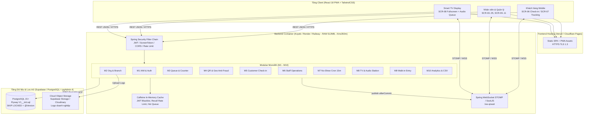
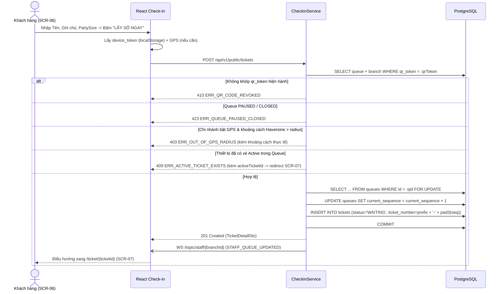
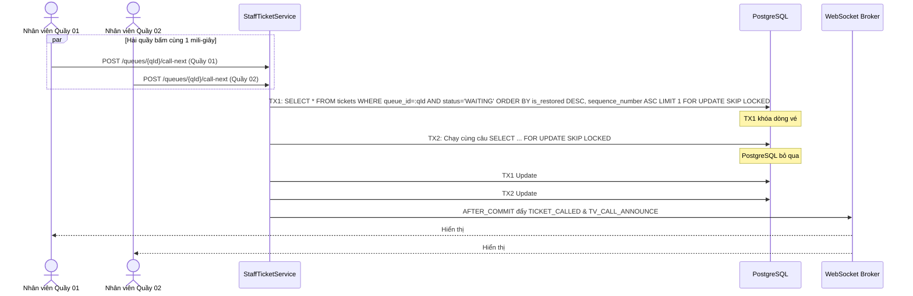
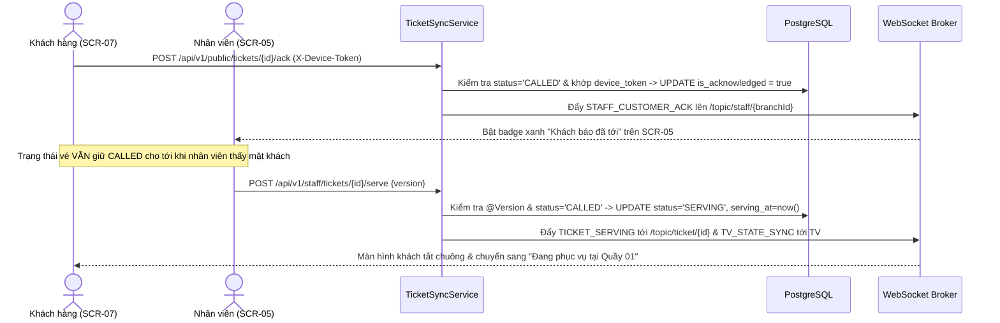

# TÀI LIỆU THIẾT KẾ CHI TIẾT HỆ THỐNG (DETAILED DESIGN DOCUMENT)
## DỰ ÁN: HỆ THỐNG QUẢN LÝ HÀNG ĐỢI ẢO THÔNG MINH (QR WAIT)

---

## THÔNG TIN TÀI LIỆU

| Hạng mục | Nội dung |
| :--- | :--- |
| **Tên dự án** | Hệ thống Quản lý Hàng đợi Ảo Thông minh (QR Wait) |
| **Phiên bản** | 1.0 |
| **Ngày lập** | 26/11/2026 |
| **Vai trò thực hiện** | Solution Architect & Tech Lead |
| **Tài liệu đầu vào** | `BRD_QR_Wait.md` (v1.3), `SRS_QR_Wait.md` (v1.2), `Design/Stitch/` (14 màn hình HTML/PNG) |
| **Trạng thái** | Chờ Product Owner / Tech Lead phê duyệt trước khi tạo Skeleton Project |

> **Phạm vi tuân thủ bắt buộc (Scope Guard):**
> - Bám sát 100% **BRD v1.3** & **SRS v1.2**: **Không** có Billing/Gói cước; **Tạm dừng** phân hệ Open API & Webhooks (`Module M11`, `FR-041`, `FR-042`).
> - Mã QR mặc định cố định theo từng Hàng chờ, hỗ trợ **Đổi mã QR mới** thủ công hoặc tự động theo Ca (`BRL-003`) kết hợp xác thực **GPS Radius** (`BRL-002`).
> - Đồng hồ **2 phút** trên Staff Panel mang tính chỉ báo trực quan, **không khóa thao tác** của nhân viên (`BRL-011`); đồng bộ 2 chiều xác nhận khách đến nơi (`ACK_ARRIVAL` vs `SERVING`); tự hủy `NO_SHOW` sau **15 phút** (`BRL-007`).
> - Chống xung đột đa tầng bằng `SELECT ... FOR UPDATE SKIP LOCKED` + `@Version` (`BRL-008`).
> - TV Display mặc định **Light Mode** đồng nhất toàn hệ thống + nút chuyển **Sáng/Tối**, tích hợp **Audio Queue** (Ding Dong + Text-to-Speech Bật/Tắt).

---

# MỤC LỤC

1. [Kiến trúc Tổng thể Hệ thống (Modular Monolith)](#1-kiến-trúc-tổng-thể-hệ-thống-modular-monolith)
2. [Tech Stack Chuẩn hóa & Chiến lược Deploy Tiết kiệm Chi phí](#2-tech-stack-chuẩn-hóa--chiến-lược-deploy-tiết-kiệm-chi-phí)
3. [Tiêu chuẩn Viết mã (Coding Convention) & Bảo mật (Security)](#3-tiêu-chuẩn-viết-mã-coding-convention--bảo-mật-security)
4. [Thiết kế Cơ sở Dữ liệu (`V1__init.sql`) & Đặc tả API](#4-thiết-kế-cơ-sở-dữ-liệu-v1__initsql--đặc-tả-api)
5. [Thiết kế Chi tiết các API & Thuật toán Xử lý Cốt lõi](#5-thiết-kế-chi-tiết-các-api--thuật-toán-xử-lý-cốt-lõi)
6. [Cấu trúc Thư mục Monorepo & Ánh xạ Giao diện Stitch](#6-cấu-trúc-thư-mục-monorepo--ánh-xạ-giao-diện-stitch)

---

# 1. Kiến trúc Tổng thể Hệ thống (Modular Monolith)

## 1.1 Lý do Lựa chọn Modular Monolith
Thay vì chia nhỏ thành nhiều Microservices gây độ trễ mạng, phức tạp khi quản lý Distributed Lock và tốn RAM cho nhiều container/broker (Kafka/Redis), **QR Wait** sử dụng kiến trúc **Modular Monolith**:
- **Phân tách ranh giới nghiệp vụ rõ ràng** thành 10 module độc lập bên trong một ứng dụng Spring Boot (`M1`–`M10`), mỗi module có Controller, Service, DTO và Repository riêng.
- **Realtime mượt mà trong cùng tiến trình (In-Process WebSocket):** `SimpMessagingTemplate` đẩy event trực tiếp xuống client ngay sau khi DB Transaction commit thành công, đảm bảo độ trễ `<= 1.5s` (`NFR-001`) mà không cần Message Broker trung gian.
- **Tối ưu chi phí triển khai:** Chạy vừa vặn trên container **512MB RAM** với cờ JVM `-Xmx350m -Xms256m` (chi phí 0đ trên tầng miễn phí hoặc `< 100.000đ/tháng`).
- **Không dùng Redis riêng:** Thay thế bằng **Caffeine In-Memory Cache** cho dữ liệu nóng (JWT Blacklist, trạng thái hàng chờ nhanh, audio TTS cache) và đẩy trạng thái bền vững xuống PostgreSQL.

## 1.2 Sơ đồ Kiến trúc Tổng thể (System Architecture)



## 1.3 Bản đồ Ánh xạ 10 Module Nghiệp vụ

| Mã Module | Package Backend | Trách nhiệm chính | SRS tham chiếu |
| :--- | :--- | :--- | :--- |
| **M1** | `com.qrwait.iam` | Đăng ký/Đăng nhập Email & Google SSO, JWT Access/Refresh Token, Khóa Brute-force, Tạo/Thu hồi tài khoản Staff | `FR-001` – `FR-004` |
| **M2** | `com.qrwait.organization` | Hồ sơ Organization, Upload Logo, Quản lý Chi nhánh (`Branch`), Cấu hình GPS & `tts_enabled` | `FR-005` – `FR-007` |
| **M3** | `com.qrwait.queue` | Cấu hình Hàng chờ (`Queue`), Prefix, Party Size, Đóng/Mở hàng chờ, Mở Phiên mới (`QueueSession`), Quản lý Quầy (`Counter`) | `FR-008` – `FR-011` |
| **M4** | `com.qrwait.qr` | Sinh mã QR, Xuất Poster PDF/PNG 300 DPI, Đổi `qr_token` thủ công/theo ca, Tính khoảng cách Haversine GPS | `FR-012` – `FR-015` |
| **M5** | `com.qrwait.ticket` *(Customer flow)* | Check-in tạo vé FIFO, `device_token` chống spam/auto-redirect, Live Tracking, Xác nhận `ACK_ARRIVAL`, Khách tự hủy | `FR-016` – `FR-023` |
| **M6** | `com.qrwait.ticket` *(Staff flow)* | Chọn Quầy, Gọi tiếp theo (`SKIP LOCKED`), Gọi lại (max 3, 15s cooldown), Bắt đầu phục vụ, Hoàn tất, Vắng mặt, Chuyển quầy/hàng chờ | `FR-024` – `FR-030` |
| **M7** | `com.qrwait.noshow` | Kích hoạt ân hạn 15 phút, Phục hồi vé `NO_SHOW`, `@Scheduled` Cron hủy tự động & giải phóng `device_token` | `FR-031` – `FR-033` |
| **M8** | `com.qrwait.display` | Sinh/Xoay vòng `ScreenToken`, API đọc trạng thái TV Display, Đẩy WebSocket `TV_CALL_ANNOUNCE` & QR mới | `FR-034` – `FR-036` |
| **M9** | `com.qrwait.ticket` *(Walk-in flow)* | Nhân viên tạo vé thủ công `is_walkin = true`, xếp chung thứ tự FIFO | `FR-037` – `FR-038` |
| **M10** | `com.qrwait.analytics` | Thống kê KPI theo chi nhánh/ngày/giờ, Năng suất nhân viên, Stream xuất CSV UTF-8 BOM | `FR-039` – `FR-040` |

> **Lưu ý Module M11:** `OpenApiController`, `ApiKey`, `WebhookSubscription` **không khởi tạo** trong đợt triển khai này theo quyết định ngày 26/11/2026.

---

# 2. Tech Stack Chuẩn hóa & Chiến lược Deploy Tiết kiệm Chi phí

## 2.1 Ma trận Công nghệ Chi tiết

| Thành phần | Công nghệ / Thư viện chuẩn | Phiên bản / Ghi chú cấu hình |
| :--- | :--- | :--- |
| **Backend Runtime** | Java 17 LTS + Spring Boot 3.3.x | Cờ JVM Production: `-XX:+UseContainerSupport -Xmx350m -Xms256m` |
| **Web & Realtime** | `spring-boot-starter-web`, `spring-boot-starter-websocket` | STOMP over WebSocket + SockJS fallback tại `/ws-qrwait` |
| **Security & Auth** | `spring-boot-starter-security`, `jjwt` (`0.12.x`), Google ID Token Verifier | Stateless JWT (Access 1h, Refresh 30d), BCrypt (`strength = 10`) |
| **Database & Migration** | PostgreSQL 15+, `spring-boot-starter-data-jpa`, **Flyway** (`flyway-core`, `flyway-database-postgresql`) | Quản trị DB bằng **pgAdmin 4**, HikariCP `maximum-pool-size: 5` (tối ưu Supabase Free) |
| **In-Memory Cache** | `spring-boot-starter-cache` + **Caffeine** | 4 vùng cache: `jwtBlacklist`, `loginAttempts`, `recallCooldown`, `queueSnapshot` |
| **QR & PDF Export** | Google **ZXing** (`core` + `javase`), **OpenPDF** (`com.github.librepdf:openpdf`) | Sinh mã QR sắc nét & xuất Poster A4/A5/Desk PDF 300 DPI |
| **API Docs** | `springdoc-openapi-starter-webmvc-ui` | Swagger UI tại `/swagger-ui.html` (chỉ bật ở profile `dev` hoặc qua auth) |
| **Frontend Core** | **React 18** + **TypeScript 5** + **Vite 5** | PWA (`vite-plugin-pwa`), Dark/Light theme via `class="dark"` |
| **UI & Charts** | **TailwindCSS 3.4**, `lucide-react`, `recharts` | Font `Inter` + `Be Vietnam Pro`, mặc định Light Mode `#FFFFFF`/`#F9FAFB` |
| **FE Realtime & HTTP** | `@stomp/stompjs`, `sockjs-client`, `axios`, `qrcode.react` | Auto-reconnect 3s (`NFR-005`), Axios interceptor tự refresh JWT |
| **Audio & Geo Browser** | HTML5 `AudioContext` (Ding Dong `.mp3`), Web Speech API (`vi-VN`), `navigator.geolocation` | Audio Queue FIFO tuần tự trên `SCR-08`, không nói chồng chéo |

## 2.2 Hạ tầng Triển khai Chi phí 0đ – < 100.000đ/tháng

| Tầng hệ thống | Dịch vụ khuyên dùng | Chi phí | Kết nối & Quản trị |
| :--- | :--- | :--- | :--- |
| **Frontend (React PWA)** | **Vercel** hoặc **Cloudflare Pages** | 0đ / tháng | Tự động build từ Git nhánh `main`, hỗ trợ HTTPS & custom domain |
| **Backend (Spring Boot Docker)** | **Koyeb** (Free Nano 512MB) hoặc **Railway** Hobby | 0đ – ~100k/tháng | Deploy qua `Dockerfile`, truyền biến môi trường `SPRING_DATASOURCE_URL` |
| **Database (PostgreSQL)** | **Supabase** Free Tier (500MB DB) hoặc **Neon.tech** | 0đ / tháng | Kết nối từ **pgAdmin 4** bằng Host/Port (`6543` pooler hoặc `5432` direct) + SSL `require` |
| **Logo Storage** | **Supabase Storage** (bucket public `logos`) / **Cloudinary** | 0đ / tháng | Không lưu ảnh lên disk local của Backend container để tránh mất file khi re-deploy |

---

# 3. Tiêu chuẩn Viết mã (Coding Convention) & Bảo mật (Security)

## 3.1 Quy ước Phân tầng Backend (Clean Modular Architecture)

```text
Controller (REST / STOMP)  -->  Service (@Transactional)  -->  Repository (Spring Data JPA)  -->  Entity (PostgreSQL)
         |                              |
   Input @Valid DTO              Business Rules (BRL-001..011)
   Output ApiResponse<T>         Domain Exceptions -> GlobalExceptionHandler
                                 ApplicationEventPublisher -> WebSocketAfterCommitListener
```

1. **Nguyên tắc `After-Commit WebSocket`:** Tuyệt đối **không** gọi `messagingTemplate.convertAndSend(...)` khi transaction chưa commit xong. Dùng `TransactionSynchronizationManager` hoặc `@TransactionalEventListener(phase = TransactionPhase.AFTER_COMMIT)` để đảm bảo khi Client nhận tin nhắn và gọi lại REST API, dữ liệu mới đã hiện hữu trong PostgreSQL.
2. **Định dạng Response Thống nhất:**
   - Thành công:
     ```json
     {
       "success": true,
       "data": { ... },
       "timestamp": "2026-11-26T07:32:00Z"
     }
     ```
   - Lỗi chuẩn hóa qua `@RestControllerAdvice GlobalExceptionHandler` (khớp 100% Mục 13.2 SRS):
     ```json
     {
       "success": false,
       "errorCode": "ERR_OUT_OF_GPS_RADIUS",
       "message": "Bạn đang ở cách cửa hàng 240m, ngoài phạm vi lấy số (100m). Vui lòng đến gần hơn.",
       "details": { "distanceMeters": 240, "allowedRadiusMeters": 100 },
       "timestamp": "2026-11-26T07:32:00Z"
     }
     ```
3. **Danh mục `ErrorCode` Enum Đầy đủ:**

| HTTP Status | `errorCode` | Nguồn SRS / Mục đích |
| :---: | :--- | :--- |
| `400` | `ERR_NAME_REQUIRED` | Tên khách trống hoặc `< 2` / `> 30` ký tự (`SRS 13.2`) |
| `400` | `ERR_PARTY_SIZE_INVALID` | `partySize` ngoài `[minPartySize, maxPartySize]` (`SRS 13.2`) |
| `400` | `ERR_RECALL_LIMIT_EXCEEDED` | Đã gọi lại đủ 3 lần (`SRS 13.2`, `BRL-006`) |
| `400` | `ERR_INVALID_INPUT` | Lỗi Bean Validation tổng quát (email, password, prefix, tọa độ) |
| `400` | `ERR_COUNTER_REQUIRED` | Nhân viên gọi số nhưng chưa chọn Quầy trực (`FR-024`) |
| `400` | `ERR_NO_WAITING_TICKETS` | Hàng chờ không còn vé `WAITING` (`FR-025`) |
| `401` | `ERR_INVALID_CREDENTIALS` | Sai email/mật khẩu hoặc JWT hết hạn/trong Blacklist (`FR-002`) |
| `401` | `ERR_SCREEN_TOKEN_INVALID` | `ScreenToken` TV Display không tồn tại hoặc đã bị thu hồi (`FR-034`) |
| `403` | `ERR_OUT_OF_GPS_RADIUS` | Khoảng cách Haversine `> gps_radius_meters` (`SRS 13.2`, `BRL-002`) |
| `403` | `ERR_GPS_PERMISSION_DENIED` | Chi nhánh bật GPS nhưng client không gửi tọa độ (`SRS 13.2`) |
| `403` | `ERR_ACCOUNT_DISABLED` | Tài khoản bị khóa `is_active = false` (`FR-004`) |
| `403` | `ERR_FORBIDDEN` | Vượt quyền vai trò hoặc chi nhánh không được phân công (`FR-003`) |
| `404` | `ERR_RESOURCE_NOT_FOUND` | Không tìm thấy Org/Branch/Queue/Ticket/Counter |
| `409` | `ERR_ACTIVE_TICKET_EXISTS` | Thiết bị đã có vé Active trong cùng hàng chờ; kèm `activeTicketId` (`SRS 13.2`, `BRL-009`) |
| `409` | `ERR_CONCURRENT_CONFLICT` | Xung đột Optimistic Lock `@Version` hoặc double-click (`SRS 13.2`, `BRL-008`) |
| `409` | `ERR_TICKET_ALREADY_CALLED` | Vé đã được quầy khác giữ/gọi (`SRS 13.2`, `BRL-008`) |
| `409` | `ERR_DUPLICATE_RESOURCE` | Trùng Email (`FR-001`) hoặc trùng `prefix` trong cùng Branch (`FR-008`) |
| `409` | `ERR_INVALID_STATE_TRANSITION` | Chuyển trạng thái bị cấm theo Mục 11.2 SRS |
| `410` | `ERR_QR_CODE_REVOKED` | `qr_token` đã bị đổi hoặc thu hồi (`SRS 13.2`, `BRL-003`) |
| `410` | `ERR_NOSHOW_RESTORE_EXPIRED` | Vé `NO_SHOW` đã quá 15 phút (`SRS 13.2`, `BRL-007`) |
| `423` | `ERR_QUEUE_PAUSED_CLOSED` | Hàng chờ đang `PAUSED` hoặc `CLOSED` (`SRS 13.2`, `FR-009`) |
| `429` | `ERR_RECALL_RATE_LIMITED` | Gọi lại chưa đủ 15 giây cooldown (`SRS 13.2`, `BRL-006`) |
| `429` | `ERR_TOO_MANY_LOGIN_ATTEMPTS` | Nhập sai mật khẩu 5 lần liên tiếp, khóa 5 phút (`FR-002`) |

## 3.2 Quy ước Frontend React & UI System
- **Feature-based Architecture:** Mỗi phân hệ nằm trong `src/features/<feature>/` (components, hooks, api, types), không nhồi logic WebSocket trực tiếp trong component UI.
- **Theme Sáng/Tối Đồng nhất:** Sử dụng `ThemeContext` + Tailwind `darkMode: 'class'`. **Mặc định là `light`** (`#FFFFFF` / `#F9FAFB`, border `1px solid #E5E7EB`) trên toàn bộ ứng dụng kể cả `SCR-08` TV Display; nút Sun/Moon Toggle lưu trạng thái vào `localStorage('qrwait_theme')`.
- **Hiển thị Số vé Bắt buộc:** Mọi component render mã vé (`#A-025`) phải gắn class `whitespace-nowrap tabular-nums` để không bao giờ rớt dòng giữa tiền tố và số.
- **Axios Interceptor:** Tự động đính kèm `Authorization: Bearer <accessToken>`; khi gặp `401`, thực hiện single-flight `POST /api/v1/auth/refresh` để gia hạn token mà không đá người dùng ra màn hình đăng nhập.
- **Route Guard:** `ProtectedRoute` kiểm tra `user.role` (`OWNER`, `MANAGER`, `STAFF`, `SUPER_ADMIN`) và điều hướng mặc định sau login (`OWNER`/`MANAGER` -> `/dashboard`, `STAFF` -> `/staff/panel`).

## 3.3 Ma trận Kiểm soát Bảo mật & Chống Xung đột
1. **Zero-PII (`NFR-006`):** Database và API tuyệt đối không có cột hay trường JSON nhận số điện thoại, CMND/CCCD hay email của khách lấy số. Chỉ lưu `display_name` (được sanitize HTML tags để chống XSS) và `device_token` (UUID v4 lưu `localStorage`).
2. **Chống Brute-Force & JWT Blacklist:** Dùng Caffeine Cache `loginAttempts` đếm số lần đăng nhập sai theo email (`expireAfterWrite = 5 phút`, khóa tại lần thứ 5). Khi khóa tài khoản nhân viên (`FR-004`), đẩy `userId` và `issuedAt` vào `jwtBlacklist` + xóa toàn bộ `refresh_tokens` trong DB + bắn lệnh force-disconnect lên `/topic/staff/{branchId}`.
3. **Khóa Đa tầng DB (`BRL-008`):**
   - Lớp 1 (Pessimistic `SKIP LOCKED`): Khi nhiều quầy bấm "Gọi tiếp theo" cùng mili-giây, SQL chọn 1 vé `WAITING` chưa bị transaction khác khóa.
   - Lớp 2 (Optimistic `@Version`): Mọi thao tác chuyển trạng thái trên một `ticket_id` cụ thể (`CALLED -> SERVING`, `WAITING -> CANCELLED`, `NO_SHOW -> WAITING`) đều kiểm tra cột `version`; nếu `ObjectOptimisticLockingFailureException` xảy ra sẽ map về `409 ERR_CONCURRENT_CONFLICT`.
4. **Phân tách Kênh Truy cập Không Đăng nhập:**
   - Khách check-in dùng `qr_token` (validate khớp `queues.qr_token`) và `device_token` (chỉ đọc/hủy vé trùng `device_token` khi chưa hoàn tất).
   - TV Display dùng `screen_token` 64 ký tự ngẫu nhiên (`screen_tokens.is_active = true`), **chỉ có quyền GET** và subscribe topic WebSocket `/topic/branch/{branchId}/tv`, không thể phát lệnh đột biến trạng thái.

---

# 4. Thiết kế Cơ sở Dữ liệu (`V1__init.sql`) & Đặc tả API

## 4.1 Sơ đồ Quan hệ Dữ liệu Triển khai (Physical ERD)
Dựa trên **9 thực thể lõi** trong SRS Mục 9.1–9.2, bổ sung **2 bảng liên kết N-N** (`user_branches` cho `FR-003` và `counter_queues` cho `FR-011`) cùng **1 bảng bảo mật** (`refresh_tokens` cho `FR-004`) để chuẩn hóa 3NF hoàn chỉnh trên PostgreSQL:
- Bảng `tickets` bổ sung 2 cột phục vụ trực tiếp yêu cầu SRS đã đặc tả ở `FR-032` và `BRL-006`: `is_restored BOOLEAN NOT NULL DEFAULT FALSE` và `last_recalled_at TIMESTAMPTZ`.

## 4.2 Script DDL PostgreSQL Hoàn chỉnh (`V1__init.sql`)

```sql
-- ============================================================================
-- QR-WAIT Database Migration V1__init.sql (PostgreSQL 15+ / Flyway)
-- Tương thích 100% với PostgreSQL Local & Supabase Cloud (Quản trị qua pgAdmin 4)
-- ============================================================================

-- 1. Organizations (Tenant doanh nghiệp)
CREATE TABLE organizations (
    id          UUID PRIMARY KEY,
    name        VARCHAR(100) NOT NULL,
    logo_url    VARCHAR(500),
    timezone    VARCHAR(50)  NOT NULL DEFAULT 'Asia/Ho_Chi_Minh',
    is_active   BOOLEAN      NOT NULL DEFAULT TRUE,
    created_at  TIMESTAMPTZ  NOT NULL DEFAULT NOW()
);

-- 2. Branches (Chi nhánh vật lý & Cấu hình GPS/TTS)
CREATE TABLE branches (
    id                 UUID PRIMARY KEY,
    organization_id    UUID             NOT NULL REFERENCES organizations(id) ON DELETE CASCADE,
    name               VARCHAR(100)     NOT NULL,
    address            VARCHAR(255)     NOT NULL,
    latitude           DOUBLE PRECISION NOT NULL CHECK (latitude BETWEEN -90.0 AND 90.0),
    longitude          DOUBLE PRECISION NOT NULL CHECK (longitude BETWEEN -180.0 AND 180.0),
    is_geo_enabled     BOOLEAN          NOT NULL DEFAULT FALSE,
    gps_radius_meters  INTEGER          NOT NULL DEFAULT 100 CHECK (gps_radius_meters BETWEEN 30 AND 500),
    tts_enabled        BOOLEAN          NOT NULL DEFAULT TRUE,
    is_active          BOOLEAN          NOT NULL DEFAULT TRUE,
    created_at         TIMESTAMPTZ      NOT NULL DEFAULT NOW()
);
CREATE INDEX idx_branches_org ON branches(organization_id);

-- 3. Queues (Hàng chờ dịch vụ & QR Token cố định/đổi theo ca)
CREATE TABLE queues (
    id                    UUID PRIMARY KEY,
    branch_id             UUID         NOT NULL REFERENCES branches(id) ON DELETE CASCADE,
    name                  VARCHAR(100) NOT NULL,
    prefix                VARCHAR(5)   NOT NULL,
    avg_service_minutes   INTEGER      NOT NULL DEFAULT 10 CHECK (avg_service_minutes >= 1),
    min_party_size        INTEGER      NOT NULL DEFAULT 1 CHECK (min_party_size >= 1),
    max_party_size        INTEGER      NOT NULL DEFAULT 20,
    status                VARCHAR(20)  NOT NULL DEFAULT 'OPEN' CHECK (status IN ('OPEN', 'PAUSED', 'CLOSED')),
    qr_token              VARCHAR(64)  NOT NULL UNIQUE,
    rotate_qr_on_session  BOOLEAN      NOT NULL DEFAULT FALSE,
    current_sequence      INTEGER      NOT NULL DEFAULT 0 CHECK (current_sequence >= 0),
    created_at            TIMESTAMPTZ  NOT NULL DEFAULT NOW(),
    CONSTRAINT chk_party_size CHECK (max_party_size >= min_party_size),
    CONSTRAINT uq_queue_branch_prefix UNIQUE (branch_id, prefix)
);
CREATE INDEX idx_queues_branch ON queues(branch_id);

-- 4. Queue Sessions (Phiên làm việc để Reset số về 001 & lưu lịch sử ca)
CREATE TABLE queue_sessions (
    id              UUID PRIMARY KEY,
    queue_id        UUID        NOT NULL REFERENCES queues(id) ON DELETE CASCADE,
    session_number  INTEGER     NOT NULL CHECK (session_number >= 1),
    started_at      TIMESTAMPTZ NOT NULL DEFAULT NOW(),
    ended_at        TIMESTAMPTZ,
    status          VARCHAR(20) NOT NULL DEFAULT 'ACTIVE' CHECK (status IN ('ACTIVE', 'CLOSED')),
    CONSTRAINT uq_queue_session_num UNIQUE (queue_id, session_number)
);
CREATE INDEX idx_queue_sessions_active ON queue_sessions(queue_id, status);

-- 5. Counters (Quầy phục vụ vật lý)
CREATE TABLE counters (
    id          UUID PRIMARY KEY,
    branch_id   UUID        NOT NULL REFERENCES branches(id) ON DELETE CASCADE,
    name        VARCHAR(50) NOT NULL,
    is_active   BOOLEAN     NOT NULL DEFAULT TRUE,
    created_at  TIMESTAMPTZ NOT NULL DEFAULT NOW()
);
CREATE INDEX idx_counters_branch ON counters(branch_id);

-- Bảng liên kết Quầy <-> Hàng chờ (FR-011)
CREATE TABLE counter_queues (
    counter_id  UUID NOT NULL REFERENCES counters(id) ON DELETE CASCADE,
    queue_id    UUID NOT NULL REFERENCES queues(id) ON DELETE CASCADE,
    PRIMARY KEY (counter_id, queue_id)
);

-- 6. Users (Tài khoản Owner, Manager, Staff, Super Admin)
CREATE TABLE users (
    id               UUID PRIMARY KEY,
    organization_id  UUID REFERENCES organizations(id) ON DELETE CASCADE,
    display_name     VARCHAR(100) NOT NULL,
    email            VARCHAR(100) NOT NULL UNIQUE,
    password_hash    VARCHAR(255) NOT NULL,
    role             VARCHAR(30)  NOT NULL CHECK (role IN ('SUPER_ADMIN', 'OWNER', 'MANAGER', 'STAFF')),
    is_active        BOOLEAN      NOT NULL DEFAULT TRUE,
    created_at       TIMESTAMPTZ  NOT NULL DEFAULT NOW()
);
CREATE INDEX idx_users_org ON users(organization_id);

-- Bảng phân công Chi nhánh cho Manager / Staff (FR-003)
CREATE TABLE user_branches (
    user_id    UUID NOT NULL REFERENCES users(id) ON DELETE CASCADE,
    branch_id  UUID NOT NULL REFERENCES branches(id) ON DELETE CASCADE,
    PRIMARY KEY (user_id, branch_id)
);

-- Bảng quản lý Refresh Token để thu hồi phiên tức thì khi khóa nhân viên (FR-004)
CREATE TABLE refresh_tokens (
    id          UUID PRIMARY KEY,
    user_id     UUID         NOT NULL REFERENCES users(id) ON DELETE CASCADE,
    token_hash  VARCHAR(128) NOT NULL UNIQUE,
    expires_at  TIMESTAMPTZ  NOT NULL,
    created_at  TIMESTAMPTZ  NOT NULL DEFAULT NOW()
);
CREATE INDEX idx_refresh_tokens_user ON refresh_tokens(user_id);

-- 7. Tickets (Vé chờ lượt - Zero PII)
CREATE TABLE tickets (
    id                   UUID PRIMARY KEY,
    queue_id             UUID        NOT NULL REFERENCES queues(id) ON DELETE CASCADE,
    session_id           UUID        NOT NULL REFERENCES queue_sessions(id) ON DELETE CASCADE,
    counter_id           UUID        REFERENCES counters(id) ON DELETE SET NULL,
    staff_id             UUID        REFERENCES users(id) ON DELETE SET NULL,
    ticket_number        VARCHAR(20) NOT NULL,
    sequence_number      INTEGER     NOT NULL CHECK (sequence_number >= 1),
    display_name         VARCHAR(50) NOT NULL,
    notes                VARCHAR(255),
    party_size           INTEGER     NOT NULL CHECK (party_size >= 1),
    is_walkin            BOOLEAN     NOT NULL DEFAULT FALSE,
    status               VARCHAR(20) NOT NULL DEFAULT 'WAITING'
                         CHECK (status IN ('WAITING', 'CALLED', 'SERVING', 'COMPLETED', 'NO_SHOW', 'CANCELLED', 'EXPIRED')),
    device_token         VARCHAR(64),
    recall_count         INTEGER     NOT NULL DEFAULT 0 CHECK (recall_count BETWEEN 0 AND 3),
    last_recalled_at     TIMESTAMPTZ,
    is_acknowledged      BOOLEAN     NOT NULL DEFAULT FALSE,
    is_restored          BOOLEAN     NOT NULL DEFAULT FALSE,
    version              BIGINT      NOT NULL DEFAULT 0,
    created_at           TIMESTAMPTZ NOT NULL DEFAULT NOW(),
    called_at            TIMESTAMPTZ,
    serving_at           TIMESTAMPTZ,
    completed_at         TIMESTAMPTZ,
    noshow_at            TIMESTAMPTZ,
    cancel_scheduled_at  TIMESTAMPTZ,
    cancelled_at         TIMESTAMPTZ,
    cancellation_reason  VARCHAR(50)
);

-- Index tối ưu FIFO Call Next (ưu tiên vé phục hồi is_restored DESC, sau đó sequence_number ASC)
CREATE INDEX idx_tickets_fifo_waiting
    ON tickets(queue_id, session_id, is_restored DESC, sequence_number ASC, created_at ASC)
    WHERE status = 'WAITING';

-- Index Partial Unique đảm bảo 1 thiết bị chỉ có tối đa 1 vé Active trên 1 hàng chờ (BRL-009)
CREATE UNIQUE INDEX uq_tickets_active_device_per_queue
    ON tickets(queue_id, device_token)
    WHERE device_token IS NOT NULL AND status IN ('WAITING', 'CALLED', 'SERVING', 'NO_SHOW');

-- Index tối ưu Scheduled Cron quét No-Show hết hạn 15 phút (FR-033)
CREATE INDEX idx_tickets_noshow_timeout
    ON tickets(cancel_scheduled_at)
    WHERE status = 'NO_SHOW';

-- Index tối ưu Analytics & Xuất CSV theo khoảng thời gian (M10)
CREATE INDEX idx_tickets_analytics
    ON tickets(queue_id, created_at DESC, status);

-- 8. Ticket Audit Logs (Lịch sử chuyển trạng thái phục vụ truy vết & báo cáo)
CREATE TABLE ticket_audit_logs (
    id             UUID PRIMARY KEY,
    ticket_id      UUID        NOT NULL REFERENCES tickets(id) ON DELETE CASCADE,
    staff_id       UUID        REFERENCES users(id) ON DELETE SET NULL,
    from_status    VARCHAR(20) NOT NULL,
    to_status      VARCHAR(20) NOT NULL,
    transition_at  TIMESTAMPTZ NOT NULL DEFAULT NOW(),
    note           VARCHAR(255)
);
CREATE INDEX idx_audit_logs_ticket ON ticket_audit_logs(ticket_id, transition_at DESC);

-- 9. Screen Tokens (Secret URL cho TV Display Read-only)
CREATE TABLE screen_tokens (
    id          UUID PRIMARY KEY,
    branch_id   UUID        NOT NULL REFERENCES branches(id) ON DELETE CASCADE,
    token       VARCHAR(64) NOT NULL UNIQUE,
    is_active   BOOLEAN     NOT NULL DEFAULT TRUE,
    created_at  TIMESTAMPTZ NOT NULL DEFAULT NOW()
);
CREATE INDEX idx_screen_tokens_branch ON screen_tokens(branch_id, is_active);
```

## 4.3 Đặc tả REST API Nội bộ (OpenAPI 3 Standard)

### A. Nhóm M1 — Authentication & IAM (`/api/v1/auth`, `/api/v1/users`)

| Method | Endpoint | Quyền | Request / Query | Response chính | SRS |
| :--- | :--- | :--- | :--- | :--- | :--- |
| `POST` | `/api/v1/auth/register` | Public | `{email, password, displayName, organizationName}` | `201` `{accessToken, refreshToken, user}` | `FR-001` |
| `POST` | `/api/v1/auth/login` | Public | `{email, password}` | `200` `{accessToken, refreshToken, user}` | `FR-002` |
| `POST` | `/api/v1/auth/google` | Public | `{idToken, organizationName?}` | `200` `{accessToken, refreshToken, user}` | `FR-001/002` |
| `POST` | `/api/v1/auth/refresh` | Public | `{refreshToken}` | `200` `{accessToken, refreshToken}` | `FR-002` |
| `POST` | `/api/v1/auth/logout` | Authenticated | `{refreshToken}` | `204 No Content` | `FR-002` |
| `GET` | `/api/v1/users` | `OWNER`, `MANAGER` | `?branchId=` | `200` `List<UserSummaryDto>` | `FR-003` |
| `POST` | `/api/v1/users` | `OWNER`, `MANAGER` | `{displayName, email, password, role, branchIds}` | `201` `UserSummaryDto` | `FR-003` |
| `PATCH` | `/api/v1/users/{id}/status` | `OWNER`, `MANAGER` | `{isActive}` | `200` `UserSummaryDto` *(+ blacklists JWT)* | `FR-004` |

### B. Nhóm M2 — Organization & Branch (`/api/v1/organization`, `/api/v1/branches`)

| Method | Endpoint | Quyền | Request / Query | Response chính | SRS |
| :--- | :--- | :--- | :--- | :--- | :--- |
| `GET` | `/api/v1/organization` | `OWNER`, `MANAGER` | – | `200` `OrganizationDto` | `FR-005` |
| `PUT` | `/api/v1/organization` | `OWNER` | `{name, timezone}` | `200` `OrganizationDto` | `FR-005` |
| `POST` | `/api/v1/organization/logo` | `OWNER` | `multipart/form-data` (`file <= 2MB`) | `200` `{logoUrl}` | `FR-005` |
| `GET` | `/api/v1/branches` | `OWNER`, `MANAGER`, `STAFF` | – | `200` `List<BranchDto>` | `FR-006` |
| `POST` | `/api/v1/branches` | `OWNER` | `{name, address, latitude, longitude}` | `201` `BranchDto` | `FR-006` |
| `PUT` | `/api/v1/branches/{id}` | `OWNER`, `MANAGER` | `{name, address, latitude, longitude}` | `200` `BranchDto` | `FR-006` |
| `PATCH` | `/api/v1/branches/{id}/geo` | `OWNER`, `MANAGER` | `{isGeoEnabled, gpsRadiusMeters}` | `200` `BranchDto` | `FR-007` |
| `PATCH` | `/api/v1/branches/{id}/tts` | `OWNER`, `MANAGER`, `STAFF` | `{ttsEnabled}` | `200` `{ttsEnabled}` *(+ WS tới TV)* | `FR-036` |

### C. Nhóm M3 & M4 — Queues, Sessions, Counters & QR (`/api/v1/queues`, `/api/v1/counters`)

| Method | Endpoint | Quyền | Request / Query | Response chính | SRS |
| :--- | :--- | :--- | :--- | :--- | :--- |
| `GET` | `/api/v1/branches/{branchId}/queues` | `OWNER`, `MANAGER`, `STAFF` | – | `200` `List<QueueDto>` | `FR-008` |
| `POST` | `/api/v1/branches/{branchId}/queues` | `OWNER`, `MANAGER` | `{name, prefix, avgServiceMinutes, minPartySize, maxPartySize, rotateQrOnSession}` | `201` `QueueDto` | `FR-008` |
| `PUT` | `/api/v1/queues/{queueId}` | `OWNER`, `MANAGER` | `{name, avgServiceMinutes, minPartySize, maxPartySize, rotateQrOnSession}` | `200` `QueueDto` | `FR-008` |
| `PATCH` | `/api/v1/queues/{queueId}/status` | `OWNER`, `MANAGER`, `STAFF` | `{status}` (`OPEN`/`PAUSED`/`CLOSED`) | `200` `QueueDto` | `FR-009` |
| `POST` | `/api/v1/queues/{queueId}/sessions/reset` | `OWNER`, `MANAGER`, `STAFF` | `{confirmExpirePending: true}` | `201` `QueueSessionDto` *(đưa vé tồn sang `EXPIRED`)* | `FR-010` |
| `POST` | `/api/v1/queues/{queueId}/qr/rotate` | `OWNER`, `MANAGER`, `STAFF` | – | `200` `{qrToken, qrUrl}` *(+ WS tới TV)* | `FR-013` |
| `GET` | `/api/v1/queues/{queueId}/qr/poster` | `OWNER`, `MANAGER` | `?format=pdf|png&paper=A4|A5|DESK&accentColor=` | `200` Binary Stream (`application/pdf` / `image/png`) | `FR-012` |
| `GET` | `/api/v1/branches/{branchId}/counters` | `OWNER`, `MANAGER`, `STAFF` | – | `200` `List<CounterDto>` | `FR-011` |
| `POST` | `/api/v1/branches/{branchId}/counters` | `OWNER`, `MANAGER` | `{name, queueIds}` | `201` `CounterDto` | `FR-011` |
| `PUT` | `/api/v1/counters/{counterId}` | `OWNER`, `MANAGER` | `{name, isActive, queueIds}` | `200` `CounterDto` | `FR-011` |

### D. Nhóm M5 — Public Customer Check-in & Live Tracking (`/api/v1/public/...`)

| Method | Endpoint | Quyền | Request / Query | Response chính | SRS |
| :--- | :--- | :--- | :--- | :--- | :--- |
| `GET` | `/api/v1/public/checkin/{qrToken}` | Public | Header `X-Device-Token` *(optional)* | `200` `CheckinContextDto` (hoặc `activeTicketId` nếu đang có vé Active) | `FR-015/016/018` |
| `POST` | `/api/v1/public/tickets` | Public | `{qrToken, displayName, notes?, partySize, deviceToken, latitude?, longitude?}` | `201` `TicketDetailDto` (hoặc `409 ERR_ACTIVE_TICKET_EXISTS` kèm `activeTicketId`) | `FR-017/019` |
| `GET` | `/api/v1/public/tickets/{ticketId}` | Public | Header `X-Device-Token` *(hoặc signed view key)* | `200` `TicketDetailDto` (`aheadCount`, `estimatedWaitMinutes`, `cancelScheduledAt`) | `FR-020` |
| `POST` | `/api/v1/public/tickets/{ticketId}/ack` | Public | Header `X-Device-Token` | `200` `TicketDetailDto` (`isAcknowledged = true`) | `FR-022` |
| `POST` | `/api/v1/public/tickets/{ticketId}/cancel` | Public | Header `X-Device-Token` `{reason?}` | `200` `TicketDetailDto` (`status = CANCELLED`) | `FR-023` |

### E. Nhóm M6, M7, M9 — Staff Calling Panel (`/api/v1/staff/...`)

| Method | Endpoint | Quyền | Request / Query | Response chính | SRS |
| :--- | :--- | :--- | :--- | :--- | :--- |
| `GET` | `/api/v1/staff/queues/{queueId}/state` | `STAFF`, `MANAGER`, `OWNER` | `?counterId=` | `200` `StaffQueueStateDto` (`currentTicket`, `waitingList`, `noshowList`) | `FR-024/025` |
| `POST` | `/api/v1/staff/queues/{queueId}/call-next` | `STAFF`, `MANAGER`, `OWNER` | `{counterId}` | `200` `TicketStaffDto` *(bắt đầu 2-min visual timer)* | `FR-025` |
| `POST` | `/api/v1/staff/tickets/{ticketId}/recall` | `STAFF`, `MANAGER`, `OWNER` | `{version}` | `200` `TicketStaffDto` | `FR-026` |
| `POST` | `/api/v1/staff/tickets/{ticketId}/serve` | `STAFF`, `MANAGER`, `OWNER` | `{version}` | `200` `TicketStaffDto` (`SERVING`) | `FR-027` |
| `POST` | `/api/v1/staff/tickets/{ticketId}/complete` | `STAFF`, `MANAGER`, `OWNER` | `{version}` | `200` `TicketStaffDto` (`COMPLETED`) | `FR-028` |
| `POST` | `/api/v1/staff/tickets/{ticketId}/noshow` | `STAFF`, `MANAGER`, `OWNER` | `{version}` | `200` `TicketStaffDto` (`NO_SHOW`, `+15m`) | `FR-029` |
| `POST` | `/api/v1/staff/tickets/{ticketId}/restore` | `STAFF`, `MANAGER`, `OWNER` | `{version}` | `200` `TicketStaffDto` (`WAITING`, `isRestored = true`) | `FR-032` |
| `POST` | `/api/v1/staff/tickets/{ticketId}/transfer` | `STAFF`, `MANAGER`, `OWNER` | `{targetCounterId?, targetQueueId?, reason?, version}` | `200` `TicketStaffDto` | `FR-030` |
| `POST` | `/api/v1/staff/queues/{queueId}/walkin` | `STAFF`, `MANAGER`, `OWNER` | `{displayName, partySize, notes?}` | `201` `TicketStaffDto` (`isWalkin = true`) | `FR-037/038` |

### F. Nhóm M8 & M10 — TV Display & Analytics (`/api/v1/display`, `/api/v1/analytics`)

| Method | Endpoint | Quyền | Request / Query | Response chính | SRS |
| :--- | :--- | :--- | :--- | :--- | :--- |
| `POST` | `/api/v1/branches/{branchId}/screen-tokens` | `OWNER`, `MANAGER` | – | `201` `{token, displayUrl}` *(thu hồi token cũ nếu làm mới)* | `FR-034` |
| `GET` | `/api/v1/public/display/{screenToken}` | Public *(Token)* | – | `200` `TvDisplayBootstrapDto` (`servingCards`, `recentCalled`, `queuesQr`, `ttsEnabled`) | `FR-035` |
| `GET` | `/api/v1/analytics/overview` | `OWNER`, `MANAGER` | `?branchId=&queueId=&from=&to=` | `200` `AnalyticsOverviewDto` (KPIs, hourly bar, status donut, staff ranking) | `FR-039` |
| `GET` | `/api/v1/analytics/export` | `OWNER`, `MANAGER` | `?branchId=&queueId=&from=&to=` *(max 90 ngày)* | `200` `text/csv; charset=UTF-8` *(UTF-8 BOM streaming)* | `FR-040` |

## 4.4 Đặc tả Kênh WebSocket STOMP (`/ws-qrwait`)

| Topic STOMP | Đối tượng Subscribe | Event Type (`type`) | Payload JSON rút gọn |
| :--- | :--- | :--- | :--- |
| `/topic/ticket/{ticketId}` | Khách hàng (`SCR-07`) | `TICKET_CALLED`, `TICKET_RECALLED`, `TICKET_SERVING`, `TICKET_COMPLETED`, `TICKET_NOSHOW`, `TICKET_RESTORED`, `TICKET_CANCELLED`, `TICKET_EXPIRED`, `TICKET_TRANSFERRED` | `{eventId, type, ticketId, status, counterName, recallCount, isAcknowledged, cancelScheduledAt, serverNow, version}` |
| `/topic/queue/{queueId}` | Khách chờ (`SCR-07`) & Check-in (`SCR-06`) | `QUEUE_PROGRESS_UPDATED`, `QUEUE_STATUS_CHANGED`, `QUEUE_SESSION_RESET` | `{type, queueId, queueStatus, waitingCount, activeCountersCount, currentServingSeq}` |
| `/topic/branch/{branchId}/tv` | TV Display (`SCR-08`) | `TV_CALL_ANNOUNCE`, `TV_STATE_SYNC`, `TV_QR_ROTATED`, `TV_TTS_TOGGLED` | `{type, ticketNumber, displayName, counterName, ttsEnabled, qrToken, qrQueueId, servingCards[], recentCalled[]}` |
| `/topic/staff/{branchId}` | Staff Panel (`SCR-05`) & Dashboard (`SCR-03`) | `STAFF_QUEUE_UPDATED`, `STAFF_CUSTOMER_ACK`, `STAFF_USER_REVOKED` | `{type, queueId, ticketId, revokedUserId?, isAcknowledged?, waitingCount}` |

---

# 5. Thiết kế Chi tiết các API & Thuật toán Xử lý Cốt lõi

## 5.1 Luồng 1: Khách hàng Check-in Lấy số FIFO (`POST /api/v1/public/tickets`)

### Sequence Diagram


### Method Signature & Thuật toán
```java
@Transactional
public TicketDetailDto createPublicTicket(CreateTicketRequest req)
```
1. **Validate đầu vào & Sanitize:** Trim `displayName` (`2..30` ký tự, strip HTML tags chống XSS). Nếu rỗng -> ném `ERR_NAME_REQUIRED`.
2. **Xác thực `qrToken` (`BRL-003`):** Tìm `Queue` theo `qrToken`. Nếu không tồn tại -> ném `ERR_QR_CODE_REVOKED`. Kiểm tra `queue.status == OPEN`, nếu không -> ném `ERR_QUEUE_PAUSED_CLOSED`.
3. **Kiểm tra Quy mô nhóm (`BRL-005`):** Kiểm tra `minPartySize <= req.partySize <= maxPartySize`, vi phạm -> ném `ERR_PARTY_SIZE_INVALID`.
4. **Kiểm tra GPS Radius (`BRL-002`):** Nếu `branch.isGeoEnabled == true`:
   - Thiếu `latitude`/`longitude` -> ném `ERR_GPS_PERMISSION_DENIED`.
   - Tính khoảng cách bằng công thức **Haversine** (bán kính Trái Đất $R = 6.371.000\text{ m}$):
     $$d = 2R \cdot \arcsin\left(\sqrt{\sin^2\left(\frac{\Delta\phi}{2}\right) + \cos(\phi_1)\cos(\phi_2)\sin^2\left(\frac{\Delta\lambda}{2}\right)}\right)$$
   - Nếu `Math.round(d) > branch.gpsRadiusMeters` -> ném `ERR_OUT_OF_GPS_RADIUS` kèm `{distanceMeters, allowedRadiusMeters}`.
5. **Chống Spam thiết bị (`BRL-009`):** Nếu `deviceToken` đã có bản ghi `Ticket` thuộc `queue_id` có `status IN ('WAITING','CALLED','SERVING','NO_SHOW')`, trả về `409 ERR_ACTIVE_TICKET_EXISTS` chứa `activeTicketId` để Frontend chuyển hướng ngay.
6. **Khóa hàng chờ & Cấp số FIFO (`BRL-001`):** Khóa dòng `Queue` (`LockModeType.PESSIMISTIC_WRITE`), tăng `current_sequence += 1`, format `String.format("%s-%03d", queue.prefix, nextSeq)`. Lấy `QueueSession` đang `ACTIVE` (nếu chưa có thì tự tạo Session #1).
7. **Lưu DB & Phát sự kiện sau Commit:** Lưu `Ticket` (`WAITING`), ghi `TicketAuditLog` (`NONE -> WAITING`), đăng ký `AfterCommitEvent` đẩy `STAFF_QUEUE_UPDATED` và `QUEUE_PROGRESS_UPDATED`. *(Catch `DataIntegrityViolationException` trên `uq_tickets_active_device_per_queue` nếu 2 tab gửi đồng thời để trả về `409 ERR_ACTIVE_TICKET_EXISTS`).*

---

## 5.2 Luồng 2: Nhân viên Gọi Tiếp theo (`SKIP LOCKED` + `@Version` + Đồng hồ 2 Phút)

### Sequence Diagram


### Method Signature & Thuật toán
```java
@Transactional
public TicketStaffDto callNextTicket(UUID queueId, UUID counterId, UUID staffId)
```
1. Kiểm tra `counterId` tồn tại, `isActive == true`, và nhân viên có quyền trên chi nhánh của `queueId`.
2. Gọi Native Query JPA trên `TicketRepository`:
   ```sql
   SELECT * FROM tickets
   WHERE queue_id = :queueId AND session_id = :activeSessionId AND status = 'WAITING'
   ORDER BY is_restored DESC, sequence_number ASC, created_at ASC
   LIMIT 1
   FOR UPDATE SKIP LOCKED
   ```
3. Nếu không có dòng nào -> ném `400 ERR_NO_WAITING_TICKETS`.
4. Cập nhật `status = CALLED`, `counterId`, `staffId`, `calledAt = Instant.now()`, `recallCount = 0`, `isAcknowledged = false`. JPA tự động tăng `version`.
5. Ghi `TicketAuditLog` (`WAITING -> CALLED`).
6. Sau Commit (`AFTER_COMMIT`):
   - Đẩy `TICKET_CALLED` tới `/topic/ticket/{ticketId}` (máy khách chuyển xanh + rung + chuông).
   - Đẩy `TV_CALL_ANNOUNCE` tới `/topic/branch/{branchId}/tv` (TV chớp sáng + Audio Queue).
   - Đẩy `QUEUE_PROGRESS_UPDATED` tới `/topic/queue/{queueId}` và `STAFF_QUEUE_UPDATED` tới `/topic/staff/{branchId}`.
7. **Quy tắc Đồng hồ 2 Phút trên Frontend (`BRL-011`):** Staff Panel dùng `calledAt` tính `elapsed = now - calledAt`; hiển thị đếm lùi từ `02:00 -> 00:00` (chuyển sang cảnh báo đỏ quá hạn khi `elapsed >= 120s`). Các nút **Vắng mặt** và **Gọi tiếp theo** luôn ở trạng thái khả dụng (`disabled = false`) ở mọi thời điểm.

---

## 5.3 Luồng 3: Đồng bộ 2 Chiều Xác nhận Đến nơi (`ACK_ARRIVAL` vs `SERVING`)

### Sequence Diagram


### Method Signatures
- Khách xác nhận: `public TicketDetailDto acknowledgeArrival(UUID ticketId, String deviceToken)` — kiểm tra `ticket.status == CALLED` và khớp `deviceToken`, cập nhật `isAcknowledged = true` (idempotent nếu bấm nhiều lần).
- Nhân viên phục vụ: `public TicketStaffDto startServing(UUID ticketId, UUID staffId, Long expectedVersion)` — kiểm tra `expectedVersion` khớp `ticket.version` (chống bấm đúp / xung đột), chuyển `CALLED -> SERVING`, gán `servingAt = now()`, ghi Audit Log.

---

## 5.4 Luồng 4: Xử lý No-Show 15 Phút (`@Scheduled` Cron & Phục hồi Vé)

### Thuật toán Đánh dấu Vắng mặt & Hủy Tự động (`BRL-007`)
1. **Đánh dấu `NO_SHOW` (`markNoShow`):**
   - Chỉ hợp lệ khi `ticket.status == CALLED` và khớp `version`.
   - Gán `status = NO_SHOW`, `noshowAt = now`, `cancelScheduledAt = now.plusSeconds(900)` (đúng 15 phút), giải phóng quầy đang trực để nhân viên gọi người tiếp theo ngay.
   - Đẩy `TICKET_NOSHOW` kèm `cancelScheduledAt` tới máy khách -> Client dùng `cancelScheduledAt - serverNow` để chạy đồng hồ đếm ngược chuẩn xác kể cả khi tải lại trang.
2. **Phục hồi Vé (`restoreNoShowTicket`):**
   - Kiểm tra `ticket.status == NO_SHOW` và `Instant.now().isBefore(ticket.cancelScheduledAt)`. Nếu đã quá hạn -> ném `410 ERR_NOSHOW_RESTORE_EXPIRED`.
   - Đặt `status = WAITING`, `isRestored = true`, `noshowAt = null`, `cancelScheduledAt = null`, `counterId = null`. Nhờ `ORDER BY is_restored DESC` trong câu query `SKIP LOCKED`, vé phục hồi tự động lên đầu hàng chờ.
3. **Background Job Tự động Hủy (`@Scheduled(fixedDelay = 15000)`):**
   - Chạy mỗi 15 giây trong transaction theo từng batch (`LIMIT 100`):
     ```sql
     SELECT * FROM tickets
     WHERE status = 'NO_SHOW' AND cancel_scheduled_at <= NOW()
     LIMIT 100 FOR UPDATE SKIP LOCKED
     ```
   - Cập nhật từng vé: `status = CANCELLED`, `cancelledAt = NOW()`, `cancellationReason = 'NO_SHOW_TIMEOUT_15MIN'`. Khi chuyển sang `CANCELLED`, Partial Unique Index `uq_tickets_active_device_per_queue` tự động giải phóng `device_token` để khách lấy số mới.
   - Đẩy `TICKET_CANCELLED` xuống máy khách và `STAFF_QUEUE_UPDATED` lên Staff Panel.

---

## 5.5 Luồng 5: Mở Phiên Hàng chờ Mới (`Reset 001`) & Đổi Mã QR (`rotateQrToken`)

```java
@Transactional
public QueueSessionDto startNewSession(UUID queueId, UUID actorId)
```
1. Khóa bản ghi `Queue` (`PESSIMISTIC_WRITE`).
2. Tìm `QueueSession` đang `ACTIVE` của hàng chờ này -> cập nhật `status = CLOSED`, `endedAt = now()`.
3. Cập nhật toàn bộ vé còn tồn đọng trong phiên cũ (`status IN ('WAITING', 'CALLED', 'SERVING', 'NO_SHOW')`) sang `EXPIRED` + ghi `TicketAuditLog` hàng loạt + bắn sự kiện `TICKET_EXPIRED` tới các khách bị đóng ca.
4. Tạo `QueueSession` mới với `sessionNumber = oldSessionNumber + 1`, `status = ACTIVE`, `startedAt = now()`.
5. Đặt `queue.currentSequence = 0` (`BRL-010`).
6. **Kiểm tra `queue.rotateQrOnSession` (`BRL-003`):** Nếu `true`, sinh mới `queue.qrToken = SecureTokenGenerator.nextToken(32)` và phát `TV_QR_ROTATED` qua WebSocket để TV Display đổi ảnh QR ngay lập tức.
7. Với API **Đổi mã QR thủ công** (`POST /api/v1/queues/{queueId}/qr/rotate`), thực hiện trực tiếp bước 6 mà không làm gián đoạn phiên làm việc hay vé đang chờ.

---

## 5.6 Luồng 6: TV Display Audio Queue (Ding Dong + TTS Tiếng Việt) & Giao diện Sáng/Tối

### Cơ chế Audio Queue Tuần tự (TypeScript Hook `useTvAudioQueue.ts`)
Để giải quyết triệt để vấn đề 2 quầy bấm gọi cùng lúc khiến 2 câu TTS đọc đè lên nhau trên TV (`FR-036`), Frontend TV duy trì hàng đợi FIFO trong bộ nhớ:
```typescript
export interface TvAnnouncementItem {
  id: string;
  ticketNumber: string;
  displayName: string;
  counterName: string;
  ttsEnabled: boolean;
}
```
1. **Autoplay Unlock:** Lần đầu mở `SCR-08`, hiển thị nút **"Kích hoạt âm thanh"** trên Header. Khi người dùng click, gọi `audioContext.resume()` và `window.speechSynthesis.cancel()` để mở khóa Audio Policy của Chrome/Smart TV.
2. **Xử lý khi nhận `TV_CALL_ANNOUNCE`:**
   - Kích hoạt state `highlightedTicketIds` (nhấp nháy thẻ quầy 4 giây).
   - Đẩy `TvAnnouncementItem` vào `queueRef.current`. Nếu `isPlayingRef.current === false`, gọi `processNext()`.
3. **Thuật toán `processNext()`:**
   - Bước A: Phát file `/sounds/ding-dong.mp3` qua `HTMLAudioElement` (`Promise` resolve khi sự kiện `onended` kích hoạt hoặc timeout an toàn 1.5s).
   - Bước B: Kiểm tra `item.ttsEnabled && localTtsSwitch`:
     - Nếu `true`: Phát giọng đọc qua `SpeechSynthesisUtterance` (`lang = 'vi-VN'`, `rate = 0.95`) với câu chuẩn hóa:
       `"Xin mời khách hàng số ${spellOut(item.ticketNumber)}, ${item.displayName}, đến ${item.counterName}"`
       *(Hàm `spellOut("#A-025")` tách thành `"A 0 2 5"` để trình duyệt đọc rõ từng chữ số thay vì đọc gộp "hai mươi lăm" hoặc đọc dấu `#`).*
     - Đợi `utterance.onend` (kèm safety timeout 8 giây chống treo trình duyệt TV) rồi mới `isPlayingRef.current = false` và gọi đệ quy `processNext()`.
4. **Hỗ trợ Light/Dark Mode:** Mặc định `SCR-08` khởi chạy với **Light Mode** (`bg-[#F8FAFC]`, thẻ `#FFFFFF`, viền `#E2E8F0`), người dùng có thể bấm nút Sun/Moon ở Header TV để chuyển sang Dark Mode (`bg-[#0F172A]`) tùy ánh sáng phòng chờ mà không ngắt kết nối WebSocket hay Audio Queue.

---

## 5.7 Luồng 7: Analytics & Export CSV Streaming Chuẩn UTF-8 BOM

### Thuật toán Analytics (`FR-039`) & Streaming CSV (`FR-040`)
1. **Ràng buộc phạm vi ngày:** Nếu `ChronoUnit.DAYS.between(fromDate, toDate) > 90` -> trả về `400 ERR_INVALID_INPUT`.
2. **Truy vấn Analytics (`AnalyticsService.getOverview`):**
   - Dùng PostgreSQL native aggregation (`DATE_TRUNC('hour', created_at AT TIME ZONE org.timezone)`) và `EXTRACT(EPOCH FROM ...)` để tính trực tiếp trên DB:
     - `avgWaitMinutes = AVG(EXTRACT(EPOCH FROM (called_at - created_at))) / 60.0` (chỉ tính các vé đã được gọi).
     - `avgServiceMinutes = AVG(EXTRACT(EPOCH FROM (completed_at - serving_at))) / 60.0` (chỉ tính vé `COMPLETED`).
     - `noshowRate = COUNT(*) FILTER (WHERE cancellation_reason = 'NO_SHOW_TIMEOUT_15MIN') * 100.0 / NULLIF(COUNT(*), 0)`.
3. **Export CSV Không tràn RAM (`NFR-010`):**
   - Trả về `ResponseEntity<StreamingResponseBody>` với Header `Content-Disposition: attachment; filename="QRWait_Export_<Branch>_<YYYYMMDD>.csv"` và `Content-Type: text/csv; charset=UTF-8`.
   - Ghi ngay 3 byte **UTF-8 BOM (`0xEF, 0xBB, 0xBF`)** đầu stream để Microsoft Excel nhận diện đúng dấu tiếng Việt.
   - Đọc dữ liệu theo từng trang (`PageRequest.of(page, 500)`) hoặc `@QueryHints(HINT_FETCH_SIZE = "500")` kết hợp `Stream<Ticket>` trong `@Transactional(readOnly = true)` và gọi `entityManager.detach(ticket)` sau mỗi dòng để giữ RAM dưới mức giới hạn `350MB` ngay cả khi xuất `50.000` dòng.

---

# 6. Cấu trúc Thư mục Monorepo & Ánh xạ Giao diện Stitch

## 6.1 Cây thư mục Monorepo Dự kiến (`QR-Wait/`)

```text
QR-Wait/
├── backend/
│   ├── Dockerfile                            # Multi-stage build Eclipse Temurin 17 JRE Alpine (-Xmx350m)
│   ├── pom.xml                               # Spring Boot 3.3, Flyway, Caffeine, ZXing, OpenPDF, JJWT
│   └── src/
│       ├── main/
│       │   ├── java/com/qrwait/
│       │   │   ├── QrWaitApplication.java
│       │   │   ├── common/
│       │   │   │   ├── config/               # SecurityConfig, WebSocketConfig, CacheConfig, CorsConfig, OpenApiConfig
│       │   │   │   ├── dto/                  # ApiResponse, PageResponse, ApiErrorResponse
│       │   │   │   ├── exception/            # BusinessException, ErrorCode, GlobalExceptionHandler
│       │   │   │   └── util/                 # HaversineUtil, TokenGenerator, XssSanitizer
│       │   │   ├── iam/                      # M1: AuthController, UserController, JwtService, User, RefreshToken
│       │   │   ├── organization/             # M2: OrgController, BranchController, StorageService, Organization, Branch
│       │   │   ├── queue/                    # M3: QueueController, CounterController, Queue, QueueSession, Counter
│       │   │   ├── qr/                       # M4: QrStudioController, QrPosterService (ZXing + OpenPDF)
│       │   │   ├── ticket/                   # M5, M6, M9: PublicTicketController, StaffTicketController, Ticket, AuditLog
│       │   │   ├── noshow/                   # M7: NoShowSchedulerJob (@Scheduled 15s)
│       │   │   ├── display/                  # M8: TvDisplayController, ScreenToken, WebSocketBroadcaster
│       │   │   └── analytics/                # M10: AnalyticsController, CsvExportService
│       │   └── resources/
│       │       ├── application.yml
│       │       ├── application-prod.yml
│       │       └── db/migration/
│       │           └── V1__init.sql          # Flyway script tạo 9 bảng chính + 3 bảng liên kết/bảo mật
│       └── test/java/com/qrwait/             # Unit & Integration Tests (Testcontainers PostgreSQL)
├── frontend/
│   ├── index.html                            # Google Fonts (Inter, Be Vietnam Pro), PWA manifest
│   ├── package.json                          # React 18, Vite, TailwindCSS, @stomp/stompjs, lucide-react, recharts
│   ├── tailwind.config.ts                    # darkMode: 'class', palette #4F46E5 + semantic status colors
│   ├── vite.config.ts
│   └── src/
│       ├── app/                              # router.tsx, ThemeContext.tsx, AuthContext.tsx, WebSocketProvider.tsx
│       ├── lib/                              # axiosClient.ts (JWT auto-refresh), deviceToken.ts, formatters.ts
│       ├── components/ui/                    # Button, Card, Modal, TicketBadge (whitespace-nowrap), ThemeToggle
│       ├── features/
│       │   ├── landing/                      # SCR-01
│       │   ├── auth/                         # SCR-02
│       │   ├── dashboard/                    # SCR-03
│       │   ├── queues/                       # SCR-04
│       │   ├── staff/                        # SCR-05 (1-Tap Calling + 2-min Timer + Walk-in + Transfer)
│       │   ├── checkin/                      # SCR-06 (QR Check-in + GPS)
│       │   ├── tracking/                     # SCR-07 (WAITING / CALLED / NO_SHOW / CANCELLED + Ding Dong)
│       │   ├── display/                      # SCR-08 (Fullscreen TV + Audio Queue Ding Dong + TTS Toggle)
│       │   ├── qr-studio/                    # SCR-09 (Static Poster + Rotate QR + GPS Radius)
│       │   ├── analytics/                    # SCR-10 (Charts + CSV Export)
│       │   └── settings/                     # SCR-11 (Team + Branch + Screen Token + TTS Settings)
│       └── public/sounds/ding-dong.mp3
├── Design/Stitch/                            # 14 file HTML & PNG đã export từ Stitch
├── Document/
│   ├── BRD/BRD_QR_Wait.md
│   ├── SRS/SRS_QR_Wait.md
│   ├── DetailedDesign/Detailed_Design_QR_Wait.md
│   └── Prompt/
├── docker-compose.yml                        # PostgreSQL 15 + pgAdmin 4 (local dev)
└── .env.example                              # Mẫu biến môi trường DB, JWT Secret, Google Client ID, Storage URL
```

## 6.2 Bảng Ánh xạ Giao diện `Design/Stitch/` sang React Routes

| File nguồn Stitch (`Design/Stitch/`) | Route React Frontend | Vai trò truy cập | Lưu ý kỹ thuật khi ghép React |
| :--- | :--- | :--- | :--- |
| `SCR-01_Landing_Page.html` | `/` | Public | Tích hợp Widget Interactive Demo chạy giả lập state cục bộ |
| `SCR-02_Auth_Onboarding.html` | `/login`, `/register` | Public | Gắn Google Identity Services Button & Form validation |
| `SCR-03_Executive_Dashboard.html` | `/dashboard` | `OWNER`, `MANAGER` | Có ThemeToggle, bộ lọc Branch, live metrics qua `/topic/staff/{branchId}` |
| `SCR-04_Queue_Management.html` | `/queues` | `OWNER`, `MANAGER` | Modal Mở phiên mới cảnh báo vé tồn & xác nhận `EXPIRED` |
| `SCR-05_Staff_Calling_Panel.html` | `/staff/panel` | `STAFF`, `MANAGER`, `OWNER` | Bắt buộc chọn Quầy; đồng hồ 2p không khóa nút; mã vé `whitespace-nowrap` |
| `SCR-06_Customer_Checkin.html` | `/c/:qrToken` | Public *(Mobile)* | Kiểm tra `device_token` trước khi hiện form; xin GPS nếu `isGeoEnabled = true` |
| `SCR-07a..d_Live_Tracking_*.html` | `/ticket/:ticketId` | Public *(Mobile)* | Một trang duy nhất đổi state theo `status` (`WAITING`/`CALLED`/`NO_SHOW`/`CANCELLED`) |
| `SCR-08_Public_TV_Display.html` | `/display/:screenToken` | Public *(Secret URL)* | Mặc định **Light Mode** + nút Sáng/Tối; Audio Queue tuần tự Ding Dong + TTS |
| `SCR-09_QR_Studio.html` | `/qr-studio` | `OWNER`, `MANAGER` | Tải PDF/PNG poster từ Backend; nút Đổi QR mới; cấu hình GPS slider 30–500m |
| `SCR-10_Analytics_Export.html` | `/analytics` | `OWNER`, `MANAGER` | Recharts Bar/Donut + nút Xuất CSV tải blob UTF-8 BOM |
| `SCR-11_Settings_Team.html` | `/settings` | `OWNER`, `MANAGER` | Tạo Staff trực tiếp; sinh Screen Token; bật/tắt TTS mặc định; upload Logo |

---

> **Trạng thái tiếp theo:** Sau khi bạn rà soát và phê duyệt tài liệu Thiết kế Chi tiết này, mình sẽ tiến hành **Phần 2 của Prompt 04** — khởi tạo **Skeleton Project** hoàn chỉnh (`backend/`, `frontend/`, `V1__init.sql`, `docker-compose.yml`).
