# TÀI LIỆU ĐẶC TẢ YÊU CẦU HỆ THỐNG (SOFTWARE REQUIREMENTS SPECIFICATION – SRS)
## DỰ ÁN: HỆ THỐNG QUẢN LÝ HÀNG ĐỢI ẢO THÔNG MINH (QR WAIT)

---

## THÔNG TIN TÀI LIỆU

| Thuộc tính | Chi tiết |
| :--- | :--- |
| **Tên tài liệu** | Software Requirements Specification (SRS) – Hệ thống Quản lý Hàng đợi Ảo QR Wait |
| **Mã tài liệu** | SRS-QRWAIT-01 |
| **Dựa trên** | BRD-QRWAIT-01 v1.3 (Đã phê duyệt) |
| **Phiên bản** | 1.2 (Cập nhật QR theo Ca/Đổi thủ công, Đồng hồ 2 phút gọi số & Đồng bộ 2 chiều, Khôi phục TTS có Bật/Tắt, Tạm dừng Open API & Webhooks) |
| **Ngày tạo** | 23/11/2026 |
| **Tác giả** | Senior Business Analyst / System Analyst |
| **Trạng thái** | Chuẩn hóa hoàn thiện (Approved for Implementation) |
| **Ngôn ngữ triển khai** | Java Spring Boot (Backend); Mobile Web PWA + Desktop Browser (Frontend) |
| **Đối tượng độc giả** | Solution Architect, Tech Lead, Frontend/Backend Developer, UI/UX Designer, QA/Tester |

### Lịch sử thay đổi

| Phiên bản | Ngày | Tác giả | Tóm tắt thay đổi |
| :--- | :--- | :--- | :--- |
| **1.0** | 23/11/2026 | Senior BA/SA | Khởi tạo tài liệu SRS theo tinh thần IEEE 29148 từ BRD v1.2 đã duyệt. |
| **1.1** | 23/11/2026 | Senior BA/SA | Sửa đổi & bổ sung theo đánh giá chất lượng: Bổ sung cấu hình Party Size (FR-009), Reset phiên hàng chờ (FR-011b), Khách xác nhận đang đến (FR-022b), Đặc tả chi tiết FR-024, Chuyển quầy/hàng chờ (FR-029b), Cập nhật ma trận phân quyền hủy vé cho Staff và chuẩn hóa Mermaid diagrams. |
| **1.2** | 26/11/2026 | Senior BA/SA | Đồng bộ với BRD v1.3: (1) Tạm dừng Module M11 (Open API & Webhooks); (2) Thay Dynamic QR xoay 30s bằng QR cố định theo Queue/Ca + nút Đổi mã QR thủ công; (3) Bổ sung đồng hồ đếm 2 phút (không khóa thao tác) ở bước CALLED, đồng bộ 2 chiều xác nhận đến nơi, khóa `@Version` chống bấm trùng; (4) Khôi phục Text-to-Speech (TTS) trên TV Display kèm công tắc Bật/Tắt và Audio Queue. |

---

# MỤC LỤC

1. [Introduction (Giới thiệu)](#1-introduction)
2. [Overall Description (Mô tả tổng quan)](#2-overall-description)
3. [System Actors and Permissions (Tác nhân & Phân quyền)](#3-system-actors-and-permissions)
4. [Functional Requirements (Yêu cầu chức năng)](#4-functional-requirements)
5. [Detailed Business Workflow (Quy trình nghiệp vụ chi tiết)](#5-detailed-business-workflow)
6. [Use Case Specification (Đặc tả Use Case)](#6-use-case-specification)
7. [UI/UX Requirements (Yêu cầu giao diện)](#7-uiux-requirements)
8. [External Interface Requirements (Yêu cầu giao tiếp ngoài)](#8-external-interface-requirements)
9. [Data Requirements (Yêu cầu dữ liệu)](#9-data-requirements)
10. [Business Rules (Quy tắc nghiệp vụ)](#10-business-rules)
11. [State Transition Specification (Đặc tả chuyển trạng thái)](#11-state-transition-specification)
12. [Non-functional Requirements (Yêu cầu phi chức năng)](#12-non-functional-requirements)
13. [Error Handling and Validation (Xử lý lỗi & Kiểm tra dữ liệu)](#13-error-handling-and-validation)
14. [Requirement Traceability Matrix (Ma trận truy vết)](#14-requirement-traceability-matrix)
15. [Acceptance Criteria (Tiêu chí nghiệm thu)](#15-acceptance-criteria)
16. [Open Issues & Change Log (Vấn đề còn mở & Nhật ký thay đổi)](#16-open-issues--change-log)

---

# 1. Introduction

## 1.1 Purpose (Mục đích)

Tài liệu này là **Software Requirements Specification (SRS)** chính thức cho dự án **QR Wait** – Hệ thống Quản lý Hàng đợi Ảo Thông minh. SRS mô tả đầy đủ và chính xác các yêu cầu chức năng (Functional Requirements) và phi chức năng (Non-functional Requirements) của hệ thống, nhằm phục vụ làm cơ sở thiết kế kiến trúc kỹ thuật, phát triển phần mềm, thiết kế giao diện và xây dựng bộ kiểm thử chất lượng (QA/QC).

Tài liệu này được xây dựng dựa trên BRD-QRWAIT-01 v1.3 đã được phê duyệt và tuân thủ chặt chẽ tinh thần của chuẩn **IEEE 29148:2018** về đặc tả yêu cầu phần mềm.

## 1.2 Scope (Phạm vi)

Hệ thống **QR Wait** là nền tảng SaaS (Software-as-a-Service) đa tổ chức (Multi-tenant) cho phép doanh nghiệp số hóa quy trình xếp hàng và điều phối lượt phục vụ thông qua mã QR. Phạm vi dự án bao gồm:

**Trong phạm vi (In Scope):**
- Quản lý tài khoản tổ chức, chi nhánh, hàng chờ và quầy phục vụ (Multi-tenant SaaS).
- Hệ thống lấy số thứ tự tự phục vụ qua Mobile Browser (Zero-app, Zero-signup, bắt buộc nhập tên khách hàng).
- Bảng điều khiển nhân viên với thao tác 1 chạm (Staff Panel cảm ứng tối ưu tốc độ, kèm đồng hồ 2 phút không khóa thao tác khi gọi số).
- Màn hình theo dõi lượt chờ thời gian thực cho khách hàng (Live Tracking qua WebSocket/SSE, đồng bộ 2 chiều xác nhận đã đến).
- Màn hình TV hiển thị công cộng (TV Display) với hiệu ứng chớp sáng, chuông báo "Ding Dong" và giọng đọc Text-to-Speech (TTS) theo hàng đợi âm thanh (có công tắc Bật/Tắt).
- Cơ chế chống gian lận lấy số: QR cố định theo Queue kèm nút Đổi mã QR mới theo Ca/thủ công và xác thực vị trí địa lý (GPS Geolocation Radius).
- Quản lý khách vãng lai thủ công (Manual Walk-in Ticket).
- Quy trình xử lý khách vắng mặt đếm ngược 15 phút và tự động hủy vé (15-Minute No-Show Auto-Cancel).
- Báo cáo thống kê lưu lượng và xuất file dữ liệu chi tiết ra CSV.

**Ngoài phạm vi (Out of Scope):**
- **Tạm dừng phân hệ Open REST API & Webhooks (Module M11):** Tạm gác để tập trung hoàn thiện luồng vận hành lõi.
- Quản lý gói cước, nạp lượt và cổng thanh toán trực tuyến (Billing & Ticket Packs) - hệ thống không áp đặt giới hạn lượt vé.
- Quản lý thực đơn, đặt món ăn tại bàn (Table Ordering) và hệ thống máy bán hàng POS.
- Thu thập số điện thoại hoặc email khách hàng cho mục đích tiếp thị (SMS/Zalo Marketing).
- Cung cấp hoặc bảo hành phần cứng vật lý chuyên dụng.

## 1.3 Intended Audience (Đối tượng độc giả)

| Vai trò | Mục đích sử dụng tài liệu SRS |
| :--- | :--- |
| **Solution Architect / Tech Lead** | Thiết kế kiến trúc tổng thể, mô hình dữ liệu, hạ tầng WebSocket và API Gateway |
| **Backend Developer (Java Spring Boot)** | Xây dựng RESTful API, WebSocket Broker, Scheduled Jobs, Business Logic |
| **Frontend Developer (Mobile Web & Desktop)** | Phát triển UI PWA, tích hợp WebSocket/SSE, xử lý LocalStorage và Web Audio API |
| **UI/UX Designer** | Hoàn thiện thiết kế chi tiết các màn hình bám sát bố cục và trải nghiệm chuẩn |
| **QA / Tester** | Xây dựng Test Plan, Test Case, Test Automation dựa trên Acceptance Criteria |
| **Project Manager / Product Owner** | Kiểm soát tiến độ bàn giao theo từng Phase và quản lý phạm vi dự án |

## 1.4 Product Overview (Tổng quan sản phẩm)

QR Wait là giải pháp hàng đợi không chạm (Zero-friction Queue) với các đặc trưng vận hành cốt lõi:

- **Khách hàng:** Quét mã QR bằng camera điện thoại, nhập tên nhận diện (bắt buộc), chọn quy mô nhóm và nhận ngay số thứ tự điện tử. Khách tự do di chuyển, theo dõi tiến độ qua màn hình Live Tracking và nhận chuông báo khi được gọi.
- **Nhân viên:** Sử dụng Staff Panel trên máy tính bảng hoặc điện thoại để gọi số tiếp theo theo chuẩn FIFO bằng thao tác 1 chạm, gọi lại, bắt đầu phục vụ, đánh dấu vắng mặt hoặc chuyển quầy.
- **Quản lý / Chủ doanh nghiệp:** Thiết lập tổ chức, nhiều chi nhánh, đa hàng chờ độc lập, cấu hình quầy phục vụ, xuất poster QR in ấn, quản lý nhân viên và xem báo cáo vận hành.
- **Màn hình sảnh (TV Display):** Hoạt động qua liên kết bí mật (Secret URL / Token), tự động cập nhật số đang phục vụ tại từng quầy và phát chuông "Ding Dong" cảnh báo.

Hệ thống được phát triển trên nền tảng **Java Spring Boot** cho Backend, giao tiếp thời gian thực qua **WebSocket (STOMP)/SSE**, và Frontend dạng **Progressive Web App (PWA)** tương thích hoàn hảo trên cả trình duyệt Desktop và Mobile.

## 1.5 Definitions, Acronyms and Abbreviations (Định nghĩa & Thuật ngữ)

| Thuật ngữ | Giải thích |
| :--- | :--- |
| **SaaS** | Software-as-a-Service – Mô hình phần mềm dạng dịch vụ trên nền tảng điện toán đám mây |
| **Multi-tenant** | Kiến trúc đa tổ chức dùng chung một hệ thống nhưng dữ liệu hoàn toàn cô lập |
| **Tenant / Organization** | Một pháp nhân/thực thể doanh nghiệp đăng ký tài khoản, sở hữu các chi nhánh độc lập |
| **Branch (Chi nhánh)** | Một địa điểm kinh doanh vật lý của Organization có tọa độ GPS xác định |
| **Queue (Hàng chờ)** | Danh sách điện tử lưu trữ thứ tự các nhóm khách đang chờ phục vụ |
| **Counter (Quầy)** | Điểm phục vụ vật lý (Quầy 1, Quầy 2...) được nhân viên chọn khi trực ca |
| **Ticket (Vé chờ)** | Bản ghi số thứ tự cấp cho một nhóm khách, gắn liền với một Queue cụ thể |
| **FIFO** | First-In, First-Out – Nguyên tắc điều phối: Khách vào trước được phục vụ trước |
| **Party Size** | Quy mô số lượng người trong một nhóm khách trên một vé |
| **Static QR** | Mã QR cố định mặc định của hàng chờ dùng để in giấy/biển mica, trỏ về URL check-in |
| **Session / Regenerated QR** | Mã QR cập nhật theo Ca/Phiên hoặc khi bấm nút "Đổi mã QR mới", lập tức vô hiệu hóa mã cũ |
| **Live Tracking** | Trang web theo dõi vé chờ của khách hàng, tự động cập nhật thời gian thực |
| **No-Show** | Trạng thái vé khi khách hàng không có mặt tại quầy sau nhiều lần gọi |
| **Walk-in** | Khách vãng lai không có smartphone được nhân viên tạo vé thủ công |
| **TTS** | Text-to-Speech – Công nghệ phát giọng đọc mời số vé tới quầy trên TV Display (có công tắc Bật/Tắt) |
| **Audio Queue** | Hàng đợi phát âm thanh tuần tự trên TV giúp các quầy không đọc chồng chéo lên nhau |
| **WebSocket/SSE** | Giao thức truyền dữ liệu hai chiều/một chiều thời gian thực giữa máy chủ và client |
| **PWA** | Progressive Web App – Ứng dụng web hoạt động mượt mà như app bản địa trên di động |
| **Device Token** | Mã UUID ngẫu nhiên lưu trong LocalStorage của trình duyệt khách (không phải PII) |
| **Screen Token** | Chuỗi khóa bí mật cho phép Smart TV kết nối TV Display mà không cần đăng nhập |
| **GPS Radius** | Bán kính địa lý tối đa quanh chi nhánh cho phép khách quét mã lấy số |
| **Mutex Lock** | Cơ chế khóa đồng bộ nhằm chống tình trạng hai quầy gọi trùng một vé cùng lúc |
| **FR / NFR / BRL** | Functional Requirement / Non-functional Requirement / Business Rule |
| **UC / SCR / AC** | Use Case / Screen Requirement / Acceptance Criteria |

## 1.6 References (Tài liệu tham chiếu)

| STT | Tài liệu | Phiên bản | Ghi chú |
| :--- | :--- | :--- | :--- |
| 1 | BRD-QRWAIT-01 – Business Requirements Document | v1.3 (26/11/2026) | Tài liệu yêu cầu nghiệp vụ chính thức, đã phê duyệt |
| 2 | QR Wait Reference Product | – | https://qrwait.app/vi/ – Sản phẩm chuẩn tham chiếu trải nghiệm |
| 3 | IEEE 29148:2018 Standard | – | Chuẩn quốc tế về Systems and software engineering — Life cycle processes — Requirements engineering |
| 4 | Prompt SRS (02_Prompt.md) | – | Hướng dẫn và quy tắc biên soạn SRS nội bộ dự án |

---

# 2. Overall Description

## 2.1 Product Perspective (Góc nhìn sản phẩm)

QR Wait là một nền tảng **Cloud-based SaaS** hoạt động độc lập trên môi trường web. Hệ thống phân rã quan hệ thực thể theo mô hình phân cấp nghiêm ngặt:

```
Platform Super Admin
└── Organization (Tenant)
    ├── Brand Settings & IAM
    └── Branch (Chi nhánh vật lý)
        ├── Screen Token (TV Display)
        ├── Counter (Quầy 1, Quầy 2...)
        └── Queue (Hàng chờ dịch vụ)
            ├── Ticket (A-001, A-002...) [FIFO Queue]
            └── Session (Phiên hàng chờ - Reset số vé)
```

**Đặc tả kiến trúc công nghệ:**
- **Backend:** Java 17+, Spring Boot 3.x (Spring Web, Spring Security, Spring Data JPA, Spring WebSocket với STOMP/SockJS broker).
- **Database:** PostgreSQL (Lưu trữ quan hệ, Transaction isolation level READ COMMITTED với Pessimistic `SKIP LOCKED` & Optimistic `@Version` Locking chống xung đột).
- **Caching & Scheduled Tasks:** Redis (Cache hàng chờ nóng, cache audio TTS) và Spring TaskScheduler (@Scheduled).
- **Real-time Engine:** WebSocket STOMP qua SockJS với fallback SSE cho các trình duyệt mạng yếu.
- **Frontend Client:** Vue.js / React (Single Page Application đóng gói PWA), Responsive hoàn hảo cho Desktop (Chrome/Edge) và Mobile (iOS Safari / Android Chrome).
- **TV Display Engine:** HTML5 Web Audio API + Audio Queue (phát chuông "Ding Dong" tuần tự trước giọng đọc TTS tiếng Việt, có nút kích hoạt autoplay lần đầu).

## 2.2 Product Functions (Tóm tắt chức năng sản phẩm)

| Module | Tên phân hệ | Mục tiêu chức năng chính |
| :--- | :--- | :--- |
| **M1** | Auth & IAM | Đăng ký tổ chức, đăng nhập Email/Google SSO, quản lý nhân sự và phân quyền trực tiếp |
| **M2** | Org & Branch Management | Quản lý thông tin tổ chức, logo thương hiệu, tạo chi nhánh và cấu hình tọa độ GPS |
| **M3** | Queue & Counter Config | Tạo hàng chờ đa dạng (Prefix, Party Size, Service Time), thiết lập quầy, quản lý phiên reset |
| **M4** | QR Code & Anti-fraud | Xuất Poster QR tĩnh (A4, A5), nút Đổi mã QR mới (thủ công/theo Ca), kiểm tra bán kính GPS |
| **M5** | Customer Queue Experience | Form lấy số (bắt buộc tên), cấp số FIFO, Live Tracking đồng bộ 2 chiều, khách tự hủy vé |
| **M6** | Staff Calling Operations | Staff Panel 1 chạm: Chọn quầy, gọi tiếp (Mutex + `@Version`), đồng hồ 2 phút, gọi lại, phục vụ, chuyển quầy |
| **M7** | No-Show Handling | Đánh dấu vắng mặt, đếm ngược 15 phút, nhân viên phục hồi vé, hệ thống tự hủy sau timeout |
| **M8** | Public TV Display | Hiển thị toàn màn hình số đang phục vụ theo quầy, chớp sáng, Ding Dong, TTS (Bật/Tắt) + Audio Queue, QR sảnh |
| **M9** | Manual Walk-in | Tạo vé thủ công cho khách không có smartphone tham gia vào hàng chờ FIFO bình thường |
| **M10** | Analytics & Data Export | Thống kê biểu đồ cột lưu lượng theo giờ, thời gian chờ trung bình, xuất dữ liệu thô ra CSV |
| **M11** | Open API & Webhooks *(Tạm dừng)* | Tạm dừng phát triển (Deferred) theo quyết định PO để ưu tiên luồng vận hành lõi |

## 2.3 User Classes and Characteristics (Phân loại người dùng)

| Actor ID | Tên Actor | Trình độ công nghệ | Môi trường thiết bị chính | Mục tiêu sử dụng cốt lõi |
| :--- | :--- | :--- | :--- | :--- |
| **ACT-01** | Super Admin | Kỹ sư / Chuyên gia | Laptop / Desktop | Quản trị nền tảng, tạo/khóa Organization, giám sát SLA hệ thống |
| **ACT-02** | Organization Owner | Doanh nhân / Chủ chuỗi | Desktop / Tablet / Mobile | Cấu hình thương hiệu, thêm chi nhánh, phân quyền nhân sự, xem Analytics |
| **ACT-03** | Branch Manager | Quản lý cửa hàng | Desktop / Tablet | Cấu hình hàng chờ, quầy, tạo poster QR, mở phiên mới, giám sát vận hành |
| **ACT-04** | Staff / Attendant | Nhân viên quầy | Tablet / Smartphone / Desktop | Thao tác 1 chạm gọi số, đổi quầy, chuyển vé, thêm khách vãng lai |
| **ACT-05** | Customer / Visitor | Đại chúng (Mọi lứa tuổi) | Smartphone cá nhân (iOS/Android) | Quét QR lấy số nhanh <10s, theo dõi tiến độ, nhận chuông báo khi tới lượt |
| **ACT-06** | TV Display | Thiết bị tự động | Smart TV / TV Box (Chromium) | Hiển thị liên tục không tương tác, phát chuông "Ding Dong" cảnh báo sảnh |

## 2.4 Operating Environment (Môi trường vận hành)

- **Trình duyệt di động của khách hàng:** iOS Safari 14+, Google Chrome 90+, Samsung Internet 14+, Firefox Mobile.
- **Trình duyệt bảng điều khiển quản trị & nhân viên:** Google Chrome 90+, Microsoft Edge 90+, Apple Safari 14+.
- **Màn hình TV Display:** Smart TV tích hợp trình duyệt (LG webOS 5.0+, Samsung Tizen 5.0+, Android TV 9.0+) hoặc TV Box chạy Chrome/Edge.
- **Môi trường máy chủ:** Linux (Ubuntu 22.04 LTS / Alpine), Java Runtime Environment 17+, PostgreSQL 15+, Redis 7+.
- **Điều kiện mạng:** Băng thông tối thiểu 1 Mbps ổn định tại quầy phục vụ; thiết bị khách hoạt động tốt trên sóng 3G/4G/5G/WiFi.

## 2.5 Design and Implementation Constraints (Ràng buộc thiết kế & hiện thực)

1. **Ràng buộc Quyền riêng tư (Zero-PII & Mandatory Display Name):** Không được phép lưu trữ số điện thoại, email hay giấy tờ tùy thân của khách hàng. Chỉ bắt buộc nhập Tên gọi hiển thị (Display Name) để xưng hô.
2. **Ràng buộc Phân hệ Doanh thu (Zero-Billing Overhead):** Không xây dựng tính năng mua bán lượt vé, quản lý gói cước hay cổng thanh toán trực tuyến.
3. **Ràng buộc Âm thanh TV Display (Chime + Toggleable TTS + Audio Queue):** TV Display phát chuông "Ding Dong" trước, sau đó phát giọng đọc TTS tiếng Việt mời số vé tới quầy qua hàng đợi tuần tự (Audio Queue) để không bị đọc đè khi nhiều quầy gọi cùng lúc. Hệ thống phải có công tắc Bật/Tắt tính năng đọc TTS.
4. **Ràng buộc Công nghệ Backend:** Nền tảng Backend bắt buộc phát triển bằng **Java Spring Boot**.
5. **Ràng buộc Giao diện Khách hàng (Zero-Install PWA):** 100% chức năng của khách hàng chạy trực tiếp trên Mobile Browser mà không yêu cầu cài ứng dụng từ App Store / Google Play.
6. **Ràng buộc Truy cập TV Display:** TV kết nối qua Secret Screen URL dạng token tĩnh; không yêu cầu nhập username/password trên TV.
7. **Ràng buộc Thời gian thực (Real-time SLA):** Thời gian từ khi nhân viên nhấn "Gọi tiếp theo" đến khi điện thoại khách rung/chuông và TV phát âm thanh phải $\le 1.5$ giây trong điều kiện mạng tiêu chuẩn.

## 2.6 Assumptions and Dependencies (Giả định & Sự phụ thuộc)

**Giả định:**
- Điện thoại của khách hàng có camera hoạt động tốt và có kết nối mạng Internet.
- Khách hàng cấp quyền truy cập vị trí (GPS) khi chi nhánh bật tính năng Geolocation Radius.
- Trình duyệt TV hỗ trợ HTML5 Audio và cho phép tự động phát âm thanh sau khi nhân viên mở trang lần đầu (User Gesture Initialized).
- **Quy tắc Reset số thứ tự vé:** Số thứ tự được reset về `001` khi Quản lý hoặc Nhân viên bấm **"Mở phiên làm việc mới"** cho hàng chờ đó (không mặc định tự reset lúc 00:00).

**Sự phụ thuộc:**
- Hạ tầng máy chủ đám mây hỗ trợ duy trì kết nối WebSocket đồng thời (WebSocket Session Pooling).
- Google Identity Services cho tính năng đăng nhập Google Single Sign-On.
- HTML5 Geolocation API của trình duyệt thiết bị khách.

---

# 3. System Actors and Permissions

## 3.1 Mô tả chi tiết các Actor

### ACT-01: Super Admin (Quản trị hệ sinh thái)
- **Mã định danh:** ACT-01
- **Tên tác nhân:** Super Admin (Platform Administrator)
- **Mô tả:** Tài khoản quản trị cấp cao nhất của toàn bộ hệ thống SaaS QR Wait.
- **Trách nhiệm:** Giám sát sức khỏe toàn bộ cụm máy chủ, quản lý danh sách các Organization, xử lý tranh chấp hoặc khóa các tổ chức vi phạm điều khoản dịch vụ.
- **Quyền hạn:** Toàn quyền truy cập mọi tenant; kích hoạt/vô hiệu hóa Organization; cấu hình tham số hệ thống toàn cục.
- **Hạn chế:** Không can thiệp vào dữ liệu vận hành hàng ngày của khách hàng trừ khi có yêu cầu hỗ trợ kỹ thuật được phê duyệt.

### ACT-02: Organization Owner (Chủ sở hữu tổ chức)
- **Mã định danh:** ACT-02
- **Tên tác nhân:** Organization Owner (Tenant Owner)
- **Mô tả:** Đại diện pháp nhân doanh nghiệp đăng ký tài khoản ban đầu trên hệ thống.
- **Trách nhiệm:** Thiết lập thương hiệu, cấu hình thông tin tổ chức, tạo và quản lý các chi nhánh (Branches), phân quyền tài khoản cho Branch Manager và Staff, kiểm soát báo cáo tổng quan.
- **Quyền hạn:** Toàn quyền CRUD trên dữ liệu thuộc tổ chức của mình (Branch, Queue, Counter, Staff, Settings, API Keys).
- **Hạn chế:** Chỉ giới hạn trong phạm vi Tenant của mình, không xem được dữ liệu của Organization khác.

### ACT-03: Branch Manager (Quản lý chi nhánh)
- **Mã định danh:** ACT-03
- **Tên tác nhân:** Branch Manager
- **Mô tả:** Nhân sự quản lý được Owner phân công phụ trách tại một hoặc nhiều chi nhánh cụ thể.
- **Trách nhiệm:** Cấu hình các hàng chờ (Queues), thiết lập quầy (Counters), tạo mã QR (Static/Dynamic), mở phiên làm việc mới (Reset số vé), quản lý nhân viên tại chi nhánh và giám sát vận hành thời gian thực.
- **Quyền hạn:** CRUD Queue và Counter trong phạm vi chi nhánh được gán; Tạo tài khoản Staff cho chi nhánh; Sinh Screen Token cho TV Display; Xem Analytics chi nhánh; Reset phiên hàng chờ.
- **Hạn chế:** Không thể xóa chi nhánh hoặc tổ chức; không thể can thiệp vào chi nhánh mà mình không được phân công quản lý.

### ACT-04: Staff / Attendant (Nhân viên phục vụ)
- **Mã định danh:** ACT-04
- **Tên tác nhân:** Staff / Attendant
- **Mô tả:** Nhân viên trực tiếp vận hành tại các quầy phục vụ hoặc cửa đón tiếp khách hàng.
- **Trách nhiệm:** Chọn quầy làm việc, gọi lượt khách tiếp theo, bắt đầu phục vụ, hoàn tất, đánh dấu vắng mặt, chuyển quầy, tiếp nhận khách vãng lai và hỗ trợ hủy vé khi khách yêu cầu.
- **Quyền hạn:** Truy cập Staff Panel tại chi nhánh được gán; Thao tác chuyển trạng thái vé (Call, Recall, Start, Complete, No-Show, Restore, Transfer, Cancel); Tạo vé Manual Walk-in.
- **Hạn chế:** Không có quyền chỉnh sửa cấu hình hàng chờ, tọa độ GPS, không xem được cấu hình hệ thống hay phân quyền tài khoản khác.

### ACT-05: Customer / Visitor (Khách hàng)
- **Mã định danh:** ACT-05
- **Tên tác nhân:** Customer / Visitor
- **Mô tả:** Người dùng vãng lai đến cơ sở kinh doanh để nhận dịch vụ, không cần tạo tài khoản.
- **Trách nhiệm:** Quét mã QR, nhập tên khách (bắt buộc), chọn số lượng người, nhận vé, theo dõi tiến trình trên điện thoại, bấm "Tôi đang đến" và xuất trình vé khi tới lượt.
- **Quyền hạn:** Lấy vé thứ tự tự phục vụ; Theo dõi màn hình Live Tracking cá nhân; Bấm xác nhận "Tôi đang đến"; Tự hủy vé của chính mình.
- **Hạn chế:** Mỗi thiết bị chỉ được phép sở hữu tối đa 01 vé ở trạng thái Active trên cùng một hàng chờ tại một thời điểm; không xem được thông tin của khách hàng khác.

### ACT-06: TV Display (Màn hình công cộng sảnh chờ)
- **Mã định danh:** ACT-06
- **Tên tác nhân:** TV Display Screen
- **Mô tả:** Thiết bị hiển thị kỹ thuật số tại sảnh kết nối qua Secret Screen URL.
- **Trách nhiệm:** Trình chiếu danh sách số đang phục vụ tại từng quầy, danh sách số vừa gọi, mã QR của hàng chờ (cập nhật tức thì khi có đổi mã mới) và phát chuông "Ding Dong" kèm giọng đọc TTS (nếu bật).
- **Quyền hạn:** Nhận luồng dữ liệu hiển thị thời gian thực theo Screen Token; tự động kích hoạt Audio Chime & TTS Audio Queue (có công tắc Bật/Tắt).
- **Hạn chế:** Hoàn toàn chỉ đọc (Read-only); không thể gửi bất kỳ lệnh điều khiển hay thay đổi trạng thái vé nào lên hệ thống.

## 3.2 Role Permission Matrix (Ma trận phân quyền chi tiết)

| Module / Hành động nghiệp vụ | Super Admin | Org Owner | Branch Manager | Staff | Customer | TV Display |
| :--- | :---: | :---: | :---: | :---: | :---: | :---: |
| **Quản lý thông tin Tổ chức & Logo** | CRUD | CRUD (own) | Read | – | – | – |
| **Quản lý Chi nhánh (Branch)** | CRUD | CRUD | Update (own) | Read | – | – |
| **Cấu hình Tọa độ & Bán kính GPS** | – | Configure | Configure | Read | – | – |
| **Cấu hình Hàng chờ (Tên, Prefix, Party Size)** | CRUD | CRUD | CRUD (own) | Read | – | – |
| **Mở phiên mới & Reset số vé về 001** | – | Execute | Execute | Execute | – | – |
| **Cấu hình Quầy phục vụ (Counters)** | CRUD | CRUD | CRUD (own) | Read | – | – |
| **Tạo tài khoản Nhân viên (Staff)** | CRUD | CRUD | Create/Revoke (own) | – | – | – |
| **Tạo & Tải Poster QR tĩnh (A4, A5)** | – | Create | Create | – | – | – |
| **Đổi mã QR mới (Thủ công / Theo Ca)** | – | Execute | Execute | Execute | – | – |
| **Bật / Tắt giọng đọc TTS trên TV** | – | Configure | Configure | Configure | – | – |
| **Sinh Secret Token cho TV Display** | – | Create | Create | – | – | – |
| **Truy cập Màn hình TV Display** | – | Read | Read | Read | – | Read (Token) |
| **Chọn Quầy làm việc khi vào ca** | – | – | – | Select | – | – |
| **Gọi khách tiếp theo (Call Next)** | – | – | – | Execute | – | – |
| **Gọi lại (Recall, max 3 lần)** | – | – | – | Execute | – | – |
| **Bắt đầu & Hoàn tất phục vụ** | – | – | – | Execute | – | – |
| **Đánh dấu Vắng mặt (Mark No-Show)** | – | – | – | Execute | – | – |
| **Phục hồi vé No-Show trong 15 phút** | – | – | – | Execute | – | – |
| **Chuyển quầy / Chuyển hàng chờ (Transfer)**| – | – | – | Execute | – | – |
| **Tạo vé Walk-in thủ công** | – | – | – | Create | – | – |
| **Hủy vé (Cancel Ticket)** | – | – | – | Cancel (Hỗ trợ) | Cancel (Vé mình) | – |
| **Quét QR & Nhập tên lấy số** | – | – | – | – | Create | – |
| **Xác nhận "Tôi đang đến"** | – | – | – | – | Execute | – |
| **Xem Live Tracking thời gian thực** | – | – | – | – | Read (Vé mình) | – |
| **Xem Báo cáo Analytics** | Read all | Read (own Org) | Read (own Branch) | – | – | – |
| **Xuất dữ liệu chi tiết ra CSV** | – | Export | Export | – | – | – |
| **Quản lý API Keys & Webhooks *(Tạm dừng)*** | – | *(Deferred)* | – | – | – | – |

---

# 4. Functional Requirements

## Module M1 – Authentication & Identity Access Management (Auth & IAM)

---

**Requirement ID:** FR-001  
**Requirement Name:** Đăng ký tài khoản Tổ chức mới (Organization Registration)  
**Description:** Hệ thống cho phép người dùng đăng ký tài khoản Organization Owner bằng Email + Mật khẩu hoặc Google SSO. Khi đăng ký thành công, hệ thống tự động khởi tạo Organization đầu tiên và gắn quyền Owner cho tài khoản.  
**Actor:** Khách ghé thăm (Visitor) $\rightarrow$ Organization Owner (ACT-02)  
**Priority:** Must Have (Phase 1)  
**Preconditions:** Người dùng chưa từng đăng ký email này trên hệ thống.  
**Trigger:** Người dùng nhấn nút "Đăng ký miễn phí" trên Landing Page (SCR-01).  
**Main Flow:**  
1. Người dùng truy cập màn hình Đăng ký (SCR-02).  
2. Người dùng chọn một trong hai hình thức: (a) Nhập Email, Mật khẩu (tối thiểu 8 ký tự, gồm chữ và số), Tên doanh nghiệp; hoặc (b) Nhấn "Tiếp tục với Google".  
3. Đối với Google SSO: Hệ thống nhận OAuth2 token từ Google Identity Services và trích xuất Email, Full Name.  
4. Hệ thống kiểm tra tính duy nhất của Email trong cơ sở dữ liệu.  
5. Hệ thống khởi tạo bản ghi `User` với vai trò `ORGANIZATION_OWNER` và bản ghi `Organization` với tên doanh nghiệp vừa nhập.  
6. Hệ thống cấp phát cặp mã xác thực JWT (Access Token thời hạn 1 giờ, Refresh Token thời hạn 30 ngày).  
7. Hệ thống chuyển hướng người dùng trực tiếp vào màn hình Dashboard tổng quan (SCR-03).  
**Alternative Flow:**  
- AF-001-1: Người dùng đã có tài khoản Google SSO $\rightarrow$ Hệ thống tự động chuyển sang luồng đăng nhập và dẫn vào Dashboard.  
**Exception Flow:**  
- EF-001-1: Email đã tồn tại $\rightarrow$ Hệ thống hiển thị thông báo lỗi màu đỏ: *"Email này đã được sử dụng. Vui lòng đăng nhập hoặc sử dụng email khác."*  
- EF-001-2: Mật khẩu dưới 8 ký tự hoặc thiếu chữ/số $\rightarrow$ Hiển thị thông báo yêu cầu độ mạnh mật khẩu bên dưới ô nhập.  
- EF-001-3: Mạng gián đoạn hoặc lỗi Google OAuth2 $\rightarrow$ Hiển thị lỗi kết nối và giữ nguyên thông tin đã nhập trên form.  
**Business Rules:** BRL-009; BRD BR-001  
**Input:** Email, Mật khẩu, Tên doanh nghiệp (hoặc Google Auth Token)  
**Output:** Bản ghi User và Organization mới; JWT Token; Chuyển hướng SCR-03  
**Postconditions:** Phiên làm việc của Owner được thiết lập trong trình duyệt.  
**Acceptance Criteria:**  
- AC-001-1: Đăng ký qua Email/Mật khẩu hoàn tất trong vòng $\le 3$ giây.  
- AC-001-2: Đăng ký bằng Google SSO chỉ cần 1 lần xác thực Google, không yêu cầu nhập thêm mật khẩu.  
- AC-001-3: Tuyệt đối không cho phép tạo 2 tài khoản có cùng địa chỉ email.

---

**Requirement ID:** FR-002  
**Requirement Name:** Đăng nhập tài khoản quản trị và nhân viên (User Login)  
**Description:** Hệ thống xác thực danh tính người dùng (Owner, Branch Manager, Staff) bằng Email + Mật khẩu hoặc Google SSO, cấp quyền JWT và chuyển hướng đến màn hình tương ứng với vai trò.  
**Actor:** Organization Owner, Branch Manager, Staff  
**Priority:** Must Have (Phase 1)  
**Preconditions:** Người dùng đã có tài khoản đang ở trạng thái Hoạt động (`is_active = true`).  
**Trigger:** Người dùng truy cập trang Đăng nhập (SCR-02) và nhấn "Đăng nhập".  
**Main Flow:**  
1. Người dùng nhập Email và Mật khẩu (hoặc chọn Google SSO).  
2. Hệ thống kiểm tra thông tin đăng nhập và trạng thái tài khoản.  
3. Nếu hợp lệ, hệ thống trả về JWT Token chứa `user_id`, `org_id`, `role` và danh sách `branch_ids` được phân quyền.  
4. Hệ thống điều hướng thông minh dựa trên vai trò:  
   - Owner / Branch Manager $\rightarrow$ Điều hướng về Dashboard (SCR-03).  
   - Staff $\rightarrow$ Điều hướng trực tiếp về Staff Panel (SCR-05).  
**Exception Flow:**  
- EF-002-1: Sai email hoặc mật khẩu $\rightarrow$ Hiển thị: *"Email hoặc mật khẩu không chính xác."*  
- EF-002-2: Tài khoản bị khóa (`is_active = false`) $\rightarrow$ Hiển thị: *"Tài khoản của bạn đã bị vô hiệu hóa. Vui lòng liên hệ quản trị viên."*  
- EF-002-3: Nhập sai mật khẩu liên tiếp 5 lần $\rightarrow$ Khóa đăng nhập tạm thời trong 5 phút để chống tấn công Brute-force.  
**Business Rules:** BRD BR-003  
**Input:** Email, Password (hoặc Google Credential)  
**Output:** JWT Access Token & Refresh Token; Điều hướng giao diện tương ứng  
**Acceptance Criteria:**  
- AC-002-1: Thời gian xác thực và điều hướng $\le 1.5$ giây.  
- AC-002-2: Phiên đăng nhập tự động gia hạn bằng Refresh Token khi Access Token hết hạn mà người dùng không bị văng ra ngoài.

---

**Requirement ID:** FR-003  
**Requirement Name:** Quản lý tạo tài khoản Nhân viên trực tiếp (Direct Staff Account Creation)  
**Description:** Chủ tổ chức (Owner) hoặc Quản lý chi nhánh (Branch Manager) tạo tài khoản nhân viên trực tiếp trên giao diện quản trị (SCR-11) bằng cách nhập Tên hiển thị, Email đăng nhập, Mật khẩu khởi tạo và phân quyền Chi nhánh. Nhân viên có thể sử dụng thông tin này để đăng nhập ngay mà không cần qua quy trình gửi email kích hoạt phức tạp.  
**Actor:** Organization Owner (ACT-02), Branch Manager (ACT-03)  
**Priority:** Must Have (Phase 1)  
**Preconditions:** Người thực hiện đã đăng nhập với vai trò Owner hoặc Manager.  
**Trigger:** Người dùng nhấn nút "+ Thêm thành viên" trong tab Thành viên (SCR-11).  
**Main Flow:**  
1. Người dùng mở modal "Thêm thành viên mới".  
2. Nhập các trường thông tin:  
   - Tên hiển thị (Bắt buộc, tối đa 50 ký tự).  
   - Email đăng nhập (Bắt buộc, đúng định dạng RFC 5322).  
   - Mật khẩu ban đầu (Bắt buộc, tối thiểu 6 ký tự).  
   - Vai trò: Chọn `Branch Manager` hoặc `Staff`.  
   - Chi nhánh phân công: Chọn 1 hoặc nhiều chi nhánh (Bắt buộc).  
3. Người dùng nhấn nút "Tạo tài khoản".  
4. Hệ thống kiểm tra email chưa tồn tại trên toàn hệ thống.  
5. Hệ thống băm mật khẩu bằng BCrypt và lưu bản ghi `User` với trạng thái `is_active = true`.  
6. Tài khoản mới xuất hiện ngay lập tức trong bảng danh sách thành viên.  
**Exception Flow:**  
- EF-003-1: Email đã tồn tại $\rightarrow$ Báo lỗi: *"Email này đã được sử dụng bởi một tài khoản khác."*  
- EF-003-2: Branch Manager cố tình gán quyền cho chi nhánh mà mình không quản lý $\rightarrow$ Hệ thống từ chối với mã lỗi 403 Forbidden.  
**Business Rules:** BRD BR-003; Q&A Q1  
**Input:** Tên nhân viên, Email, Mật khẩu ban đầu, Vai trò, Danh sách Branch IDs  
**Output:** Bản ghi User mới; Thông báo tạo thành công  
**Acceptance Criteria:**  
- AC-003-1: Nhân viên mới có thể đăng nhập ngay lập tức bằng email và mật khẩu vừa được tạo.  
- AC-003-2: Branch Manager chỉ nhìn thấy và gán được các chi nhánh nằm trong quyền quản lý của mình.

---

**Requirement ID:** FR-004  
**Requirement Name:** Thu hồi quyền và Khóa tài khoản nhân viên (Staff Access Revocation)  
**Description:** Owner hoặc Branch Manager có thể vô hiệu hóa tài khoản của nhân sự khi nghỉ việc hoặc chuyển công tác. Khi bị vô hiệu hóa, mọi phiên làm việc hiện tại của nhân sự đó lập tức bị hủy bỏ.  
**Actor:** Organization Owner, Branch Manager  
**Priority:** Must Have (Phase 1)  
**Preconditions:** Tài khoản nhân sự cần khóa đang ở trạng thái Hoạt động.  
**Trigger:** Nhấn nút "Vô hiệu hóa" hoặc "Khóa" tại dòng nhân viên trong SCR-11.  
**Main Flow:**  
1. Quản lý chọn tài khoản nhân viên cần khóa và nhấn "Vô hiệu hóa".  
2. Hệ thống hiển thị hộp thoại xác nhận cảnh báo.  
3. Quản lý xác nhận.  
4. Hệ thống cập nhật trường `is_active = false` trong cơ sở dữ liệu.  
5. Hệ thống đưa token của nhân viên vào Blacklist trên Redis hoặc xóa Refresh Token tương ứng.  
6. Nếu nhân viên đang mở Staff Panel, hệ thống lập tức ngắt kết nối WebSocket và đẩy người dùng về trang đăng nhập với thông báo tài khoản bị khóa.  
**Business Rules:** BRD BR-003  
**Input:** User ID cần khóa  
**Output:** `is_active = false`; Hủy phiên đăng nhập ngay lập tức  
**Acceptance Criteria:**  
- AC-004-1: Nhân viên bị khóa không thể thực hiện thêm bất kỳ thao tác gọi số nào kể từ thời điểm bấm khóa.

---

## Module M2 – Organization & Branch Management

---

**Requirement ID:** FR-005  
**Requirement Name:** Quản lý Hồ sơ Tổ chức & Cấu hình Thương hiệu (Organization Profile & Branding)  
**Description:** Chủ tổ chức có thể cập nhật tên thương hiệu doanh nghiệp, múi giờ vận hành mặc định và tải lên logo nhận diện.  
**Actor:** Organization Owner (ACT-02)  
**Priority:** Must Have (Phase 1)  
**Preconditions:** Người dùng đã đăng nhập với vai trò Owner.  
**Trigger:** Người dùng truy cập SCR-11 (Settings) tab "Hồ sơ tổ chức".  
**Main Flow:**  
1. Người dùng nhập: Tên tổ chức (Bắt buộc), Múi giờ (Bắt buộc, mặc định `Asia/Ho_Chi_Minh`), Mô tả ngắn.  
2. Người dùng nhấn nút "Tải logo" $\rightarrow$ Chọn file ảnh từ máy tính (hỗ trợ JPG, PNG, SVG; dung lượng tối đa 2MB).  
3. Hệ thống tải ảnh lên Object Storage / Local Storage an toàn và lưu đường dẫn `logo_url`.  
4. Người dùng nhấn "Lưu thay đổi".  
5. Hệ thống cập nhật thông tin và phản hồi thông báo thành công.  
**Business Rules:** BRD BR-001  
**Input:** Tên tổ chức, Múi giờ, File Logo  
**Output:** Bản ghi Organization cập nhật; Logo hiển thị trên Header, Màn hình Check-in và TV Display  
**Acceptance Criteria:**  
- AC-005-1: Logo hiển thị sắc nét trên màn hình lấy số của khách hàng (SCR-06) và TV Display (SCR-08).

---

**Requirement ID:** FR-006  
**Requirement Name:** Thêm mới và Chỉnh sửa Chi nhánh (Branch Management)  
**Description:** Cho phép tạo mới và chỉnh sửa danh sách các chi nhánh vật lý thuộc doanh nghiệp. Mỗi chi nhánh sở hữu tên, địa chỉ thực tế và tọa độ vị trí địa lý độc lập.  
**Actor:** Organization Owner (ACT-02), Branch Manager (ACT-03 - chỉ sửa chi nhánh mình)  
**Priority:** Must Have (Phase 1)  
**Preconditions:** Người dùng có quyền quản trị chi nhánh.  
**Trigger:** Nhấn "+ Thêm chi nhánh" trong mục Cài đặt chi nhánh.  
**Main Flow:**  
1. Người dùng nhập: Tên chi nhánh (Bắt buộc, ví dụ: "Chi nhánh Quận 1"), Địa chỉ chi tiết (Bắt buộc), Số điện thoại liên hệ (Tùy chọn).  
2. Người dùng nhập tọa độ GPS: Vĩ độ (Latitude) và Kinh độ (Longitude), hoặc click chọn trực tiếp trên bản đồ tích hợp.  
3. Người dùng nhấn "Lưu chi nhánh".  
4. Hệ thống kiểm tra và lưu bản ghi `Branch`.  
5. Chi nhánh mới sẵn sàng để tạo hàng chờ và gán nhân sự.  
**Business Rules:** BRD BR-002  
**Input:** Tên chi nhánh, Địa chỉ, Latitude, Longitude  
**Output:** Bản ghi Branch mới được khởi tạo  
**Acceptance Criteria:**  
- AC-006-1: Chi nhánh tạo thành công lập tức xuất hiện trong bộ lọc Dashboard và danh sách hàng chờ.

---

**Requirement ID:** FR-007  
**Requirement Name:** Cấu hình Bán kính Định vị GPS cho Chi nhánh (GPS Geolocation Radius Configuration)  
**Description:** Cung cấp tùy chọn bật/tắt tính năng xác thực vị trí và cấu hình bán kính cho phép lấy số (từ 30m đến 500m, mặc định 100m) quanh tọa độ chi nhánh.  
**Actor:** Organization Owner, Branch Manager  
**Priority:** Should Have (Phase 2)  
**Preconditions:** Chi nhánh đã có tọa độ GPS hợp lệ.  
**Trigger:** Bật switch "Bảo vệ vị trí GPS" trong trang chi tiết chi nhánh hoặc QR Studio (SCR-09).  
**Main Flow:**  
1. Người dùng bật toggle "Yêu cầu vị trí khi quét mã".  
2. Người dùng kéo thanh trượt hoặc nhập số bán kính: Phạm vi từ $30$ mét đến $500$ mét (Mặc định $100$ mét).  
3. Người dùng nhấn "Lưu cài đặt".  
4. Hệ thống cập nhật `is_geo_enabled = true` và `gps_radius_meters` trong cơ sở dữ liệu.  
**Business Rules:** BRL-002; BRD BR-008  
**Input:** Toggle status (true/false), Bán kính (meters)  
**Output:** Cấu hình vị trí được kích hoạt cho mọi hàng chờ thuộc chi nhánh  
**Acceptance Criteria:**  
- AC-007-1: Khi bật tính năng này, mọi lượt quét mã check-in đều bắt buộc phải kích hoạt cơ chế kiểm tra tọa độ thiết bị khách.

---

## Module M3 – Queue & Counter Configuration

---

**Requirement ID:** FR-008  
**Requirement Name:** Tạo mới và Thiết lập Hàng chờ (Queue Creation & Configuration)  
**Description:** Quản lý tạo các hàng chờ độc lập trong chi nhánh theo mục đích phục vụ, cấu hình tiền tố số vé (Prefix), thời gian phục vụ ước tính trung bình và giới hạn số lượng người tối thiểu/tối đa trong nhóm (Party Size Limit).  
**Actor:** Organization Owner, Branch Manager  
**Priority:** Must Have (Phase 1)  
**Preconditions:** Chi nhánh đã tồn tại.  
**Trigger:** Nhấn "+ Tạo hàng chờ mới" trên màn hình Quản lý Hàng chờ (SCR-04).  
**Main Flow:**  
1. Người dùng nhập các thông số:  
   - Tên hàng chờ (Bắt buộc, ví dụ: "Bàn 1-2 người", "Khám nội tổng quát").  
   - Tiền tố số vé (Prefix) (Bắt buộc, gồm 1 đến 3 ký tự in hoa, ví dụ: `A`, `B`, `VIP`).  
   - Thời gian phục vụ trung bình một lượt (Bắt buộc, tính bằng phút, ví dụ: 10 phút).  
   - Số người tối thiểu trong nhóm (`min_party_size`, mặc định: 1).  
   - Số người tối đa trong nhóm (`max_party_size`, mặc định: 20).  
2. Người dùng nhấn "Tạo hàng chờ".  
3. Hệ thống kiểm tra tính duy nhất của Prefix trong cùng một chi nhánh.  
4. Hệ thống lưu bản ghi `Queue` với trạng thái mặc định là `OPEN`.  
**Exception Flow:**  
- EF-008-1: Tiền tố (Prefix) bị trùng với một hàng chờ khác trong cùng chi nhánh $\rightarrow$ Báo lỗi: *"Tiền tố này đã được sử dụng cho hàng chờ khác tại chi nhánh."*  
- EF-008-2: `min_party_size` lớn hơn `max_party_size` $\rightarrow$ Báo lỗi: *"Số lượng người tối thiểu không thể lớn hơn số lượng tối đa."*  
**Business Rules:** BRL-001; BRL-005; BRD BR-004  
**Input:** Tên hàng chờ, Prefix, Thời gian phục vụ trung bình, Min Party Size, Max Party Size  
**Output:** Bản ghi Queue mới với trạng thái OPEN  
**Acceptance Criteria:**  
- AC-008-1: Hàng chờ tạo mới có đầy đủ thuộc tính và áp dụng ngay quy tắc giới hạn nhóm khi khách lấy số.

---

**Requirement ID:** FR-009  
**Requirement Name:** Điều khiển Trạng thái Hàng chờ (Queue Status Control)  
**Description:** Cho phép Quản lý chuyển đổi trạng thái hoạt động của hàng chờ giữa: Đang mở (`OPEN`), Tạm ngưng nhận khách (`PAUSED`) và Đóng cửa (`CLOSED`).  
**Actor:** Organization Owner, Branch Manager  
**Priority:** Must Have (Phase 1)  
**Preconditions:** Hàng chờ đã tồn tại trong hệ thống.  
**Trigger:** Quản lý thay đổi trạng thái tại switch/dropdown trên SCR-04 hoặc Staff Panel.  
**Main Flow:**  
1. Người dùng chọn trạng thái mới cho hàng chờ.  
2. Hệ thống cập nhật trường `status` của hàng chờ.  
3. Nếu trạng thái là `PAUSED` hoặc `CLOSED`:  
   - Mọi khách hàng mới quét mã QR sẽ nhận được thông báo: *"Hàng chờ hiện đang tạm đóng. Vui lòng liên hệ nhân viên để được hỗ trợ."*  
   - Các khách hàng đang có vé ở trạng thái `WAITING` vẫn tiếp tục được giữ chỗ và phục vụ bình thường.  
4. Hệ thống phát sự kiện WebSocket đồng bộ trạng thái đến màn hình khách và nhân viên.  
**Business Rules:** BRD BR-004  
**Input:** Queue ID, Trạng thái mới (`OPEN`, `PAUSED`, `CLOSED`)  
**Output:** Cập nhật trạng thái Queue; Hiển thị thông báo trên trang Check-in khách  
**Acceptance Criteria:**  
- AC-009-1: Ngay khi chuyển sang `PAUSED`/`CLOSED`, form lấy số của khách bị khóa nút submit ngay lập tức.

---

**Requirement ID:** FR-010  
**Requirement Name:** Mở phiên làm việc mới & Đặt lại số thứ tự vé (New Queue Session & Ticket Counter Reset)  
**Description:** Cung cấp chức năng cho phép Quản lý hoặc Nhân viên chủ động bấm "Bắt đầu phiên mới / Mở ca mới" cho một hàng chờ. Thao tác này sẽ đặt lại bộ đếm số thứ tự vé tự tăng về `001` cho các lượt lấy số tiếp theo mà không làm ảnh hưởng đến dữ liệu báo cáo lịch sử.  
**Actor:** Branch Manager (ACT-03), Staff (ACT-04)  
**Priority:** Must Have (Phase 1)  
**Preconditions:** Hàng chờ đang ở trạng thái OPEN hoặc CLOSED.  
**Trigger:** Người dùng nhấn nút "Bắt đầu phiên mới (Reset số)" trong menu tùy chọn của hàng chờ tại SCR-04 hoặc SCR-05.  
**Main Flow:**  
1. Người dùng chọn chức năng "Bắt đầu ca/phiên mới".  
2. Hệ thống kiểm tra số lượng vé đang ở trạng thái `WAITING`, `CALLED`, `SERVING` trong hàng chờ:  
   - Nếu còn vé chưa hoàn tất, hệ thống hiển thị cảnh báo: *"Hiện còn X khách đang chờ. Bạn có chắc muốn đóng phiên cũ và bắt đầu phiên mới không? Các vé cũ chưa phục vụ sẽ được đánh dấu Hết hạn (EXPIRED)."*  
3. Người dùng nhập xác nhận đồng ý.  
4. Hệ thống tạo một bản ghi `QueueSession` mới, lưu timestamp bắt đầu phiên.  
5. Bộ đếm vé tự tăng (`current_sequence`) của hàng chờ được đặt lại về giá trị `0`.  
6. Các vé đang chờ dở dang (nếu có) được chuyển sang trạng thái `EXPIRED`.  
7. Lượt lấy số kế tiếp sẽ nhận vé bắt đầu từ `001` (Ví dụ: `A-001`).  
**Business Rules:** BRL-001; BRL-010; Q&A Q2  
**Input:** Queue ID, Lựa chọn xử lý vé tồn đọng  
**Output:** QueueSession mới được kích hoạt; `current_sequence = 0`  
**Acceptance Criteria:**  
- AC-010-1: Sau khi reset phiên, vé đầu tiên được tạo phải có số thứ tự là `[Prefix]-001`.  
- AC-010-2: Dữ liệu phân tích báo cáo của các phiên trước đó vẫn được lưu trữ nguyên vẹn theo Session ID.

---

**Requirement ID:** FR-011  
**Requirement Name:** Thiết lập và Quản lý Quầy phục vụ (Counter Management)  
**Description:** Cho phép Branch Manager tạo các quầy vật lý trong chi nhánh (Ví dụ: Quầy 1, Quầy 2, Bàn tiếp nhận A) và liên kết quầy với một hoặc nhiều hàng chờ cụ thể.  
**Actor:** Organization Owner, Branch Manager  
**Priority:** Should Have (Phase 2)  
**Preconditions:** Chi nhánh và các hàng chờ đã được khởi tạo.  
**Trigger:** Nhấn "+ Thêm quầy mới" tại tab Cấu hình Quầy trong SCR-11.  
**Main Flow:**  
1. Người dùng nhập tên quầy (Bắt buộc, ví dụ: "Quầy số 01").  
2. Người dùng chọn các hàng chờ mà quầy này có thể tiếp nhận phục vụ (Multi-select).  
3. Nhấn "Lưu quầy".  
4. Hệ thống lưu bản ghi `Counter` với trạng thái `is_active = true`.  
**Business Rules:** BRD BR-005  
**Input:** Tên quầy, Danh sách Queue IDs liên kết  
**Output:** Bản ghi Counter được tạo trong hệ thống  
**Acceptance Criteria:**  
- AC-011-1: Quầy tạo mới xuất hiện trong danh sách lựa chọn của nhân viên khi mở Staff Panel.

---

## Module M4 – QR Code & Anti-fraud System

---

**Requirement ID:** FR-012  
**Requirement Name:** Tạo Poster Mã QR Tĩnh chuẩn in ấn (Static QR Poster Generation)  
**Description:** Hệ thống tự động tạo mã QR tĩnh trỏ trực tiếp đến URL check-in của hàng chờ và hỗ trợ xuất file poster in ấn theo các khổ chuẩn (A4, A5, thẻ để bàn mini) tích hợp sẵn logo thương hiệu và tên cửa hàng.  
**Actor:** Organization Owner, Branch Manager  
**Priority:** Must Have (Phase 1)  
**Preconditions:** Hàng chờ đã được tạo.  
**Trigger:** Người dùng nhấn "Xuất mã QR / Poster" tại trang QR Studio (SCR-09).  
**Main Flow:**  
1. Người dùng chọn hàng chờ cần tạo mã.  
2. Người dùng chọn mẫu thiết kế: Khổ A4 đứng, Khổ A5, hoặc Thẻ để bàn.  
3. Hệ thống render bản xem trước trực quan (Preview) gồm: Logo doanh nghiệp, Mã QR sắc nét, Tên hàng chờ, Dòng hướng dẫn *"Quét mã để lấy số thứ tự - Không cần cài app"*.  
4. Người dùng nhấn nút "Tải file in ấn (PDF / PNG)".  
5. Hệ thống sinh file vector PDF chuẩn in độ phân giải 300 DPI và tải xuống máy người dùng.  
**Business Rules:** BRD BR-004  
**Input:** Queue ID, Tùy chọn khổ in (A4/A5/Desk)  
**Output:** File in ấn PDF/PNG chất lượng cao  
**Acceptance Criteria:**  
- AC-012-1: Mã QR in trên poster quét được nhanh chóng bằng ứng dụng camera mặc định trên cả iOS và Android ở khoảng cách $\ge 1.5$ mét.

---

**Requirement ID:** FR-013  
**Requirement Name:** Đổi Mã QR Thủ công / Theo Ca làm việc (Manual & Session QR Token Rotation)  
**Description:** Mặc định mỗi hàng chờ giữ nguyên 01 mã QR cố định (phục vụ in poster giấy dán cửa hoặc chiếu trên TV/Tablet). Khi quản lý hoặc nhân viên bấm nút **"Đổi mã QR mới"** (hoặc bật tùy chọn tự đổi khi mở Ca/Phiên làm việc mới), hệ thống sinh `qr_token` mới, lập tức vô hiệu hóa mã QR cũ và cập nhật realtime mã mới lên màn hình TV Display.  
**Actor:** Organization Owner, Branch Manager, Staff (Thực hiện); TV Display (Trình chiếu)  
**Priority:** Should Have (Phase 2)  
**Preconditions:** Hàng chờ đã được tạo.  
**Trigger:** Người dùng nhấn "Đổi mã QR mới" trong QR Studio (SCR-09) hoặc bấm mở ca mới (khi bật tùy chọn tự đổi theo ca).  
**Main Flow:**  
1. Người dùng nhấn nút "Đổi mã QR mới".  
2. Hệ thống hiển thị hộp thoại cảnh báo: *"Mã QR cũ trên giấy in hoặc ảnh chụp màn hình trước đó sẽ mất hiệu lực ngay lập tức. Bạn có chắc muốn đổi mã QR mới không?"*.  
3. Người dùng xác nhận.  
4. Backend sinh chuỗi `qr_token` ngẫu nhiên mới và lưu vào bản ghi `Queue`.  
5. Hệ thống phát sự kiện WebSocket tới TV Display (SCR-08) để render mã QR mới ngay lập tức mà không cần tải lại TV.  
**Business Rules:** BRL-003; BRD BR-007  
**Input:** Queue ID, Xác nhận đổi mã (hoặc cài đặt `rotate_qr_on_session`)  
**Output:** `qr_token` mới được lưu; TV Display cập nhật mã QR mới tức thì  
**Acceptance Criteria:**  
- AC-013-1: Nếu không bấm đổi mã (và tắt tự đổi theo ca), mã QR mặc định giữ nguyên ổn định lâu dài.  
- AC-013-2: Ngay khi bấm đổi mã mới, màn hình TV Display cập nhật mã QR trong vòng $\le 1.5$ giây và mọi lượt quét từ mã QR cũ bị từ chối.

---

**Requirement ID:** FR-014  
**Requirement Name:** Xác thực Vị trí Địa lý khi Lấy số (Geolocation Verification Engine)  
**Description:** Khi chi nhánh bật tính năng GPS Radius, hệ thống bắt buộc kiểm tra tọa độ GPS của thiết bị khách hàng tại thời điểm bấm lấy số. Nếu khoảng cách tính theo đường chim bay từ thiết bị đến chi nhánh vượt quá bán kính cấu hình, hệ thống từ chối cấp vé.  
**Actor:** Customer (ACT-05), System  
**Priority:** Should Have (Phase 2)  
**Preconditions:** Chi nhánh đã bật `is_geo_enabled = true` và có tọa độ chuẩn.  
**Trigger:** Khách hàng nhấn nút "Lấy số ngay" trên màn hình Check-in (SCR-06).  
**Main Flow:**  
1. Trình duyệt khách gọi HTML5 Geolocation API yêu cầu quyền lấy tọa độ.  
2. Khách hàng bấm "Cho phép" (Allow).  
3. Trình duyệt gửi tọa độ `{latitude, longitude, accuracy}` kèm yêu cầu lấy vé lên server.  
4. Server áp dụng công thức Haversine tính khoảng cách $D$ giữa tọa độ khách và tọa độ chi nhánh.  
5. Nếu $D \le \text{gps\_radius\_meters}$: Cho phép tạo vé và chuyển sang màn hình vé.  
**Exception Flow:**  
- EF-014-1: Khách hàng ở ngoài bán kính cho phép ($D > \text{gps\_radius\_meters}$) $\rightarrow$ Từ chối cấp số và hiển thị thông báo lỗi màu vàng: *"Bạn đang ở cách cửa hàng X mét, vượt quá phạm vi lấy số cho phép (Y mét). Vui lòng đến gần cửa hàng hơn để lấy số."*  
- EF-014-2: Khách hàng từ chối cấp quyền truy cập vị trí $\rightarrow$ Hiển thị hướng dẫn cách mở quyền vị trí trên trình duyệt và thông báo: *"Cửa hàng yêu cầu xác thực vị trí để lấy số. Nếu không thể chia sẻ vị trí, vui lòng gặp nhân viên tại quầy để được hỗ trợ."*  
**Business Rules:** BRL-002; BRD BR-008  
**Input:** Tọa độ GPS khách hàng, Tọa độ chi nhánh, Bán kính cho phép  
**Output:** Xác thực hợp lệ hoặc Từ chối tạo vé kèm lý do  
**Acceptance Criteria:**  
- AC-014-1: Tính toán khoảng cách chính xác theo công thức Haversine với sai số $\le 5$ mét.  
- AC-014-2: Khách hàng ngoài phạm vi bán kính quy định 100% không thể tạo vé.

---

**Requirement ID:** FR-015  
**Requirement Name:** Từ chối Mã QR Cũ Đã Bị Thu hồi (Revoked QR Code Rejection)  
**Description:** Khi quản lý đã đổi mã QR mới cho hàng chờ, mọi yêu cầu truy cập check-in bằng `qr_token` cũ (từ ảnh chụp màn hình hoặc giấy in cũ) đều bị hệ thống từ chối và hướng dẫn khách quét mã QR mới nhất.  
**Actor:** Customer (ACT-05), System  
**Priority:** Should Have (Phase 2)  
**Preconditions:** Hàng chờ đã thực hiện đổi `qr_token` mới.  
**Trigger:** Khách hàng quét ảnh chụp màn hình hoặc mã QR cũ gửi lên hệ thống.  
**Main Flow:**  
1. Server kiểm tra `qr_token` trong URL quét mã so với `queue.qr_token` hiện tại.  
2. Nếu không khớp: Server từ chối xử lý và trả về mã lỗi `QR_CODE_REVOKED`.  
3. Giao diện khách hàng hiển thị thông báo rõ ràng: *"Mã QR này đã được cửa hàng thay mới hoặc đã hết hiệu lực. Vui lòng hướng camera quét mã QR hiện tại trên màn hình/bảng mới."*  
**Business Rules:** BRL-003  
**Input:** QR Token từ URL quét  
**Output:** Mã lỗi `QR_CODE_REVOKED` và màn hình hướng dẫn quét mã mới  
**Acceptance Criteria:**  
- AC-015-1: Ảnh chụp màn hình mã QR từ ca trước hoặc trước lúc bấm đổi mã không thể sử dụng để lấy vé thành công.

---

## Module M5 – Customer Queue Experience & Live Tracking

---

**Requirement ID:** FR-016  
**Requirement Name:** Màn hình Khách hàng Lấy số Thứ tự (Customer Check-in Form)  
**Description:** Trang web lấy số tự phục vụ hiển thị trực quan thông tin cửa hàng, tên hàng chờ và form thông tin. Bắt buộc nhập Tên khách hàng (Display Name); trường Ghi chú là tùy chọn; cung cấp bộ chọn số lượng người trong nhóm (Party Size) tuân thủ giới hạn của hàng chờ.  
**Actor:** Customer (ACT-05)  
**Priority:** Must Have (Phase 1)  
**Preconditions:** Khách đã quét mã QR thành công; Hàng chờ đang `OPEN`.  
**Trigger:** Trình duyệt di động mở URL check-in của hàng chờ.  
**Main Flow:**  
1. Trình duyệt tải giao diện SCR-06: Logo thương hiệu, Tên chi nhánh, Tên hàng chờ, Số lượng nhóm hiện đang chờ phía trước.  
2. Khách hàng nhập **Tên khách hàng** (Bắt buộc, từ 2 đến 30 ký tự, dùng để nhân viên xưng hô khi gọi số).  
3. Khách hàng nhập **Ghi chú** (Tùy chọn, ví dụ: "Ngồi gần cửa sổ", "Có em bé").  
4. Khách hàng chọn **Số lượng người trong nhóm (Party Size)** qua các nút bấm nhanh: `1`, `2`, `3-4`, `5+` hoặc bộ tăng giảm số lượng (nằm trong khoảng `min_party_size` đến `max_party_size`).  
5. Khách hàng nhấn nút lớn "LẤY SỐ NGAY".  
6. Hệ thống chuyển sang luồng cấp vé FIFO (FR-017).  
**Exception Flow:**  
- EF-016-1: Khách để trống trường Tên $\rightarrow$ Nút submit bị chặn, viền ô Tên chuyển màu đỏ kèm thông báo lỗi: *"Vui lòng nhập tên của bạn để nhân viên gọi số."*  
- EF-016-2: Số lượng người chọn nằm ngoài giới hạn Min/Max của hàng chờ $\rightarrow$ Hiển thị thông báo giới hạn nhóm và yêu cầu chọn lại.  
**Business Rules:** BRL-005; BRD BR-006; Q&A Q3/Q4  
**Input:** Tên khách hàng (Bắt buộc), Ghi chú (Tùy chọn), Party Size (Bắt buộc)  
**Output:** Dữ liệu hợp lệ sẵn sàng tạo vé  
**Acceptance Criteria:**  
- AC-016-1: Tuyệt đối không cho phép tạo vé nếu trường Tên bị để trống hoặc chỉ chứa khoảng trắng.  
- AC-016-2: Giao diện tối ưu cảm ứng trên màn hình nhỏ từ 320px, bàn phím ảo tự động focus vào ô nhập Tên khi mở trang.

---

**Requirement ID:** FR-017  
**Requirement Name:** Cấp vé Thứ tự FIFO & Khởi tạo Phiên thiết bị (FIFO Ticket Issuance & Device Token)  
**Description:** Khi khách hàng gửi form check-in hợp lệ, hệ thống tạo bản ghi vé mới theo thứ tự FIFO, sinh mã Device Token (UUID v4) lưu vào LocalStorage/Cookie của trình duyệt và chuyển hướng khách hàng sang màn hình Live Tracking.  
**Actor:** Customer (ACT-05), System  
**Priority:** Must Have (Phase 1)  
**Preconditions:** Form check-in hợp lệ; Hàng chờ đang `OPEN`.  
**Trigger:** Yêu cầu tạo vé hợp lệ từ FR-016.  
**Main Flow:**  
1. Hệ thống tăng bộ đếm số vé tự tăng của hàng chờ lên 1 đơn vị.  
2. Sinh mã số vé hiển thị theo định dạng: `[Queue Prefix]-[Số tự tăng có tiền tố 0]` (Ví dụ: `A-025`, `VIP-003`).  
3. Hệ thống kiểm tra thiết bị:  
   - Nếu thiết bị đã có `device_token` trong LocalStorage: Sử dụng lại token đó.  
   - Nếu chưa có: Sinh mã UUID ngẫu nhiên mới và lưu vào LocalStorage của client.  
4. Hệ thống tạo bản ghi `Ticket` với trạng thái ban đầu là `WAITING`, lưu thời điểm `created_at`.  
5. Hệ thống trả về mã định danh vé (`ticket_id`) và chuyển hướng trình duyệt sang màn hình Live Tracking (SCR-07).  
6. Vé mới lập tức được đẩy qua WebSocket lên danh sách chờ của Staff Panel.  
**Business Rules:** BRL-001; BRL-009; BRL-010  
**Input:** Queue ID, Display Name, Notes, Party Size, Device Token  
**Output:** Bản ghi Ticket mới ở trạng thái `WAITING`; Chuyển hướng sang SCR-07  
**Acceptance Criteria:**  
- AC-017-1: Số thứ tự cấp phát tăng dần liên tục, không bị nhảy cóc hoặc trùng lặp số giữa hai lượt tạo đồng thời.  
- AC-017-2: Thời gian phản hồi từ lúc bấm "Lấy số" đến khi hiển thị màn hình vé $\le 1.5$ giây.

---

**Requirement ID:** FR-018  
**Requirement Name:** Tự động Nhận diện Thiết bị & Điều hướng Vé Đang hoạt động (Active Ticket Auto-Redirect)  
**Description:** Khi khách hàng truy cập lại trang check-in hoặc quét lại mã QR của hàng chờ đó, hệ thống tự động kiểm tra `device_token` trong LocalStorage. Nếu thiết bị đang sở hữu một vé ở trạng thái Active (`WAITING`, `CALLED`, `SERVING`, `NO_SHOW`), hệ thống tự động chuyển hướng khách hàng về màn hình Live Tracking của vé hiện tại mà không hiển thị form tạo vé mới.  
**Actor:** Customer (ACT-05), System  
**Priority:** Must Have (Phase 1)  
**Preconditions:** Thiết bị đã từng lấy số và có lưu `device_token` trong LocalStorage.  
**Trigger:** Khách quét lại mã QR hoặc mở lại liên kết check-in trên trình duyệt.  
**Main Flow:**  
1. Trình duyệt gửi request check-in kèm header chứa `device_token`.  
2. Server truy vấn cơ sở dữ liệu tìm vé thuộc hàng chờ này khớp với `device_token` có trạng thái khác các trạng thái kết thúc (`COMPLETED`, `CANCELLED`, `EXPIRED`).  
3. Nếu tìm thấy vé Active: Server phản hồi lệnh redirect HTTP 302 trực tiếp về trang Live Tracking của vé đó: `/ticket/{ticket_id}`.  
4. Màn hình của khách hiển thị ngay trạng thái vé hiện tại.  
**Alternative Flow:**  
- AF-018-1: Nếu vé trước đó đã chuyển sang trạng thái kết thúc (`COMPLETED`, `CANCELLED`, `EXPIRED`) $\rightarrow$ Server cho phép mở form Check-in bình thường để khách lấy số mới.  
**Business Rules:** BRL-009; Q&A Q3 (Hành vi A)  
**Input:** Device Token, Queue ID  
**Output:** Redirect 302 về màn hình vé Active  
**Acceptance Criteria:**  
- AC-018-1: 100% các trường hợp thiết bị đang có vé chờ hợp lệ khi quét lại QR đều quay trở về màn hình vé của mình mà không bị tạo vé trùng lặp.

---

**Requirement ID:** FR-019  
**Requirement Name:** Cơ chế Chống Gian lận / Spam Lấy Nhiều Vé (Anti-Spam Active Ticket Enforcement)  
**Description:** Hệ thống từ chối yêu cầu tạo vé mới nếu thiết bị của khách hàng đang có một vé ở trạng thái Active trên cùng một hàng chờ. Thiết bị chỉ được quyền tạo vé tiếp theo sau khi vé trước đó đã đạt đến trạng thái kết thúc (`COMPLETED` hoặc `CANCELLED`).  
**Actor:** Customer (ACT-05), System  
**Priority:** Must Have (Phase 1)  
**Preconditions:** Thiết bị đang có vé Active trong cơ sở dữ liệu.  
**Trigger:** Client cố tình gọi API tạo vé (`POST /api/v1/tickets`) bằng cùng một Device Token.  
**Main Flow:**  
1. Server tiếp nhận payload yêu cầu tạo vé.  
2. Kiểm tra điều kiện: Tồn tại bản ghi `Ticket` có `device_token = client_token` AND `queue_id = target_queue` AND `status NOT IN ('COMPLETED', 'CANCELLED', 'EXPIRED')`.  
3. Nếu điều kiện thỏa mãn: Server từ chối tạo bản ghi mới, trả về HTTP status 409 Conflict kèm payload chứa thông tin vé Active hiện tại.  
4. Client nhận response và tự động chuyển hướng màn hình về vé cũ.  
**Business Rules:** BRL-009; Q&A Q4  
**Input:** Device Token, Queue ID  
**Output:** Từ chối tạo vé; Trả về thông tin vé Active  
**Acceptance Criteria:**  
- AC-019-1: Không một thiết bị nào có thể tạo được từ 2 vé Active trở lên trên cùng một hàng chờ dưới mọi hình thức (kể cả mở nhiều tab trình duyệt hoặc gửi request API trực tiếp).

---

**Requirement ID:** FR-020  
**Requirement Name:** Màn hình Vé chờ Trực tiếp Cập nhật Thời gian thực (Live Tracking Real-time Screen)  
**Description:** Trang web vé chờ của khách hàng (SCR-07) duy trì kết nối WebSocket/SSE liên tục, tự động cập nhật số nhóm đang chờ phía trước, thời gian chờ ước tính và trạng thái phục vụ mà khách hàng không cần nhấn F5 tải lại trang.  
**Actor:** Customer (ACT-05)  
**Priority:** Must Have (Phase 1)  
**Preconditions:** Khách hàng đang mở màn hình vé hợp lệ.  
**Trigger:** Có bất kỳ sự kiện thay đổi trạng thái nào trong hàng chờ (vé khác được gọi, hoàn tất, vắng mặt).  
**Main Flow:**  
1. Khi mở SCR-07, client thiết lập kết nối WebSocket subscribe vào topic `/topic/ticket/{ticket_id}` và `/topic/queue/{queue_id}`.  
2. Giao diện hiển thị các trường dữ liệu trực quan:  
   - Số thứ tự to bản (Ví dụ: `#A-024`).  
   - Tên khách hàng và quy mô nhóm.  
   - Số nhóm đang chờ phía trước: *"Còn 3 nhóm phía trước bạn"*.  
   - Thời gian chờ ước tính: *"Dự kiến ~15 phút"* (Tính theo công thức BRL-004).  
   - Thanh tiến trình trạng thái trực quan.  
3. Khi nhân viên xử lý các vé khác: Server đẩy thông báo cập nhật, client tự động nhảy số nhóm phía trước và thời gian chờ mà không tải lại trang.  
**Exception Flow:**  
- EF-020-1: Mất kết nối mạng $\rightarrow$ Hiển thị thanh cảnh báo nhỏ màu vàng ở trên cùng: *"Đang kết nối lại..."*; Client tự động thử kết nối lại sau mỗi 3 giây; khi có mạng lại, tự động kéo dữ liệu mới nhất.  
**Business Rules:** BRL-004; BRD BR-010  
**Input:** Ticket ID  
**Output:** Giao diện cập nhật thời gian thực không reload  
**Acceptance Criteria:**  
- AC-020-1: Thông tin số người phía trước cập nhật trong vòng $\le 1$ giây sau khi vé phía trước được gọi.  
- AC-020-2: Đảm bảo hoạt động ổn định khi điện thoại khóa màn hình rồi mở lại (tự động đồng bộ lại state mới nhất).

---

**Requirement ID:** FR-021  
**Requirement Name:** Chuông báo và Màn hình Cảnh báo khi Tới Lượt (Call Alert & Notification)  
**Description:** Khi nhân viên quầy nhấn gọi vé của khách, thiết bị của khách hàng lập tức chuyển sang giao diện cảnh báo nổi bật, rung máy và phát âm thanh chuông cảnh báo rõ ràng.  
**Actor:** Customer (ACT-05), System  
**Priority:** Must Have (Phase 1)  
**Preconditions:** Vé chuyển từ `WAITING` sang `CALLED`.  
**Trigger:** Server gửi event `TICKET_CALLED` qua WebSocket đến thiết bị khách.  
**Main Flow:**  
1. Thiết bị nhận sự kiện `TICKET_CALLED` kèm thông tin tên quầy phục vụ.  
2. Giao diện Live Tracking lập tức đổi sang tông màu xanh lá cây rực rỡ với dòng chữ lớn nhấp nháy: **"TỚI LƯỢT BẠN! VUI LÒNG ĐẾN [TÊN QUẦY]"**.  
3. Trình duyệt kích hoạt rung máy (Vibration API) và phát âm thanh chuông thông báo (Audio Chime).  
4. Hiển thị nút bấm xác nhận to bản: **"TÔI ĐANG ĐẾN"** (Xem FR-022).  
**Business Rules:** BRD BR-011  
**Input:** Event `TICKET_CALLED` `{ticket_number, counter_name}`  
**Output:** Màn hình cảnh báo, âm thanh chuông, rung thiết bị  
**Acceptance Criteria:**  
- AC-021-1: Âm thanh và hiệu ứng cảnh báo xuất hiện trong vòng $\le 1.5$ giây kể từ thời điểm nhân viên nhấn gọi trên Staff Panel.

---

**Requirement ID:** FR-022  
**Requirement Name:** Đồng bộ 2 Chiều Xác nhận Khách Đang đến / Đã tới (Two-Way Arrival Sync)  
**Description:** Khi được gọi số (`CALLED`), khách hàng có thể nhấn nút "TÔI ĐANG ĐẾN / ĐÃ TỚI" trên điện thoại để gửi tín hiệu báo cho nhân viên. Đồng thời, khi nhân viên bấm "BẮT ĐẦU PHỤC VỤ" tại quầy, màn hình khách hàng lập tức đồng bộ chuyển sang trạng thái đang phục vụ.  
**Actor:** Customer (ACT-05), Staff (ACT-04)  
**Priority:** Must Have (Phase 1)  
**Preconditions:** Vé đang ở trạng thái `CALLED`.  
**Trigger:** Khách hàng nhấn nút "TÔI ĐANG ĐẾN / ĐÃ TỚI" trên SCR-07 (hoặc nhân viên nhấn "BẮT ĐẦU PHỤC VỤ" trên SCR-05).  
**Main Flow:**  
1. Khách hàng nhấn nút "TÔI ĐANG ĐẾN / ĐÃ TỚI".  
2. Client gửi message WebSocket/REST lên server: `ACK_ARRIVAL`.  
3. Server cập nhật cờ `is_acknowledged = true` (vẫn giữ trạng thái `CALLED`, không tự chuyển `SERVING` để chống khách bấm khống từ xa) và gửi event tới Staff Panel.  
4. Trên Staff Panel của nhân viên, thẻ vé của khách lập tức hiển thị huy hiệu (Badge) màu xanh phát sáng: **"Khách báo đã tới / đang tới"**.  
5. Trên điện thoại khách, nút chuyển sang trạng thái: *"Đã báo cho nhân viên. Vui lòng tiến lại quầy phục vụ."*  
6. Khi nhân viên thấy khách tại quầy và bấm "BẮT ĐẦU PHỤC VỤ" (FR-027), điện thoại khách tức thì đồng bộ chuyển sang màn hình `SERVING`.  
**Business Rules:** BRD BR-011; Sơ đồ 11.1  
**Input:** Ticket ID, Customer acknowledgment  
**Output:** Đồng bộ 2 chiều trạng thái giữa điện thoại khách và Staff Panel  
**Acceptance Criteria:**  
- AC-022-1: Huy hiệu "Khách báo đã tới" hiển thị trên màn hình nhân viên trong vòng $\le 1$ giây sau khi khách nhấn nút.  
- AC-022-2: Khách bấm xác nhận trên app không tự động nhảy sang trạng thái `SERVING` khi nhân viên chưa tiếp nhận tại quầy.

---

**Requirement ID:** FR-023  
**Requirement Name:** Khách hàng Chủ động Hủy lượt Chờ (Customer Self-Cancellation)  
**Description:** Khách hàng có thể chủ động hủy vé của mình bất cứ lúc nào khi còn ở trạng thái `WAITING` nếu có việc bận hoặc thay đổi kế hoạch, giải phóng lượt cho các khách hàng phía sau.  
**Actor:** Customer (ACT-05)  
**Priority:** Must Have (Phase 1)  
**Preconditions:** Vé của khách đang ở trạng thái `WAITING`.  
**Trigger:** Khách hàng nhấn nút "Hủy lượt chờ" ở cuối màn hình Live Tracking.  
**Main Flow:**  
1. Khách hàng nhấn "Hủy lượt chờ".  
2. Hệ thống hiển thị modal xác nhận: *"Bạn có chắc chắn muốn hủy lượt chờ không? Thao tác này không thể hoàn tác."* kèm hai lựa chọn: "Hủy lượt" và "Giữ lại".  
3. Khách hàng bấm "Hủy lượt".  
4. Client gửi yêu cầu hủy vé lên server.  
5. Server chuyển trạng thái vé sang `CANCELLED` và lưu `cancelled_at = now()`.  
6. Màn hình của khách chuyển sang giao diện thông báo vé đã hủy kèm nút "Quét mã lấy số mới".  
7. Vé lập tức biến mất khỏi danh sách chờ trên Staff Panel của nhân viên; số nhóm phía sau tự động đôn lên 1 lượt.  
**Exception Flow:**  
- EF-023-1: Vé đã được nhân viên bấm gọi (`CALLED`) hoặc đang phục vụ (`SERVING`) $\rightarrow$ Nút hủy bị vô hiệu hóa; khách không thể tự hủy mà phải báo trực tiếp với nhân viên.  
**Business Rules:** BRD BR-010  
**Input:** Ticket ID, Lý do hủy (Tùy chọn)  
**Output:** Vé chuyển sang `CANCELLED`; Giải phóng Device Token để lấy số mới  
**Acceptance Criteria:**  
- AC-023-1: Sau khi hủy, thiết bị của khách có thể quét mã lấy số mới ngay lập tức mà không bị chặn spam.

---

## Module M6 – Staff Calling & Serving Operations

---

**Requirement ID:** FR-024  
**Requirement Name:** Nhân viên Đăng nhập & Chọn Quầy trực ca (Counter Selection on Panel Open)  
**Description:** Khi nhân viên truy cập vào Bảng điều khiển phục vụ (Staff Panel - SCR-05), hệ thống bắt buộc nhân viên phải chọn Quầy phục vụ mà mình đang trực trước khi thực hiện các thao tác điều phối. Mọi thao tác gọi số từ phiên làm việc đó sẽ được gắn liền với tên quầy đã chọn để hiển thị chuẩn xác trên màn hình TV Display và điện thoại khách.  
**Actor:** Staff / Attendant (ACT-04)  
**Priority:** Should Have (Phase 2)  
**Preconditions:** Nhân viên đã đăng nhập thành công; Chi nhánh đã được cấu hình danh sách quầy.  
**Trigger:** Nhân viên mở màn hình Staff Panel lần đầu trong ca làm việc.  
**Main Flow:**  
1. Màn hình hiển thị danh sách các quầy khả dụng thuộc chi nhánh (Ví dụ: Quầy 1, Quầy 2, Bàn tiếp đón).  
2. Nhân viên chạm chọn quầy mình đang phụ trách (Ví dụ: "Quầy 02").  
3. Hệ thống lưu `current_counter_id` vào phiên làm việc và hiển thị tên quầy cố định ở thanh trạng thái trên cùng của Staff Panel.  
4. Mọi lệnh gọi số sau đó sẽ gửi kèm thông tin `counter_id = "Quầy 02"`.  
**Alternative Flow:**  
- AF-024-1: Nhân viên chuyển vị trí quầy $\rightarrow$ Bấm vào tên quầy trên thanh tiêu đề để chọn lại quầy khác bất kỳ lúc nào.  
**Business Rules:** BRD BR-005  
**Input:** Counter ID  
**Output:** Phiên làm việc gắn kết với Quầy; Tên quầy hiển thị trên TV Display  
**Acceptance Criteria:**  
- AC-024-1: Nhân viên không thể thực hiện lệnh "Gọi tiếp theo" nếu chưa hoàn tất bước chọn quầy.

---

**Requirement ID:** FR-025  
**Requirement Name:** Gọi Khách Tiếp theo 1 Chạm, Đồng hồ 2 Phút & Khóa Chống Xung đột Đa tầng (Call Next with 2-Min Timer & Concurrency Lock)  
**Description:** Nhân viên nhấn nút lớn "GỌI TIẾP THEO" trên Staff Panel. Hệ thống tìm vé tiếp theo theo FIFO, áp dụng khóa Mutex `SKIP LOCKED` và Optimistic Lock `@Version` chống gọi trùng/bấm đúp, chuyển vé sang `CALLED`, bật đồng hồ theo dõi 2 phút trên Staff Panel (không khóa nút bấm Vắng mặt/gọi lượt mới), đồng thời báo chuông máy khách và phát chuông + TTS trên TV Display.  
**Actor:** Staff / Attendant (ACT-04)  
**Priority:** Must Have (Phase 1)  
**Preconditions:** Có ít nhất một vé ở trạng thái `WAITING` trong hàng chờ; Nhân viên đã chọn quầy.  
**Trigger:** Nhân viên nhấn nút "GỌI TIẾP THEO" (Call Next) trên SCR-05.  
**Main Flow:**  
1. Nhân viên nhấn nút "GỌI TIẾP THEO".  
2. Backend mở Transaction cơ sở dữ liệu với khóa dòng (`SELECT ... FOR UPDATE SKIP LOCKED`) kết hợp `@Version` Optimistic Lock trên bảng `tickets`:  
   - Lấy vé có `status = 'WAITING'` có thời gian tạo sớm nhất (`created_at ASC`).  
3. Hệ thống cập nhật: `status = 'CALLED'`, `called_at = now()`, `counter_id`, `staff_id`, `recall_count = 0`, tăng `version`.  
4. Trên Staff Panel, hiển thị **đồng hồ đếm 2 phút** (`02:00` đếm lùi; quá 2 phút chuyển cảnh báo đỏ *"Đã quá 2 phút chưa thấy khách"*). **Lưu ý:** Đồng hồ chỉ mang tính chỉ báo trực quan; nhân viên có toàn quyền bấm "Vắng mặt" để giải phóng quầy và mời khách tiếp theo **bất cứ lúc nào** (không cần đợi đủ 2 phút).  
5. Backend phát tán đồng thời các sự kiện thời gian thực qua WebSocket:  
   - Gửi event `TICKET_CALLED` tới thiết bị khách hàng (rung, chuông và màn hình xanh).  
   - Gửi event `TV_CALL_ANNOUNCE` tới TV Display (chớp sáng, phát "Ding Dong" và đọc TTS nếu đang bật).  
**Exception Flow:**  
- EF-025-1: Hai nhân viên tại hai quầy khác nhau cùng nhấn "GỌI TIẾP THEO" tại cùng một mili-giây $\rightarrow$ `SKIP LOCKED` phân xử: Quầy 1 nhận vé $N$, Quầy 2 nhận vé $N+1$.  
- EF-025-2: Nhân viên bấm đúp 2 lần liên tiếp hoặc khách vừa hủy vé đúng mili-giây nhân viên bấm gọi $\rightarrow$ `@Version` Optimistic Lock chặn lệnh trùng thứ 2 (`409 Conflict`) hoặc tự động lấy vé `WAITING` hợp lệ kế tiếp.  
- EF-025-3: Hàng chờ hết khách (`WAITING = 0`) $\rightarrow$ Nút "GỌI TIẾP THEO" disabled; thông báo: *"Hiện không có khách nào đang chờ."*  
**Business Rules:** BRL-001; BRL-008; BRL-011; BRD BR-013  
**Input:** Queue ID, Staff ID, Counter ID  
**Output:** Vé chuyển `CALLED`; Bật đồng hồ 2 phút trên Staff Panel; Khách và TV nhận thông báo  
**Acceptance Criteria:**  
- AC-025-1: Thao tác gọi số hoàn tất trong vòng $\le 500$ms; đồng hồ 2 phút bắt đầu chạy ngay trên Staff Panel.  
- AC-025-2: Không bao giờ xảy ra gọi trùng vé khi 2 quầy bấm đồng thời hoặc bấm đúp 2 lần.  
- AC-025-3: Nhân viên bấm "Vắng mặt" hoặc mời lượt mới được ngay ở giây thứ 10 mà không bị bắt đợi đủ 2 phút.

---

**Requirement ID:** FR-026  
**Requirement Name:** Thao tác Gọi lại & Giới hạn Tần suất (Recall with Rate Limiting)  
**Description:** Khi đã gọi số nhưng khách chưa có mặt ngay, nhân viên có thể bấm nút "GỌI LẠI" (Recall) tối đa 03 lần. Mỗi lần bấm sẽ kích hoạt lại chuông trên điện thoại khách và hiệu ứng trên TV. Hệ thống áp đặt thời gian giãn cách tối thiểu 15 giây giữa hai lần gọi lại liên tiếp để chống spam.  
**Actor:** Staff / Attendant (ACT-04)  
**Priority:** Must Have (Phase 1)  
**Preconditions:** Vé hiện tại đang ở trạng thái `CALLED`; Số lần gọi lại `recall_count < 3`.  
**Trigger:** Nhân viên nhấn nút "GỌI LẠI" trên SCR-05.  
**Main Flow:**  
1. Hệ thống kiểm tra thời điểm bấm gọi lại gần nhất. Nếu đã qua $\ge 15$ giây:  
2. Tăng `recall_count = recall_count + 1`.  
3. Gửi lại tín hiệu rung chuông đến điện thoại khách và hiệu ứng chớp sáng trên TV Display.  
4. Trên nút "GỌI LẠI" hiển thị số lần đã gọi (Ví dụ: *"GỌI LẠI (2/3)"*).  
5. Bắt đầu đếm ngược 15 giây trên nút bấm (nút bị mờ đi cho đến khi hết 15 giây).  
**Exception Flow:**  
- EF-026-1: Nhân viên đã bấm gọi lại đủ 3 lần (`recall_count = 3`) $\rightarrow$ Nút "GỌI LẠI" bị vô hiệu hóa hoàn toàn; hệ thống hiển thị thông báo gợi ý: *"Đã hết số lần gọi lại tối đa. Vui lòng chuyển sang Đánh dấu Vắng mặt."*  
- EF-026-2: Nhân viên bấm liên tục khi chưa đủ 15 giây $\rightarrow$ Hệ thống hiển thị toast cảnh báo: *"Vui lòng đợi X giây nữa trước khi gọi lại."*  
**Business Rules:** BRL-006; BRD BR-013  
**Input:** Ticket ID  
**Output:** `recall_count` tăng; Phát lại chuông cảnh báo  
**Acceptance Criteria:**  
- AC-026-1: Không thể nhấn gọi lại lần thứ 4.  
- AC-026-2: Khoảng cách giữa 2 lần kích hoạt chuông luôn luôn $\ge 15$ giây.

---

**Requirement ID:** FR-027  
**Requirement Name:** Bắt đầu Phục vụ Khách hàng (Start Serving)  
**Description:** Khi khách hàng đã có mặt tại quầy và xuất trình màn hình vé, nhân viên nhấn nút "BẮT ĐẦU" để chuyển trạng thái vé sang `SERVING`, ghi nhận mốc thời gian bắt đầu phục vụ thực tế phục vụ cho việc tính toán hiệu suất.  
**Actor:** Staff / Attendant (ACT-04)  
**Priority:** Must Have (Phase 1)  
**Preconditions:** Vé đang ở trạng thái `CALLED`.  
**Trigger:** Nhân viên nhấn nút "BẮT ĐẦU PHỤC VỤ" trên SCR-05.  
**Main Flow:**  
1. Nhân viên nhấn "BẮT ĐẦU PHỤC VỤ".  
2. Server cập nhật `status = 'SERVING'` và `serving_at = now()`.  
3. Màn hình của khách hàng tức thì đồng bộ chuyển sang trạng thái: *"Đang được phục vụ tại [Tên Quầy]"* và tự động tắt chuông gọi/đồng hồ chờ.  
4. Bảng TV Display duy trì hiển thị số vé tại cột "Đang phục vụ".  
5. Trên Staff Panel, giao diện dừng đồng hồ chờ 2 phút và bắt đầu đếm thời gian phục vụ thực tế (Elapsed Time: 00:01, 00:02...).  
**Business Rules:** BRD BR-013  
**Input:** Ticket ID  
**Output:** Vé chuyển `SERVING`; Ghi nhận `serving_at`  
**Acceptance Criteria:**  
- AC-027-1: Thời gian chuyển trạng thái tức thì $\le 300$ms; đồng hồ bấm giờ phục vụ bắt đầu chạy.

---

**Requirement ID:** FR-028  
**Requirement Name:** Hoàn tất Lượt Phục vụ (Complete Service)  
**Description:** Khi kết thúc cung cấp dịch vụ cho khách hàng, nhân viên nhấn nút "HOÀN TẤT" để đóng lượt vé. Vé chuyển sang trạng thái kết thúc `COMPLETED`, lưu trữ dữ liệu thời gian phục vụ vào bảng báo cáo và đưa Staff Panel về trạng thái sẵn sàng đón lượt khách mới.  
**Actor:** Staff / Attendant (ACT-04)  
**Priority:** Must Have (Phase 1)  
**Preconditions:** Vé đang ở trạng thái `SERVING`.  
**Trigger:** Nhân viên nhấn nút "HOÀN TẤT" trên SCR-05.  
**Main Flow:**  
1. Nhân viên nhấn "HOÀN TẤT".  
2. Server cập nhật `status = 'COMPLETED'` và `completed_at = now()`.  
3. Server tính toán:  
   - $\text{Wait Duration} = \text{called\_at} - \text{created\_at}$  
   - $\text{Service Duration} = \text{completed\_at} - \text{serving\_at}$  
4. Lưu các chỉ số trên vào bản ghi để phục vụ báo cáo Analytics (FR-038).  
5. Màn hình của khách hàng hiển thị thông điệp cảm ơn: *"Cảm ơn bạn đã sử dụng dịch vụ! Lượt phục vụ đã hoàn tất."* kèm nút đánh giá trải nghiệm.  
6. Staff Panel quay về trạng thái rỗng, nút "GỌI TIẾP THEO" sáng lên sẵn sàng cho lượt tiếp.  
**Business Rules:** BRD BR-013  
**Input:** Ticket ID  
**Output:** Vé chuyển `COMPLETED`; Ghi nhận các mốc thời gian hoàn chỉnh  
**Acceptance Criteria:**  
- AC-028-1: Vé đã hoàn tất không thể mở lại hoặc can thiệp trạng thái.  
- AC-028-2: Sau khi hoàn tất, thiết bị khách được giải phóng để có thể lấy số mới.

---

**Requirement ID:** FR-029  
**Requirement Name:** Đánh dấu Khách Vắng mặt (Mark Customer No-Show)  
**Description:** Khi đã hết số lần gọi lại hoặc hết thời gian chờ mà khách hàng không xuất hiện tại quầy, nhân viên nhấn nút "VẮNG MẶT". Vé được chuyển sang trạng thái `NO_SHOW` và kích hoạt ngay tiến trình ân hạn đếm ngược 15 phút.  
**Actor:** Staff / Attendant (ACT-04)  
**Priority:** Must Have (Phase 1)  
**Preconditions:** Vé đang ở trạng thái `CALLED`.  
**Trigger:** Nhân viên nhấn nút "VẮNG MẶT" (No-Show) trên SCR-05.  
**Main Flow:**  
1. Nhân viên nhấn "VẮNG MẶT".  
2. Server cập nhật `status = 'NO_SHOW'`, lưu `noshow_at = now()` và tính toán `cancel_scheduled_at = now() + 15 phút`.  
3. Vé được chuyển vào danh sách "Khách vắng mặt tạm thời" trên Staff Panel.  
4. Kích hoạt quy trình thông báo và đếm ngược 15 phút trên máy khách (FR-031).  
5. Staff Panel giải phóng quầy để nhân viên có thể bấm "GỌI TIẾP THEO" phục vụ khách kế tiếp ngay lập tức mà không phải chờ đợi.  
**Business Rules:** BRL-007; BRD BR-013  
**Input:** Ticket ID  
**Output:** Vé chuyển `NO_SHOW`; Kích hoạt hẹn giờ hủy sau 15 phút  
**Acceptance Criteria:**  
- AC-029-1: Ngay sau khi đánh dấu vắng mặt, quầy của nhân viên sẵn sàng gọi khách tiếp theo trong vòng 1 giây.

---

**Requirement ID:** FR-030  
**Requirement Name:** Chuyển Lượt Vé sang Quầy hoặc Hàng chờ Khác (Transfer Ticket)  
**Description:** Cung cấp tính năng cho phép nhân viên điều phối chuyển một vé đang xử lý sang một Quầy phục vụ khác hoặc chuyển sang một Hàng chờ khác trong chi nhánh (Ví dụ: Khách lấy nhầm hàng chờ bàn nhỏ nhưng thực tế đi đông người cần chuyển sang hàng chờ bàn lớn, hoặc quầy gặp sự cố cần bàn giao khách sang quầy bên cạnh).  
**Actor:** Staff / Attendant (ACT-04)  
**Priority:** Should Have (Phase 2)  
**Preconditions:** Vé đang ở trạng thái `CALLED` hoặc `SERVING`.  
**Trigger:** Nhân viên nhấn nút "Chuyển vé" (Transfer) trên Staff Panel.  
**Main Flow:**  
1. Nhân viên nhấn biểu tượng "Chuyển vé".  
2. Modal lựa chọn hiện ra với 2 tùy chọn:  
   - (a) Chuyển sang Quầy khác: Chọn Quầy đích trong danh sách.  
   - (b) Chuyển sang Hàng chờ khác: Chọn Hàng chờ đích.  
3. Nhân viên chọn đích đến và nhập lý do chuyển (Tùy chọn, ví dụ: "Khách đi thêm 3 người").  
4. Nhấn "Xác nhận chuyển".  
5. Hệ thống cập nhật:  
   - Nếu chuyển Quầy: Đổi `counter_id` sang quầy mới; vé giữ nguyên số thứ tự.  
   - Nếu chuyển Hàng chờ: Đổi `queue_id` sang hàng chờ mới; vé được ưu tiên xếp lên vị trí đầu hàng của hàng chờ đích (`WAITING` ưu tiên).  
6. Màn hình điện thoại của khách hàng nhận thông báo cập nhật về quầy/hàng chờ mới được điều chuyển.  
**Business Rules:** BRD 7.3  
**Input:** Ticket ID, Target Counter ID hoặc Target Queue ID, Lý do chuyển  
**Output:** Vé được điều chuyển thành công; Ghi nhận vết chuyển quầy trong lịch sử  
**Acceptance Criteria:**  
- AC-030-1: Màn hình khách hàng và TV Display cập nhật ngay thông tin quầy mới sau khi điều chuyển.

---

## Module M7 – No-Show Handling & Auto-Cancellation

---

**Requirement ID:** FR-031  
**Requirement Name:** Kích hoạt Đếm ngược 15 Phút & Thông báo Vắng mặt cho Khách (No-Show Countdown Activation)  
**Description:** Ngay khi vé bị đánh dấu `NO_SHOW`, hệ thống tự động gửi thông báo đẩy đến điện thoại khách hàng thông báo về thời gian ân hạn 15 phút. Màn hình Live Tracking của khách lập tức chuyển sang chế độ đếm ngược trực quan chính xác từ 15:00 về 00:00.  
**Actor:** System (Tự động), Customer (ACT-05)  
**Priority:** Must Have (Phase 1)  
**Preconditions:** Vé chuyển sang trạng thái `NO_SHOW` (từ FR-029).  
**Trigger:** Sự kiện chuyển trạng thái `NO_SHOW` kích hoạt.  
**Main Flow:**  
1. Hệ thống phát thông báo đẩy (Web Push Notification) đến thiết bị khách: *"Bạn đã bị đánh dấu vắng mặt. Vui lòng quay lại quầy trong vòng 15 phút để phục hồi lượt phục vụ."*  
2. Màn hình SCR-07 của khách hàng đổi sang tông màu vàng cam cảnh báo, hiển thị dòng chữ: **"BẠN ĐANG BỊ ĐÁNH DẤU VẮNG MẶT"**.  
3. Đồng hồ đếm ngược hiển thị to bản chạy lùi từng giây từ `15:00` về `00:00` (đồng bộ theo timestamp máy chủ `cancel_scheduled_at`).  
4. Hiển thị thông báo hướng dẫn: *"Nếu bạn đã quay lại cửa hàng, vui lòng xuất trình màn hình này cho nhân viên tại quầy để được phục hồi lượt."*  
**Business Rules:** BRL-007; BRD BR-007 (Phê duyệt PO)  
**Input:** Ticket ID, `cancel_scheduled_at` timestamp  
**Output:** Đồng hồ đếm ngược 15 phút chạy trên thiết bị khách  
**Acceptance Criteria:**  
- AC-031-1: Đồng hồ đếm ngược hiển thị chính xác theo thời gian thực của máy chủ, không bị sai lệch khi khách tải lại trang.

---

**Requirement ID:** FR-032  
**Requirement Name:** Nhân viên Phục hồi Vé Vắng mặt trong Thời gian Ân hạn (Ticket Restoration within Grace Period)  
**Description:** Trong vòng 15 phút kể từ khi bị đánh dấu vắng mặt, nếu khách hàng xuất hiện tại quầy, nhân viên có quyền nhấn nút "Phục hồi vé" (Restore). Vé sẽ được khôi phục về trạng thái `WAITING` và được ưu tiên xếp lên vị trí đầu hàng để gọi phục vụ kế tiếp.  
**Actor:** Staff / Attendant (ACT-04)  
**Priority:** Must Have (Phase 1)  
**Preconditions:** Vé đang ở trạng thái `NO_SHOW`; Thời gian hiện tại chưa vượt quá `cancel_scheduled_at` ($< 15$ phút).  
**Trigger:** Khách quay lại quầy xuất trình vé; Nhân viên nhấn "Phục hồi vé" trong danh sách vắng mặt trên SCR-05.  
**Main Flow:**  
1. Nhân viên mở danh sách "Khách vắng mặt" trên Staff Panel.  
2. Tìm vé của khách theo số vé hoặc tên khách (Hệ thống hiển thị thời gian còn lại của từng vé, ví dụ: "Còn 08:45").  
3. Nhân viên nhấn nút "Phục hồi vé" (Restore).  
4. Hệ thống cập nhật:  
   - `status = 'WAITING'`  
   - `is_restored = true`  
   - Đặt vé lên vị trí ưu tiên đầu tiên của danh sách chờ.  
5. Điện thoại của khách nhận thông báo: *"Lượt vé của bạn đã được phục hồi thành công. Vui lòng đứng gần quầy để chuẩn bị phục vụ."*  
6. Màn hình Live Tracking của khách trở về giao diện chờ bình thường với vị trí hàng chờ cập nhật.  
**Exception Flow:**  
- EF-032-1: Đúng thời điểm nhân viên bấm phục hồi thì thời gian 15 phút vừa hết $\rightarrow$ Hệ thống từ chối thao tác với thông báo: *"Vé đã quá thời gian ân hạn 15 phút và đã bị hủy tự động."*  
**Business Rules:** BRL-007  
**Input:** Ticket ID  
**Output:** Vé chuyển `WAITING` ưu tiên đầu hàng; Thông báo phục hồi tới khách  
**Acceptance Criteria:**  
- AC-032-1: Vé sau khi phục hồi sẽ là vé đầu tiên được gọi khi nhân viên bấm "GỌI TIẾP THEO".

---

**Requirement ID:** FR-033  
**Requirement Name:** Tự động Hủy Vé Vĩnh viễn sau Hết hạn 15 Phút (Auto-Cancellation after 15-min Timeout)  
**Description:** Một Scheduled Job chạy ngầm định kỳ trên hệ thống liên tục rà soát các vé đang ở trạng thái `NO_SHOW`. Đúng khi thời gian hiện tại vượt qua `cancel_scheduled_at` (hết 15 phút), hệ thống tự động chuyển trạng thái vé sang `CANCELLED`, gửi thông báo hủy vé vĩnh viễn đến khách hàng và giải phóng mã thiết bị. Khách hàng bắt buộc phải quét lại mã QR để lấy số mới từ đầu.  
**Actor:** System (Scheduled Background Job)  
**Priority:** Must Have (Phase 1)  
**Preconditions:** Vé đang ở trạng thái `NO_SHOW`; `now() >= cancel_scheduled_at`.  
**Trigger:** Tiến trình Spring Task Scheduler `@Scheduled(fixedDelay = 15000)` kích hoạt kiểm tra.  
**Main Flow:**  
1. Tiến trình ngầm quét cơ sở dữ liệu tìm các bản ghi thỏa mãn: `status = 'NO_SHOW' AND cancel_scheduled_at <= now()`.  
2. Với mỗi vé tìm thấy, hệ thống thực hiện:  
   - Cập nhật `status = 'CANCELLED'`.  
   - Cập nhật `cancellation_reason = 'NO_SHOW_TIMEOUT_15MIN'`.  
   - Ghi nhận `cancelled_at = now()`.  
3. Hệ thống gửi thông báo đẩy đến điện thoại khách hàng: *"Lượt vé #[Số vé] của bạn đã bị hủy tự động do quá 15 phút không có mặt. Vui lòng quét lại mã QR để lấy số mới."*  
4. Màn hình Live Tracking của khách chuyển sang màu xám với thông báo: **"VÉ ĐÃ BỊ HỦY DO QUÁ HẠN 15 PHÚT"** kèm nút bấm lớn "Quét mã lấy số mới".  
5. Vé tự động biến mất khỏi danh sách vắng mặt trên Staff Panel của nhân viên.  
6. Bản ghi `device_token` của khách được giải phóng quyền tạo vé mới (FR-019).  
**Business Rules:** BRL-007; BRL-009; BRD Q&A Q1  
**Input:** Scheduled Cron Trigger, Danh sách vé No-Show quá hạn  
**Output:** Vé chuyển `CANCELLED` vĩnh viễn; Thông báo hủy gửi đến khách  
**Acceptance Criteria:**  
- AC-033-1: Vé bị hủy trong vòng không quá 15 giây sau khi đồng hồ chạm mốc 00:00.  
- AC-033-2: Vé đã bị hủy tự động tuyệt đối không thể phục hồi bởi bất kỳ nhân viên nào.  
- AC-033-3: Khách hàng có thể lấy số mới ngay sau khi vé bị hủy mà không gặp bất kỳ thông báo lỗi nào.

---

## Module M8 – Public TV Display & Audio Station

---

**Requirement ID:** FR-034  
**Requirement Name:** Sinh Khóa Bí mật Màn hình TV Display (Screen Token & Secret URL Generation)  
**Description:** Branch Manager hoặc Owner có thể tạo ra chuỗi khóa bí mật (Screen Token) cho từng chi nhánh. Token này tạo thành một liên kết bí mật (Secret URL) cho phép cắm vào trình duyệt của Smart TV để hiển thị thông tin hàng chờ công cộng mà không cần thao tác đăng nhập tài khoản trên TV.  
**Actor:** Organization Owner, Branch Manager  
**Priority:** Should Have (Phase 2)  
**Preconditions:** Chi nhánh đã được tạo.  
**Trigger:** Nhấn nút "Tạo liên kết TV Display" tại trang cài đặt chi nhánh.  
**Main Flow:**  
1. Người dùng nhấn "Tạo liên kết TV".  
2. Hệ thống sinh chuỗi ngẫu nhiên bảo mật 64 ký tự (Screen Token) và liên kết với `branch_id`.  
3. Hệ thống hiển thị đường dẫn đầy đủ: `https://app.qrwait.com/display/{screen_token}` kèm nút "Sao chép liên kết".  
4. Quản lý dán liên kết này vào trình duyệt trên Smart TV của sảnh chờ và đánh dấu trang (Bookmark).  
**Alternative Flow:**  
- AF-034-1: Token bị lộ hoặc cần làm mới $\rightarrow$ Quản lý bấm "Tạo lại mã mới"; token cũ bị vô hiệu hóa ngay lập tức.  
**Business Rules:** Q&A Q5 (Cách 1)  
**Input:** Branch ID  
**Output:** Screen Token và Secret URL hợp lệ  
**Acceptance Criteria:**  
- AC-034-1: Mở Secret URL trên trình duyệt TV hiển thị ngay màn hình sảnh chờ mà không yêu cầu nhập username/password.

---

**Requirement ID:** FR-035  
**Requirement Name:** Giao diện Trình chiếu Toàn màn hình Sảnh chờ (Fullscreen Public TV Display)  
**Description:** Giao diện TV Display (SCR-08) được thiết kế tối ưu cho màn hình lớn (1080p, 4K), tự động điều chỉnh tỷ lệ hiển thị danh sách các số đang được phục vụ tại từng quầy, danh sách các số vừa gọi gần đây và bảng mã QR động cho khách quét tại chỗ.  
**Actor:** TV Display (ACT-06)  
**Priority:** Should Have (Phase 2)  
**Preconditions:** TV kết nối internet và mở Secret URL hợp lệ.  
**Trigger:** Tải trang TV Display trên Smart TV.  
**Main Flow:**  
1. Trình duyệt TV tải trang SCR-08 và tự động chuyển sang chế độ Fullscreen (nếu trình duyệt hỗ trợ).  
2. Bố cục màn hình chia thành các phân khu rõ ràng:  
   - Khu vực bên trái: Bảng "ĐANG PHỤC VỤ" hiển thị to bản số vé và tên quầy tương ứng (Độ tương phản cao, font số cực lớn nhìn rõ từ khoảng cách 10m).  
   - Khu vực bên phải: Danh sách "VỪA GỌI GẦN ĐÂY" (3 đến 5 lượt vé gần nhất).  
   - Góc dưới: Bảng mã QR của hàng chờ cho khách quét tại sảnh (mặc định giữ nguyên theo hàng chờ và tự cập nhật tức thì qua WebSocket khi quản lý bấm đổi mã QR mới hoặc mở ca mới), kèm dòng hướng dẫn: *"Quét mã lấy số thứ tự tại sảnh"*.  
   - Thanh tiêu đề: Logo thương hiệu, Tên chi nhánh, Đồng hồ thời gian thực và **công tắc Bật/Tắt giọng đọc TTS** (cùng nút kích hoạt âm thanh trình duyệt lần đầu).  
3. Trang duy trì kết nối WebSocket thời gian thực liên tục để đón nhận các sự kiện gọi số.  
**Business Rules:** BRD BR-014; NFR-009  
**Input:** Screen Token  
**Output:** Giao diện TV Display toàn màn hình hoạt động liên tục 24/7  
**Acceptance Criteria:**  
- AC-035-1: TV Display hoạt động liên tục $\ge 8$ tiếng không bị tràn bộ nhớ (Memory Leak) hay đơ giật giao diện.

---

**Requirement ID:** FR-036  
**Requirement Name:** Hiệu ứng Chớp sáng, Chuông "Ding Dong" & Giọng đọc Text-to-Speech (Visual Flash, Chime & Toggleable TTS Audio Queue)  
**Description:** Khi có bất kỳ nhân viên nào bấm gọi số, màn hình TV Display lập tức chớp sáng nổi bật số vé vừa gọi, phát âm thanh chuông "Ding Dong", và **nếu đang bật TTS** sẽ phát giọng đọc Tiếng Việt (qua hàng đợi tuần tự Audio Queue để các quầy không đọc đè lên nhau): *"Xin mời khách hàng số [Số vé], [Tên khách], đến [Tên quầy]"*. Hệ thống cung cấp công tắc **Bật/Tắt TTS** dễ dàng.  
**Actor:** TV Display (ACT-06), Branch Manager / Staff (Bật/Tắt TTS), System  
**Priority:** Should Have (Phase 2)  
**Preconditions:** TV Display đang mở qua Secret URL; Đã bấm nút kích hoạt âm thanh trình duyệt lần đầu (vượt Autoplay Policy).  
**Trigger:** Server gửi event `TV_CALL_ANNOUNCE` qua WebSocket.  
**Main Flow:**  
1. TV nhận payload: `{ticket_number: "A-025", display_name: "Anh Nam", counter_name: "Quầy 01", tts_enabled: true}`.  
2. Màn hình kích hoạt hiệu ứng chớp sáng (Pulse Visual Flash) thẻ vé `A-025` trong vòng 3–5 giây.  
3. Sự kiện được đưa vào **Audio Queue (Hàng đợi âm thanh tuần tự)** trên TV Frontend:  
   - Phát âm thanh chuông *"Ding... Dong..."* (~0.8 giây).  
   - Nếu công tắc TTS đang **BẬT**: Sau khi chuông dứt, phát giọng đọc TTS Tiếng Việt (ưu tiên audio MP3 từ Backend hoặc fallback Web Speech API `vi-VN`): *"Xin mời khách hàng số A 0 2 5, Anh Nam, đến Quầy 01"*.  
   - Nếu có lệnh gọi thứ 2 từ quầy khác đến cùng lúc, Audio Queue đợi câu trước đọc xong mới phát câu tiếp theo.  
4. Nếu công tắc TTS đang **TẮT**: Chỉ chớp sáng và phát chuông *"Ding Dong"*.  
**Business Rules:** BRD BR-014; BRD v1.3 PO Decision  
**Input:** Event `TV_CALL_ANNOUNCE`, Trạng thái công tắc `tts_enabled`  
**Output:** Hiệu ứng chớp sáng + Chuông Ding Dong + Giọng đọc TTS tuần tự (khi Bật)  
**Acceptance Criteria:**  
- AC-036-1: Chuông Ding Dong phát ra trong vòng $\le 500$ms kể từ khi nhận event WebSocket.  
- AC-036-2: Khi bật TTS, TV đọc rõ ràng số vé, tên khách và tên quầy bằng tiếng Việt; khi tắt TTS, TV chỉ phát chuông Ding Dong.  
- AC-036-3: Khi 2 quầy gọi sát nhau, Audio Queue phát lần lượt từng câu, tuyệt đối không bị 2 giọng đọc đè lên nhau.

---

## Module M9 – Manual Walk-in Management

---

**Requirement ID:** FR-037  
**Requirement Name:** Nhân viên Tạo vé Thủ công cho Khách Vãng lai (Manual Walk-in Ticket Creation)  
**Description:** Cung cấp chức năng cho nhân viên tại quầy hoặc lễ tân tạo vé thủ công cho các đối tượng khách hàng không sở hữu điện thoại thông minh, người lớn tuổi, hoặc điện thoại hết pin/không có mạng. Nhân viên nhập Tên khách (Bắt buộc), chọn số lượng người và nhập ghi chú đặc điểm nhận dạng (Tùy chọn).  
**Actor:** Staff / Attendant (ACT-04)  
**Priority:** Should Have (Phase 2)  
**Preconditions:** Nhân viên đã đăng nhập và hàng chờ đang `OPEN`.  
**Trigger:** Nhân viên nhấn nút "+ Thêm khách (Walk-in)" trên Staff Panel (SCR-05).  
**Main Flow:**  
1. Nhân viên nhấn nút "+ Thêm khách" trên giao diện.  
2. Modal nhập thông tin xuất hiện:  
   - Tên khách hàng (Bắt buộc, ví dụ: "Bác Năm", "Khách áo xanh").  
   - Số lượng người trong nhóm (Bắt buộc, chọn qua nút bấm nhanh).  
   - Đặc điểm nhận dạng / Ghi chú (Tùy chọn, ví dụ: "Ngồi ghế sofa số 3").  
3. Nhân viên nhấn "Xác nhận cấp vé".  
4. Hệ thống cấp số thứ tự FIFO tiếp theo của hàng chờ đó.  
5. Bản ghi vé được tạo với cờ `is_walkin = true` và `device_token = null`.  
6. Màn hình hiển thị số vé vừa cấp to bản để nhân viên thông báo miệng cho khách hoặc ghi ra thẻ giấy truyền thống đưa cho khách.  
**Business Rules:** BRL-001; BRD BR-009  
**Input:** Display Name, Party Size, Notes  
**Output:** Bản ghi Ticket Walk-in ở trạng thái `WAITING`  
**Acceptance Criteria:**  
- AC-037-1: Thao tác tạo vé Walk-in hoàn tất trong vòng $\le 5$ giây để nhân viên giải tỏa nhanh hàng đợi.

---

**Requirement ID:** FR-038  
**Requirement Name:** Tích hợp Vé Walk-in vào Hàng chờ FIFO Chung (Walk-in FIFO Queue Integration)  
**Description:** Vé khách vãng lai (Walk-in) tham gia vào hàng chờ chung hoàn toàn bình đẳng và tuân thủ chặt chẽ nguyên tắc vào trước ra trước (FIFO) cùng với các vé do khách tự quét mã QR tạo ra.  
**Actor:** System  
**Priority:** Should Have (Phase 2)  
**Preconditions:** Vé Walk-in đã được tạo thành công.  
**Trigger:** Vé Walk-in được lưu vào cơ sở dữ liệu.  
**Main Flow:**  
1. Vé Walk-in nhận số thứ tự tăng dần theo chuỗi sequence chung của hàng chờ.  
2. Vé xuất hiện trong danh sách chờ của Staff Panel với biểu tượng nhận diện nhỏ (Icon Người đi bộ) để nhân viên phân biệt đây là khách không có smartphone.  
3. Khi đến lượt vé này được gọi: Nhân viên bấm "GỌI TIẾP THEO", TV Display vẫn hiển thị và phát chuông Ding Dong bình thường; đồng thời nhân viên nhìn vào ghi chú đặc điểm nhận dạng để gọi to bằng lời nói tại sảnh.  
**Business Rules:** BRL-001  
**Input:** Walk-in Ticket  
**Output:** Vé xếp đúng thứ tự FIFO trong hàng đợi  
**Acceptance Criteria:**  
- AC-038-1: Vé Walk-in không làm gián đoạn hoặc sai lệch thứ tự FIFO của các vé tự quét QR khác.

---

## Module M10 – Analytics & Data Export

---

**Requirement ID:** FR-039  
**Requirement Name:** Báo cáo Thống kê Vận hành Thời gian thực (Operational Traffic Analytics)  
**Description:** Cung cấp trang Dashboard phân tích số liệu vận hành (SCR-10) trực quan với các biểu đồ cột thể hiện lưu lượng khách theo từng khung giờ trong ngày, thời gian chờ đợi trung bình, thời gian phục vụ trung bình, tỷ lệ hoàn tất, tỷ lệ hủy và tỷ lệ khách vắng mặt (No-Show). Cho phép lọc linh hoạt theo Chi nhánh, Hàng chờ và Khoảng thời gian (Hôm nay, 7 ngày qua, 30 ngày qua, Tùy chọn).  
**Actor:** Organization Owner (Xem toàn bộ), Branch Manager (Xem chi nhánh mình)  
**Priority:** Should Have (Phase 2)  
**Preconditions:** Người dùng có quyền truy cập báo cáo; Có dữ liệu vận hành trong hệ thống.  
**Trigger:** Người dùng truy cập trang Báo cáo & Phân tích (SCR-10).  
**Main Flow:**  
1. Người dùng chọn bộ lọc: Chi nhánh, Hàng chờ, Khoảng ngày cần phân tích.  
2. Hệ thống tổng hợp dữ liệu và kết xuất các chỉ số KPI then chốt (Cards):  
   - Tổng số lượt khách tiếp nhận.  
   - Tỷ lệ phục vụ thành công (`COMPLETED` %).  
   - Thời gian chờ đợi trung bình (Từ lúc lấy số đến khi được gọi).  
   - Thời gian phục vụ trung bình (Từ lúc bắt đầu đến khi hoàn tất).  
   - Tỷ lệ vắng mặt No-Show (`NO_SHOW` $\rightarrow$ `CANCELLED` %).  
3. Hiển thị biểu đồ cột (Bar Chart): Mật độ phân bổ số lượng khách theo các khung giờ (08:00, 09:00, 10:00...) để nhận diện giờ cao điểm.  
4. Hiển thị bảng xếp hạng năng suất nhân viên: Số lượng khách đã phục vụ và thời gian xử lý trung bình của từng nhân sự.  
**Business Rules:** BRD BR-015  
**Input:** Branch ID, Queue ID, Date Range  
**Output:** Biểu đồ phân tích và bảng số liệu thống kê  
**Acceptance Criteria:**  
- AC-039-1: Thời gian truy vấn và vẽ biểu đồ cho tập dữ liệu 30 ngày $\le 2$ giây.

---

**Requirement ID:** FR-040  
**Requirement Name:** Xuất Dữ liệu Chi tiết Vé ra File CSV (Raw Data CSV Export)  
**Description:** Cho phép Quản lý tải xuống toàn bộ dữ liệu chi tiết của từng lượt vé trong khoảng thời gian đã chọn (tối đa 90 ngày) dưới dạng file CSV chuẩn UTF-8, phục vụ cho việc lưu trữ, đối soát nội bộ hoặc phân tích chuyên sâu trên Excel/BI Tools.  
**Actor:** Organization Owner, Branch Manager  
**Priority:** Should Have (Phase 2)  
**Preconditions:** Người dùng đã đăng nhập và chọn khoảng thời gian xuất dữ liệu.  
**Trigger:** Người dùng nhấn nút "Xuất file CSV" trên SCR-10.  
**Main Flow:**  
1. Người dùng chọn khoảng ngày (tối đa 90 ngày) và nhấn "Xuất CSV".  
2. Backend thực hiện stream dữ liệu từ cơ sở dữ liệu ra định dạng CSV với encoding UTF-8 có BOM (để không bị lỗi font Tiếng Việt trên Microsoft Excel).  
3. File CSV bao gồm đầy đủ các cột dữ liệu nghiệp vụ:  
   `ticket_number`, `queue_name`, `display_name`, `party_size`, `notes`, `is_walkin`, `counter_name`, `staff_name`, `status`, `created_at`, `called_at`, `serving_at`, `completed_at`, `noshow_at`, `wait_duration_seconds`, `service_duration_seconds`.  
4. Trình duyệt tự động tải xuống file có tên định dạng: `QRWait_Export_[BranchName]_[YYYYMMDD].csv`.  
**Business Rules:** BRD BR-015; NFR-010  
**Input:** Date Range (Tối đa 90 ngày), Branch ID  
**Output:** File CSV tải xuống thành công  
**Acceptance Criteria:**  
- AC-040-1: Xuất thành công file CSV dung lượng đến 50.000 dòng trong vòng $\le 30$ giây mà không làm gián đoạn hoạt động của hệ thống.

---

## Module M11 – Open REST API & Webhooks Ecosystem *(TẠM DỪNG / DEFERRED)*

> **Ghi chú trạng thái:** Theo quyết định ngày 26/11/2026 của Product Owner, các yêu cầu `FR-041` và `FR-042` thuộc Module M11 được **tạm dừng (Out of Scope tạm thời)** trong đợt triển khai hiện tại để tập trung hoàn thiện luồng vận hành lõi. Đặc tả bên dưới được lưu giữ làm tài liệu tham chiếu khi mở lại phân hệ này.

---

**Requirement ID:** FR-041 *(Tạm dừng)*  
**Requirement Name:** Cổng REST API Tích hợp Bên Ngoài (Public Integration REST API)  
**Description:** Hệ thống cung cấp bộ RESTful API chuẩn hóa kèm cơ chế xác thực bằng API Key (X-API-KEY header), cho phép các hệ thống phần mềm của bên thứ ba (như POS bán hàng, CRM chăm sóc khách hàng, Kiosk tự phục vụ) có thể tự động tạo vé mới, truy vấn trạng thái hàng chờ hoặc cập nhật thông tin đơn hàng.  
**Actor:** Third-party Developers, POS Systems  
**Priority:** Deferred (Tạm dừng)  
**Preconditions:** Doanh nghiệp đã sinh API Key hợp lệ trong màn hình cài đặt (SCR-11).  
**Trigger:** Hệ thống ngoài gửi HTTP Request đến endpoint API của QR Wait.  
**Main Flow:**  
1. Hệ thống nhận request kèm header `X-API-KEY: {secret_api_key}`.  
2. Xác thực API Key hợp lệ và kiểm tra quyền truy cập tương ứng với `org_id`.  
3. Cung cấp các endpoint cốt lõi:  
   - `POST /api/v1/queues/{queue_id}/tickets`: Tạo vé mới từ xa (tương tự Walk-in hoặc Online Booking).  
   - `GET /api/v1/queues/{queue_id}/status`: Lấy số lượng khách đang chờ và thời gian chờ ước tính.  
   - `GET /api/v1/tickets/{ticket_id}`: Tra cứu trạng thái chi tiết của một vé.  
4. Trả về kết quả JSON chuẩn RESTful.  
**Exception Flow:**  
- EF-041-1: Thiếu hoặc sai API Key $\rightarrow$ Trả về HTTP Status `401 Unauthorized`.  
- EF-041-2: Sai mã hàng chờ $\rightarrow$ Trả về HTTP Status `404 Not Found`.  
**Business Rules:** BRD BR-016  
**Input:** HTTP Request with API Key & JSON Body  
**Output:** JSON Response chuẩn  
**Acceptance Criteria:**  
- AC-041-1: Tài liệu Swagger / OpenAPI 3.0 được tự động sinh đầy đủ tại `/swagger-ui.html`.

---

**Requirement ID:** FR-042 *(Tạm dừng)*  
**Requirement Name:** Cơ chế Bắn Sự kiện Webhook Tức thì (Real-time Webhook Event Dispatcher)  
**Description:** Cho phép doanh nghiệp cấu hình Webhook URL trong giao diện quản trị. Khi có bất kỳ sự kiện thay đổi trạng thái vé quan trọng nào xảy ra trong hệ thống, QR Wait sẽ gửi ngay một HTTP POST request với payload JSON đến Webhook URL đó. Hệ thống hỗ trợ cơ chế retry tự động tối đa 3 lần theo thuật toán Exponential Backoff khi kết nối thất bại.  
**Actor:** System (Tự động), External Webhook Endpoints  
**Priority:** Deferred (Tạm dừng)  
**Preconditions:** Doanh nghiệp đã nhập Webhook URL hợp lệ và bật trạng thái Active.  
**Trigger:** Có sự kiện vòng đời vé phát sinh (`ticket.created`, `ticket.called`, `ticket.serving`, `ticket.completed`, `ticket.no_show`, `ticket.cancelled`).  
**Main Flow:**  
1. Trạng thái vé thay đổi trong cơ sở dữ liệu.  
2. Hệ thống đóng gói payload JSON chuẩn:  
   ```json
   {
     "event": "ticket.called",
     "timestamp": "2026-11-23T10:15:30Z",
     "data": {
       "ticket_id": "uuid",
       "ticket_number": "A-025",
       "queue_id": "uuid",
       "counter_name": "Quầy 01",
       "display_name": "Nguyễn Văn A"
     }
   }
   ```  
3. Gửi HTTP POST bất đồng bộ đến Webhook URL của đối tác với timeout 5 giây.  
4. Nếu đối tác phản hồi HTTP status 2xx: Ghi nhận thành công.  
**Exception Flow:**  
- EF-042-1: Endpoint của đối tác trả về lỗi (4xx, 5xx) hoặc timeout $\rightarrow$ Đưa sự kiện vào hàng đợi Retry; tự động gửi lại lần 2 sau 30 giây, lần 3 sau 5 phút. Sau 3 lần thất bại, đánh dấu Webhook failed và ghi log cảnh báo.  
**Business Rules:** BRD BR-016; NFR-015  
**Input:** Ticket State Change Event  
**Output:** HTTP POST gửi tới Webhook Endpoint  
**Acceptance Criteria:**  
- AC-042-1: Webhook được phát đi trong vòng $\le 1$ giây sau khi sự kiện xảy ra trong cơ sở dữ liệu.

---

# 5. Detailed Business Workflow

## WF-001: Quy trình Đăng ký & Đăng nhập Hệ thống

**Actors:** Visitor, Organization Owner, System  
**Điều kiện bắt đầu:** Người dùng mới chưa có tài khoản hoặc người dùng cũ cần truy cập hệ thống.  
**Kết quả:** Xác thực thành công, cấp JWT Token và điều hướng vào đúng giao diện tương ứng với vai trò.

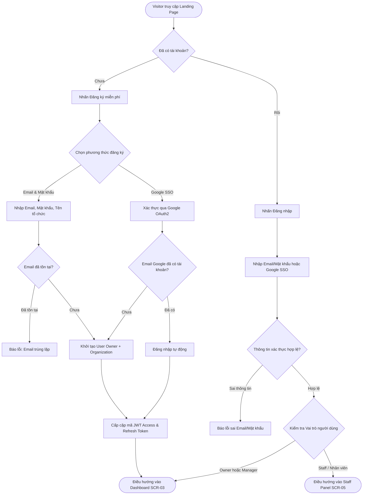

---

## WF-002: Quy trình Thiết lập Tổ chức & Chi nhánh

**Actors:** Organization Owner, System  
**Điều kiện bắt đầu:** Owner đăng ký thành công tài khoản tổ chức.  
**Kết quả:** Chi nhánh được thiết lập đầy đủ địa chỉ, tọa độ GPS và bán kính bảo vệ.

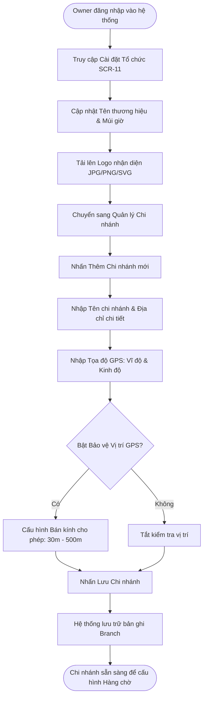

---

## WF-003: Quy trình Cấu hình Hàng chờ, Quầy & Phiên làm việc

**Actors:** Branch Manager, Staff, System  
**Điều kiện bắt đầu:** Chi nhánh đã được tạo lập trong hệ thống.  
**Kết quả:** Hàng chờ, quầy phục vụ và phiên làm việc được thiết lập hoàn chỉnh.

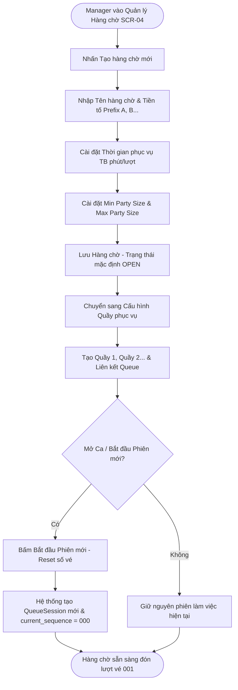

---

## WF-004: Quy trình Tạo & Quản lý Mã QR Chống Gian lận

**Actors:** Branch Manager, TV Display, System  
**Điều kiện bắt đầu:** Hàng chờ đang ở trạng thái hoạt động.  
**Kết quả:** Mã QR (Tĩnh hoặc Động) sẵn sàng cho khách hàng quét lấy số.

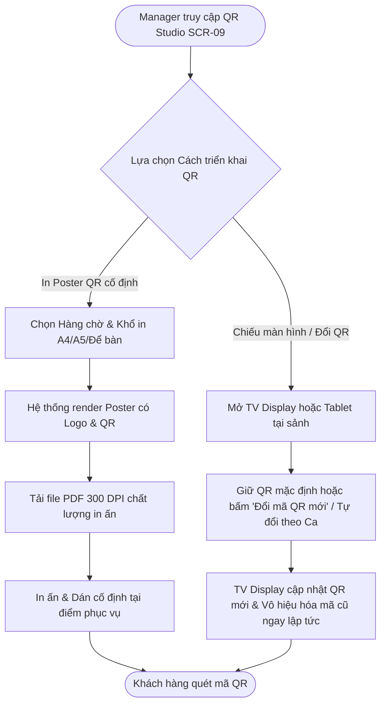

---

## WF-005: Quy trình Khách quét QR & Lấy số Thứ tự (Check-in)

**Actors:** Customer, System  
**Điều kiện bắt đầu:** Khách có mặt tại cửa hàng, sử dụng camera điện thoại quét mã QR.  
**Kết quả:** Khách nhận được số thứ tự và tự động chuyển sang màn hình Live Tracking.

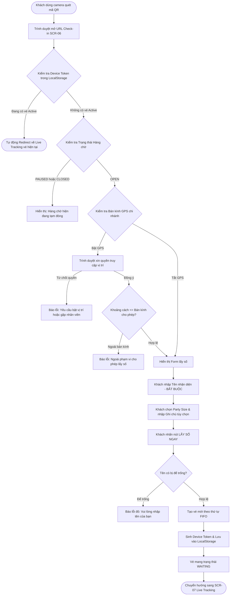

---

## WF-006: Quy trình Khách theo dõi Hàng chờ Trực tiếp (Live Tracking)

**Actors:** Customer, System, Staff  
**Điều kiện bắt đầu:** Khách hàng sở hữu vé đang ở trạng thái `WAITING`.  
**Kết quả:** Khách theo dõi tiến trình liên tục, nhận chuông báo và xác nhận đang đến.

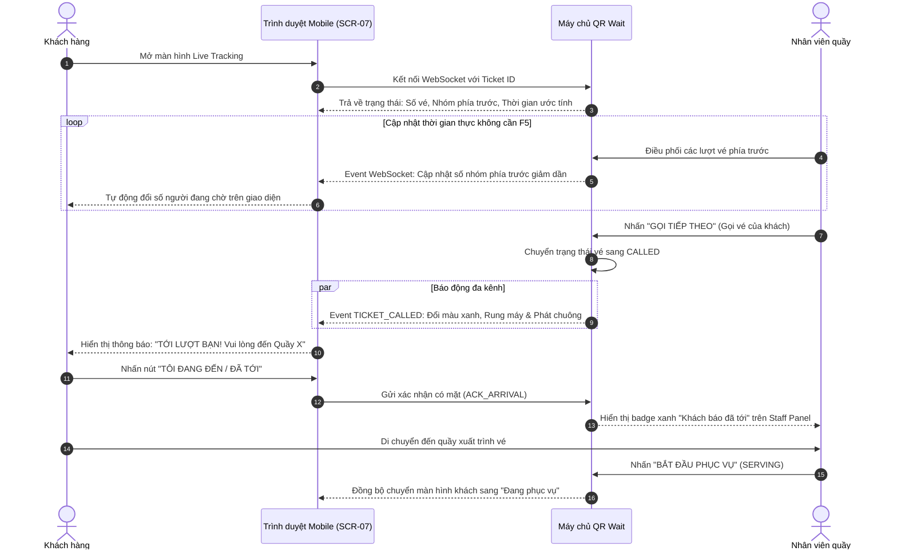

---

## WF-007: Quy trình Nhân viên Gọi & Phục vụ Khách hàng

**Actors:** Staff, System, Customer, TV Display  
**Điều kiện bắt đầu:** Nhân viên đăng nhập Staff Panel (SCR-05), chọn quầy trực; Có khách chờ.  
**Kết quả:** Khách được gọi, tiếp nhận phục vụ và đóng lượt vé hoàn tất.

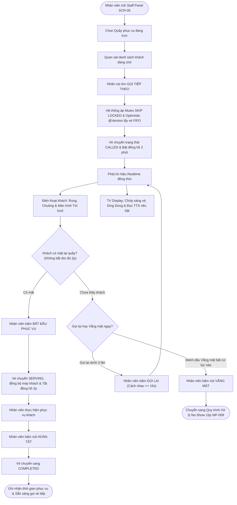

---

## WF-008: Quy trình Chuyển Quầy hoặc Chuyển Hàng chờ (Ticket Transfer)

**Actors:** Staff, System, Customer  
**Điều kiện bắt đầu:** Vé đang ở trạng thái `CALLED` hoặc `SERVING`, phát sinh nhu cầu chuyển đổi.  
**Kết quả:** Vé được bàn giao chuẩn xác sang Quầy hoặc Hàng chờ đích.

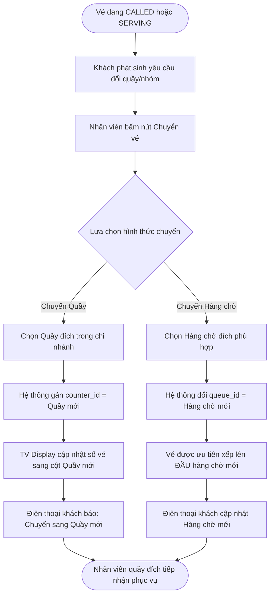

---

## WF-009: Quy trình Xử lý Khách Vắng mặt & Tự động Hủy sau 15 Phút (No-Show)

**Actors:** Staff, System, Customer  
**Điều kiện bắt đầu:** Nhân viên đánh dấu vé là VẮNG MẶT sau nhiều lần gọi không thành.  
**Kết quả:** Vé được phục hồi (nếu khách quay lại trong 15p) hoặc tự động hủy vĩnh viễn sau 15p.

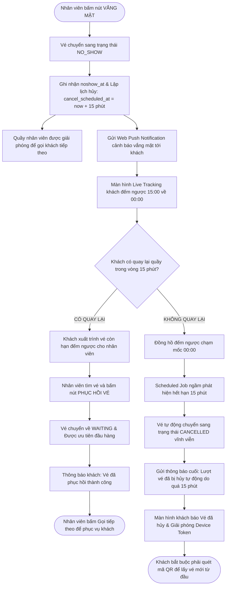

---

## WF-010: Quy trình Khách hàng Chủ động Hủy vé (Customer Self-Cancel)

**Actors:** Customer, System, Staff  
**Điều kiện bắt đầu:** Vé đang ở trạng thái `WAITING`.  
**Kết quả:** Vé chuyển `CANCELLED`, giải phóng lượt cho khách sau và giải phóng thiết bị.

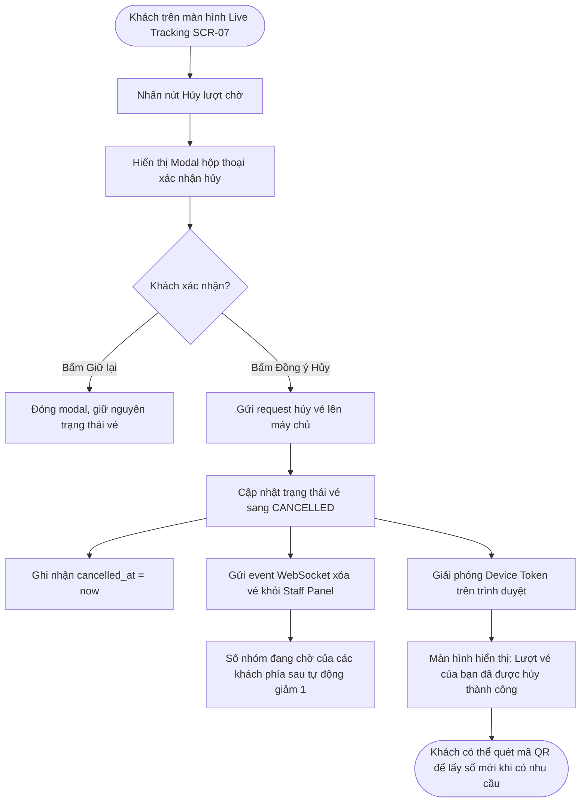

---

## WF-011: Quy trình Tiếp nhận Khách Vãng lai Thủ công (Walk-in Entry)

**Actors:** Staff, Customer, System  
**Điều kiện bắt đầu:** Khách hàng không có điện thoại thông minh đến tại quầy/cửa.  
**Kết quả:** Vé Walk-in được tạo và tham gia hàng chờ FIFO bình thường.

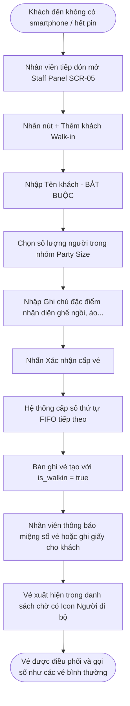

---

## WF-012: Quy trình Điều phối Đa quầy Chống Xung đột (Mutex Lock Dispatching)

**Actors:** Nhân viên Quầy 1, Nhân viên Quầy 2, Database Mutex  
**Điều kiện bắt đầu:** Nhiều nhân viên cùng trực và gọi số từ cùng một hàng chờ.  
**Kết quả:** Mỗi nhân viên nhận đúng một vé riêng biệt, không bao giờ bị gọi trùng số.

```mermaid
sequenceDiagram
    autonumber
    actor S1 as Nhân viên Quầy 1
    actor S2 as Nhân viên Quầy 2
    participant DB as Database Engine (PostgreSQL)
    participant WS as WebSocket Broker

    Note over S1,S2: Cùng nhấn "GỌI TIẾP THEO" tại cùng một thời điểm
    par Thao tác đồng thời
        S1->>DB: BEGIN TRANSACTION<br/>SELECT * FROM tickets WHERE queue_id = ? AND status = 'WAITING'<br/>ORDER BY created_at ASC LIMIT 1 FOR UPDATE SKIP LOCKED
    and
        S2->>DB: BEGIN TRANSACTION<br/>SELECT * FROM tickets WHERE queue_id = ? AND status = 'WAITING'<br/>ORDER BY created_at ASC LIMIT 1 FOR UPDATE SKIP LOCKED
    end

    Note over DB: Cơ chế Mutex Lock khóa dòng tức thì
    DB-->>S1: Khóa và trả về vé A-010
    DB-->>S2: Bỏ qua dòng bị khóa, trả về vé tiếp theo A-011

    S1->>DB: UPDATE tickets SET status = 'CALLED', counter_id = 'Quầy 1' WHERE id = A-010; COMMIT
    S2->>DB: UPDATE tickets SET status = 'CALLED', counter_id = 'Quầy 2' WHERE id = A-011; COMMIT

    par Bắn thông báo Realtime
        DB->>WS: Broadcast Event CALLED: Vé A-010 -> Quầy 1
    and
        DB->>WS: Broadcast Event CALLED: Vé A-011 -> Quầy 2
    end
    WS-->>S1: Hiển thị A-010 trên Quầy 1
    WS-->>S2: Hiển thị A-011 trên Quầy 2
```

---

## WF-013: Quy trình Vận hành Màn hình Sảnh (Public TV Display)

**Actors:** Branch Manager, TV Display, System  
**Điều kiện bắt đầu:** Chi nhánh có Smart TV nối mạng Internet tại sảnh.  
**Kết quả:** TV hiển thị liên tục số đang phục vụ và phát chuông Ding Dong khi có lượt mới.

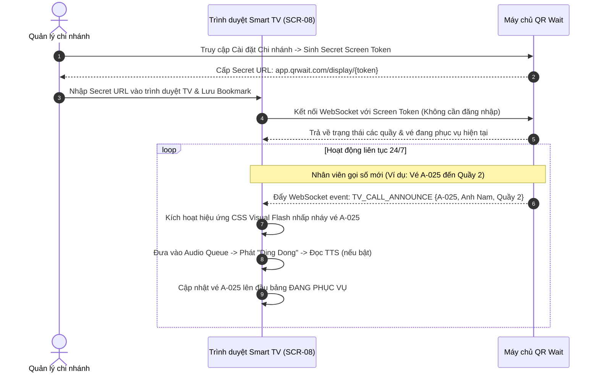

---

## WF-014: Quy trình Điều phối Hệ thống Thông báo Đa kênh (Notification Flow)

**Actors:** System Event Bus, Customer Device, TV Display  
**Điều kiện bắt đầu:** Có sự kiện thay đổi trạng thái vé phát sinh trong hệ thống.  
**Kết quả:** Các kênh thông báo tương ứng được kích hoạt chuẩn xác.

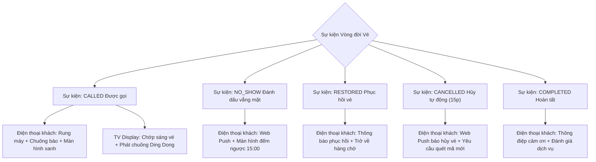

---

## WF-015: Quy trình Xem Phân tích Báo cáo & Xuất file CSV

**Actors:** Organization Owner, Branch Manager, System  
**Điều kiện bắt đầu:** Người dùng đăng nhập có quyền xem Analytics.  
**Kết quả:** Biểu đồ báo cáo hiển thị trực quan và file CSV được tải xuống thành công.

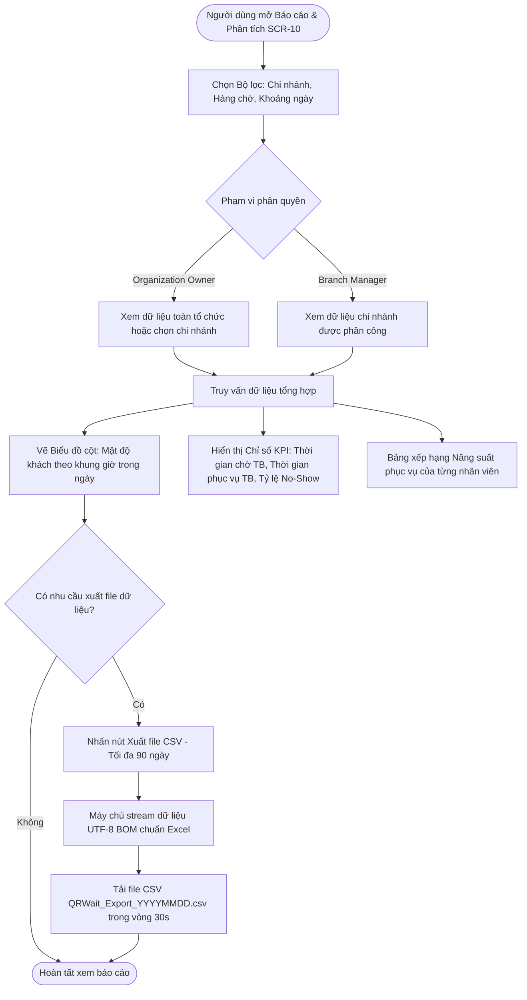


---

# 6. Use Case Specification

## 6.1 Tổng quan Use Case Diagram

Hệ thống QR Wait phân rã thành 15 Use Case cốt lõi tương ứng với 5 nhóm Actor:

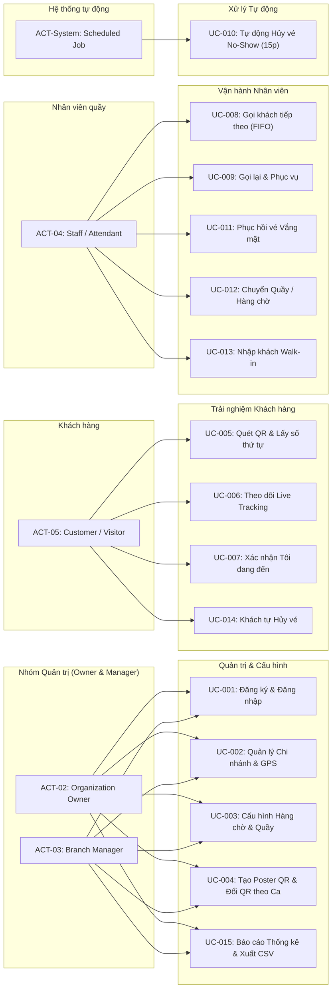

---

## 6.2 Đặc tả Chi tiết từng Use Case

### UC-001: Đăng ký & Đăng nhập Hệ thống
- **Use Case ID:** UC-001
- **Use Case Name:** Đăng ký và Đăng nhập (Register & Login)
- **Description:** Người dùng đăng ký tài khoản tổ chức mới hoặc đăng nhập vào hệ thống để truy cập các chức năng quản trị/vận hành.
- **Primary Actor:** Organization Owner, Branch Manager, Staff
- **Secondary Actor:** Google Identity Services (OAuth2)
- **Preconditions:** Người dùng có trình duyệt kết nối Internet.
- **Trigger:** Người dùng mở ứng dụng và chọn Đăng ký hoặc Đăng nhập.
- **Main Success Scenario:**
  1. Người dùng chọn phương thức xác thực (Email/Mật khẩu hoặc Google SSO).
  2. Người dùng nhập thông tin xác thực.
  3. Hệ thống xác thực danh tính và kiểm tra trạng thái tài khoản.
  4. Hệ thống cấp JWT Token.
  5. Hệ thống điều hướng vào màn hình phù hợp (Owner/Manager $\rightarrow$ Dashboard; Staff $\rightarrow$ Staff Panel).
- **Alternative Flows:**
  - AF-01: Đăng ký tổ chức mới thành công $\rightarrow$ Hệ thống tự động tạo `Organization` mặc định.
- **Exception Flows:**
  - EF-01: Sai mật khẩu hoặc tài khoản bị khóa $\rightarrow$ Hiển thị thông báo lỗi.
- **Postconditions:** Phiên làm việc được thiết lập an toàn.
- **Related Requirements:** FR-001, FR-002, FR-003, FR-004.

---

### UC-002: Quản lý Chi nhánh & Bán kính Vị trí GPS
- **Use Case ID:** UC-002
- **Use Case Name:** Quản lý Chi nhánh và Thiết lập Bán kính GPS (Branch & GPS Management)
- **Description:** Quản lý tạo địa điểm chi nhánh và cấu hình tọa độ vị trí cùng bán kính kiểm tra lấy số.
- **Primary Actor:** Organization Owner, Branch Manager
- **Preconditions:** Người dùng có quyền quản trị chi nhánh.
- **Trigger:** Người dùng truy cập Cài đặt Chi nhánh.
- **Main Success Scenario:**
  1. Người dùng nhập Tên, Địa chỉ chi nhánh và Tọa độ GPS (Kinh độ/Vĩ độ).
  2. Người dùng bật tính năng bảo vệ GPS và chọn bán kính (từ 30m đến 500m).
  3. Người dùng nhấn Lưu.
  4. Hệ thống cập nhật và áp dụng quy tắc vị trí cho mọi hàng chờ của chi nhánh.
- **Postconditions:** Chi nhánh sẵn sàng kích hoạt kiểm tra vị trí.
- **Related Requirements:** FR-006, FR-007, BRL-002.

---

### UC-003: Cấu hình Hàng chờ, Quầy & Mở Phiên làm việc
- **Use Case ID:** UC-003
- **Use Case Name:** Cấu hình Hàng chờ & Quản lý Phiên (Queue & Session Setup)
- **Description:** Thiết lập các hàng chờ (tên, tiền tố vé, min/max nhóm), quầy phục vụ và thực hiện mở phiên làm việc mới (reset số vé về 001).
- **Primary Actor:** Branch Manager, Organization Owner
- **Preconditions:** Chi nhánh đã tồn tại.
- **Trigger:** Người dùng mở màn hình Quản lý Hàng chờ (SCR-04).
- **Main Success Scenario:**
  1. Quản lý tạo hàng chờ mới với Tên, Prefix (A, B...), Min/Max Party Size và Thời gian phục vụ TB.
  2. Quản lý tạo các quầy phục vụ (Quầy 1, Quầy 2) liên kết với hàng chờ.
  3. Quản lý nhấn "Bắt đầu phiên mới / Mở ca mới".
  4. Hệ thống xác nhận và đặt lại bộ đếm số vé tự tăng về `000`. Lượt vé tiếp theo bắt đầu từ `001`.
- **Postconditions:** Hàng chờ mở cửa, bộ đếm vé sẵn sàng cấp từ số 001.
- **Related Requirements:** FR-008, FR-009, FR-010, FR-011, BRL-001, BRL-010.

---

### UC-004: Tạo Poster QR Tĩnh & Đổi Mã QR theo Ca/Thủ công
- **Use Case ID:** UC-004
- **Use Case Name:** Tạo và Quản lý Mã QR (QR Studio)
- **Description:** Xuất file in ấn Poster QR tĩnh (A4, A5) hoặc đổi mã QR mới (thủ công/theo ca) khi chiếu trên màn hình TV Display để vô hiệu hóa mã cũ.
- **Primary Actor:** Branch Manager, Organization Owner, Staff
- **Preconditions:** Hàng chờ đã được tạo.
- **Trigger:** Quản lý truy cập QR Studio (SCR-09).
- **Main Success Scenario:**
  1. Quản lý chọn xuất poster in ấn $\rightarrow$ Chọn khổ in $\rightarrow$ Tải file PDF 300 DPI có kèm logo doanh nghiệp.
  2. Hoặc khi chiếu QR trên màn hình sảnh cần đổi mã chống chụp ảnh cũ: Bấm nút "Đổi mã QR mới" (hoặc bật tự đổi khi mở ca mới) $\rightarrow$ Hệ thống xác nhận và cập nhật ngay mã QR mới lên TV Display, thu hồi hiệu lực mã cũ.
- **Postconditions:** Mã QR sẵn sàng để khách quét.
- **Related Requirements:** FR-012, FR-013, FR-015, BRL-003.

---

### UC-005: Khách hàng Quét QR & Lấy số Thứ tự
- **Use Case ID:** UC-005
- **Use Case Name:** Khách hàng Lấy số Thứ tự Tự phục vụ (Customer Check-in)
- **Description:** Khách hàng dùng camera điện thoại quét mã QR, nhập tên bắt buộc, chọn quy mô nhóm và nhận vé số điện tử.
- **Primary Actor:** Customer / Visitor (ACT-05)
- **Preconditions:** Hàng chờ đang `OPEN`.
- **Trigger:** Khách quét mã QR và mở form lấy số (SCR-06).
- **Main Success Scenario:**
  1. Trình duyệt mở trang check-in. Hệ thống kiểm tra: thiết bị chưa có vé Active trong hàng chờ này.
  2. Nếu chi nhánh bật GPS: Khách chấp thuận chia sẻ vị trí $\rightarrow$ Hệ thống kiểm tra khoảng cách hợp lệ.
  3. Khách nhập Tên nhận diện (Bắt buộc), chọn số lượng người (Party Size) và nhập ghi chú (nếu có).
  4. Khách nhấn "LẤY SỐ NGAY".
  5. Hệ thống cấp số thứ tự FIFO tiếp theo, lưu Device Token vào LocalStorage và chuyển khách sang màn hình Live Tracking.
- **Alternative Flows:**
  - AF-01: Thiết bị đã có vé Active $\rightarrow$ Hệ thống tự động chuyển thẳng về trang Live Tracking của vé cũ (Behavior A).
- **Exception Flows:**
  - EF-01: Tên để trống $\rightarrow$ Báo lỗi đỏ, chặn submit.
  - EF-02: Ngoài bán kính GPS $\rightarrow$ Báo lỗi ngoài phạm vi, từ chối tạo vé.
- **Postconditions:** Vé mới ở trạng thái `WAITING` xuất hiện trên Staff Panel.
- **Related Requirements:** FR-014, FR-016, FR-017, FR-018, FR-019, BRL-001, BRL-002, BRL-009.

---

### UC-006: Khách hàng Theo dõi Lượt chờ Trực tiếp
- **Use Case ID:** UC-006
- **Use Case Name:** Khách theo dõi Hàng chờ Trực tiếp (Customer Live Tracking)
- **Description:** Khách hàng theo dõi vị trí của mình trong hàng đợi theo thời gian thực trên màn hình điện thoại mà không cần tải lại trang.
- **Primary Actor:** Customer / Visitor (ACT-05)
- **Preconditions:** Khách sở hữu vé hợp lệ.
- **Trigger:** Mở màn hình SCR-07.
- **Main Success Scenario:**
  1. Trình duyệt kết nối WebSocket nhận dữ liệu vé.
  2. Màn hình hiển thị số vé, số nhóm phía trước và thời gian chờ ước tính.
  3. Khi các vé phía trước được xử lý, số nhóm phía trước tự động giảm dần.
  4. Khi vé được gọi: Màn hình đổi màu xanh lá cây rực rỡ, rung máy và phát chuông cảnh báo tới lượt.
- **Postconditions:** Khách luôn nắm rõ tiến độ phục vụ.
- **Related Requirements:** FR-020, FR-021, BRL-004.

---

### UC-007: Khách hàng Xác nhận "Tôi đang đến"
- **Use Case ID:** UC-007
- **Use Case Name:** Khách hàng Xác nhận Có mặt (Arrival Acknowledgment)
- **Description:** Khi được gọi số, khách bấm "TÔI ĐANG ĐẾN" để thông báo cho nhân viên biết mình đang di chuyển lại quầy.
- **Primary Actor:** Customer / Visitor (ACT-05)
- **Secondary Actor:** Staff / Attendant (ACT-04)
- **Preconditions:** Vé ở trạng thái `CALLED`.
- **Trigger:** Khách bấm nút "TÔI ĐANG ĐẾN" trên SCR-07.
- **Main Success Scenario:**
  1. Khách nhấn nút "TÔI ĐANG ĐẾN".
  2. Hệ thống gửi thông điệp WebSocket về máy chủ.
  3. Staff Panel hiển thị huy hiệu (Badge) xanh: "Khách đang tới" trên thẻ vé.
- **Postconditions:** Nhân viên nắm được trạng thái di chuyển của khách.
- **Related Requirements:** FR-022.

---

### UC-008: Nhân viên Gọi Khách Tiếp theo (FIFO)
- **Use Case ID:** UC-008
- **Use Case Name:** Nhân viên Gọi Khách Tiếp theo (Staff Call Next)
- **Description:** Nhân viên thao tác 1 chạm gọi lượt khách tiếp theo theo chuẩn FIFO với cơ chế khóa Mutex chống xung đột đa quầy.
- **Primary Actor:** Staff / Attendant (ACT-04)
- **Secondary Actor:** Customer, TV Display
- **Preconditions:** Có vé `WAITING`; Nhân viên đã chọn quầy trực.
- **Trigger:** Nhân viên nhấn "GỌI TIẾP THEO" trên SCR-05.
- **Main Success Scenario:**
  1. Nhân viên nhấn nút "GỌI TIẾP THEO".
  2. Hệ thống khóa Mutex, lấy vé `WAITING` có thời gian tạo sớm nhất và chuyển sang `CALLED`.
  3. Kích hoạt chuông và màn hình cảnh báo trên điện thoại khách.
  4. TV Display kích hoạt chớp sáng và phát chuông "Ding Dong".
  5. Thẻ vé hiển thị tại khu vực đang gọi của Staff Panel.
- **Postconditions:** Vé chuyển `CALLED`; Quầy gắn kết với vé.
- **Related Requirements:** FR-024, FR-025, BRL-001, BRL-008.

---

### UC-009: Nhân viên Gọi lại & Phục vụ Khách hàng
- **Use Case ID:** UC-009
- **Use Case Name:** Gọi lại và Phục vụ Khách (Recall, Serving & Complete)
- **Description:** Nhân viên gọi lại khách nếu chưa có mặt (tối đa 3 lần, cách nhau $\ge 15$s), nhấn bắt đầu khi khách tới và hoàn tất phục vụ.
- **Primary Actor:** Staff / Attendant (ACT-04)
- **Preconditions:** Vé đang ở trạng thái `CALLED`.
- **Trigger:** Nhân viên tương tác các nút bấm trên SCR-05.
- **Main Success Scenario:**
  1. Khách chưa tới: Nhân viên bấm "GỌI LẠI" (tối đa 3 lần, giãn cách $\ge 15$s) $\rightarrow$ Chuông reo lại trên máy khách.
  2. Khách có mặt: Nhân viên bấm "BẮT ĐẦU PHỤC VỤ" $\rightarrow$ Vé chuyển `SERVING`, bắt đầu tính thời gian phục vụ.
  3. Phục vụ xong: Nhân viên bấm "HOÀN TẤT" $\rightarrow$ Vé chuyển `COMPLETED`, ghi nhận dữ liệu báo cáo, giải phóng quầy.
- **Postconditions:** Vé hoàn tất chu trình vòng đời, lưu vết Analytics.
- **Related Requirements:** FR-026, FR-027, FR-028, BRL-006.

---

### UC-010: Tự động Hủy Vé Vắng mặt sau 15 Phút
- **Use Case ID:** UC-010
- **Use Case Name:** Xử lý Vắng mặt & Hủy Tự động (No-Show Auto-Cancel)
- **Description:** Khi nhân viên bấm "VẮNG MẶT", hệ thống kích hoạt đếm ngược 15 phút trên máy khách. Hết 15 phút không quay lại, hệ thống tự động hủy vé vĩnh viễn.
- **Primary Actor:** System (Scheduled Background Job)
- **Secondary Actor:** Staff (đánh dấu No-Show), Customer
- **Preconditions:** Vé ở trạng thái `CALLED`.
- **Trigger:** Nhân viên bấm "VẮNG MẶT" trên Staff Panel.
- **Main Success Scenario:**
  1. Vé chuyển sang `NO_SHOW`, lập lịch hủy sau 15 phút.
  2. Điện thoại khách nhận thông báo đẩy và bắt đầu đếm ngược từ 15:00 về 00:00.
  3. Sau 15 phút khách không xuất hiện: Tiến trình ngầm chuyển vé sang `CANCELLED`.
  4. Khách nhận thông báo hủy vé vĩnh viễn và hướng dẫn quét QR lấy số mới.
  5. Device Token được giải phóng để lấy số mới.
- **Postconditions:** Vé kết thúc ở trạng thái `CANCELLED`.
- **Related Requirements:** FR-029, FR-031, FR-033, BRL-007.

---

### UC-011: Nhân viên Phục hồi Vé Vắng mặt trong Thời gian Ân hạn
- **Use Case ID:** UC-011
- **Use Case Name:** Phục hồi Vé Vắng mặt (Restore No-Show Ticket)
- **Description:** Khách quay lại quầy trong vòng 15 phút ân hạn, nhân viên bấm phục hồi để đưa khách lên đầu hàng chờ.
- **Primary Actor:** Staff / Attendant (ACT-04)
- **Preconditions:** Vé đang `NO_SHOW`; Chưa quá 15 phút kể từ lúc đánh dấu vắng mặt.
- **Trigger:** Nhân viên nhấn "Phục hồi vé" trong danh sách vắng mặt.
- **Main Success Scenario:**
  1. Nhân viên tìm vé của khách trong danh sách vắng mặt.
  2. Nhân viên bấm "Phục hồi vé".
  3. Vé chuyển về `WAITING` và được ưu tiên xếp đầu hàng.
  4. Khách nhận thông báo vé đã được khôi phục thành công.
- **Postconditions:** Vé sẵn sàng được gọi phục vụ kế tiếp.
- **Related Requirements:** FR-032, BRL-007.

---

### UC-012: Chuyển Lượt Vé sang Quầy hoặc Hàng chờ Khác
- **Use Case ID:** UC-012
- **Use Case Name:** Chuyển Vé (Transfer Ticket)
- **Description:** Nhân viên chuyển lượt vé đang phụ trách sang quầy khác hoặc chuyển nhóm hàng chờ khác khi phát sinh nhu cầu.
- **Primary Actor:** Staff / Attendant (ACT-04)
- **Preconditions:** Vé đang ở trạng thái `CALLED` hoặc `SERVING`.
- **Trigger:** Nhân viên nhấn nút "Chuyển vé" trên SCR-05.
- **Main Success Scenario:**
  1. Nhân viên chọn chuyển sang Quầy khác hoặc Hàng chờ khác.
  2. Nhân viên chọn đích đến và xác nhận.
  3. Hệ thống điều chuyển vé; TV Display và màn hình khách hàng cập nhật tức thì thông tin mới.
- **Postconditions:** Vé thuộc quyền xử lý của quầy/hàng chờ mới.
- **Related Requirements:** FR-030.

---

### UC-013: Tiếp nhận Khách Vãng lai Thủ công (Walk-in)
- **Use Case ID:** UC-013
- **Use Case Name:** Thêm Khách Vãng lai Thủ công (Manual Walk-in Entry)
- **Description:** Nhân viên tạo vé cho khách hàng không có điện thoại thông minh tham gia vào hàng chờ FIFO chung.
- **Primary Actor:** Staff / Attendant (ACT-04)
- **Preconditions:** Hàng chờ đang `OPEN`.
- **Trigger:** Nhân viên bấm nút "+ Thêm khách (Walk-in)" trên SCR-05.
- **Main Success Scenario:**
  1. Nhân viên nhập Tên khách (Bắt buộc), chọn số lượng người và ghi chú đặc điểm nhận diện.
  2. Hệ thống cấp số vé tự tăng theo thứ tự FIFO chung (`is_walkin = true`).
  3. Nhân viên thông báo số vé cho khách.
  4. Vé xuất hiện trong hàng chờ với biểu tượng Người đi bộ.
- **Postconditions:** Vé Walk-in nằm trong danh sách chờ FIFO.
- **Related Requirements:** FR-037, FR-038, BRL-001.

---

### UC-014: Khách hàng Chủ động Hủy Vé
- **Use Case ID:** UC-014
- **Use Case Name:** Khách hàng Tự Hủy Vé (Customer Self-Cancellation)
- **Description:** Khách hàng chủ động hủy lượt chờ của mình khi không còn nhu cầu phục vụ.
- **Primary Actor:** Customer / Visitor (ACT-05)
- **Preconditions:** Vé đang ở trạng thái `WAITING`.
- **Trigger:** Khách bấm "Hủy lượt chờ" trên SCR-07.
- **Main Success Scenario:**
  1. Khách nhấn "Hủy lượt chờ" và xác nhận trên modal.
  2. Vé chuyển sang trạng thái `CANCELLED`.
  3. Vé biến mất khỏi Staff Panel; các khách phía sau tự động đôn lên 1 lượt.
  4. Device Token được giải phóng để lấy số mới.
- **Postconditions:** Vé bị hủy vĩnh viễn.
- **Related Requirements:** FR-023.

---

### UC-015: Xem Báo cáo Vận hành & Xuất Dữ liệu CSV
- **Use Case ID:** UC-015
- **Use Case Name:** Báo cáo Phân tích & Xuất CSV (Analytics & CSV Export)
- **Description:** Quản lý xem các chỉ số KPI vận hành, biểu đồ lưu lượng theo giờ và tải xuống file dữ liệu chi tiết ra CSV.
- **Primary Actor:** Organization Owner, Branch Manager
- **Preconditions:** Người dùng có quyền xem Analytics.
- **Trigger:** Truy cập màn hình Báo cáo (SCR-10).
- **Main Success Scenario:**
  1. Người dùng chọn bộ lọc: Chi nhánh, Hàng chờ, Khoảng thời gian.
  2. Hệ thống hiển thị biểu đồ mật độ khách theo giờ, thời gian chờ TB, thời gian phục vụ TB, tỷ lệ No-Show.
  3. Người dùng nhấn "Xuất file CSV".
  4. Hệ thống kết xuất file CSV UTF-8 và tải về máy trong vòng $\le 30$ giây.
- **Postconditions:** Quản lý có dữ liệu phục vụ cải tiến vận hành.
- **Related Requirements:** FR-039, FR-040, NFR-010.

---

# 7. UI/UX Requirements

## 7.1 Nguyên tắc Thiết kế Trải nghiệm Tổng thể
- **Phong cách thị giác (Design System):** Hiện đại, Tối giản, Độ tương phản cao. Sử dụng tông màu chủ đạo Indigo Blue (`#4F46E5`), kết hợp màu trạng thái chuẩn: Xanh lá (`#10B981` - Tới lượt/Sẵn sàng), Hổ phách (`#F59E0B` - Đang chờ), Xanh dương (`#3B82F6` - Đang phục vụ), Đỏ (`#EF4444` - Vắng mặt/Hủy).
- **Typography:** Hệ font Sans-serif trung tính (Inter / Roboto). Các con số thứ tự (Ticket Numbers) luôn sử dụng kiểu chữ to bản (Display Bold), dễ đọc ở khoảng cách xa.
- **Touch-First Accessibility:** Kích thước vùng chạm tương tác (Tap Target) trên thiết bị di động tối thiểu $48 \times 48$px. Nút bấm trên Staff Panel to bản để bấm nhanh không trượt.
- **Cross-Device Adaptability:** 100% màn hình hoạt động mượt mà trên cả trình duyệt máy tính để bàn (Desktop) và trình duyệt di động (Mobile PWA).

---

## 7.2 Đặc tả Chi tiết 11 Màn hình (SCR-01 đến SCR-11)

### SCR-01: Landing Page / Website Giới thiệu & Live Demo
- **Mã màn hình:** SCR-01
- **Tên màn hình:** Landing Page & Product Showcase
- **Đối tượng:** Khách vãng lai, Chủ doanh nghiệp tìm hiểu giải pháp SaaS
- **Mục đích:** Giới thiệu giá trị sản phẩm, giải thích cơ chế "Scan & Go" không cần cài app, cung cấp widget Live Interactive Demo và nút chuyển đổi đăng ký.
- **Bố cục & Giao diện:**
  - Header: Logo QR Wait, Menu chuyển đổi ngôn ngữ (VI/EN), Nút "Đăng nhập", Nút "Bắt đầu miễn phí" (CTA nổi bật).
  - Hero Section: Tiêu đề lớn *"Hệ thống Xếp hàng Ảo qua Mã QR – Không cần máy in phiếu, không cần cài app"*, ảnh minh họa trải nghiệm khách quét mã và màn hình TV sảnh.
  - Interactive Demo Widget: Khung tương tác cho phép người dùng click quét QR ảo, tạo vé thử và xem mô phỏng màn hình Staff Panel gọi số ngay trên web.
  - Feature Grid: 6 khối tính năng nổi bật (Chống gian lận GPS, Đổi QR theo Ca/Nút bấm, TV Display chuông Ding Dong & Giọng đọc TTS, Thao tác 1 chạm, Không giới hạn lượt vé, Báo cáo CSV).
  - Footer: Thông tin bản quyền, tài liệu hướng dẫn, liên hệ hỗ trợ.
- **Hành vi tương tác:** Click CTA mở SCR-02; click Demo tương tác trực tiếp; chuyển đổi ngôn ngữ mượt mà không reload.
- **Responsive:** Co giãn linh hoạt từ Mobile (320px) đến Desktop 4K.

---

### SCR-02: Xác thực & Đăng nhập (Auth & Onboarding)
- **Mã màn hình:** SCR-02
- **Tên màn hình:** Authentication Screen
- **Đối tượng:** Chủ tổ chức, Quản lý chi nhánh, Nhân viên
- **Mục đích:** Đăng ký tài khoản doanh nghiệp mới hoặc đăng nhập tài khoản hiện có an toàn.
- **Bố cục & Giao diện:**
  - Thiết kế dạng thẻ căn giữa màn hình (Centered Card) trên nền xám nhạt tối giản.
  - Tab chuyển đổi linh hoạt giữa: "Đăng nhập" và "Đăng ký".
  - Nút lớn "Tiếp tục với Google" (Google SSO có logo Google chuẩn).
  - Đường kẻ phân cách "hoặc sử dụng email".
  - Trường nhập: Email, Mật khẩu (có icon con mắt ẩn/hiện mật khẩu).
  - Khi ở tab Đăng ký: Bổ sung ô nhập "Tên doanh nghiệp / Cửa hàng".
  - Liên kết "Quên mật khẩu?".
- **Quy tắc kiểm tra (Validation):** Email đúng định dạng; Mật khẩu $\ge 8$ ký tự cho đăng ký; Tên doanh nghiệp không để trống.
- **Trạng thái:** Loading spinner trên nút khi đang xác thực; Thông báo lỗi nền đỏ ở trên cùng form nếu sai thông tin.

---

### SCR-03: Bảng điều khiển Tổng quan (Executive Dashboard)
- **Mã màn hình:** SCR-03
- **Tên màn hình:** Executive Dashboard
- **Đối tượng:** Organization Owner, Branch Manager
- **Mục đích:** Cung cấp cái nhìn toàn cảnh về tình hình vận hành các hàng chờ theo thời gian thực.
- **Bố cục & Giao diện:**
  - Sidebar bên trái (có thể thu gọn): Logo, Menu điều hướng (Dashboard, Hàng chờ, Nhân viên, TV Display, QR Studio, Báo cáo, Cài đặt).
  - Header: Bộ chọn Chi nhánh (Branch Selector dropdown), Thông tin người dùng đăng nhập.
  - Hàng thẻ chỉ số nhanh (Metric Cards):
    1. Tổng số vé hôm nay.
    2. Đang chờ phục vụ (`WAITING`).
    3. Đang phục vụ tại quầy (`SERVING`).
    4. Tỷ lệ hoàn tất (`COMPLETED` %).
  - Biểu đồ thời gian thực: Lưu lượng khách theo từng giờ trong ngày hôm nay.
  - Bảng trạng thái các Hàng chờ: Danh sách các hàng chờ kèm số lượng khách đang chờ, trạng thái OPEN/PAUSED và nút truy cập nhanh vào Staff Panel hoặc màn hình TV.
- **Trạng thái rỗng (Empty State):** Khi chưa tạo chi nhánh/hàng chờ nào $\rightarrow$ Hiển thị hình minh họa onboarding hướng dẫn 3 bước: "1. Thêm chi nhánh $\rightarrow$ 2. Tạo hàng chờ $\rightarrow$ 3. In mã QR".

---

### SCR-04: Quản lý Hàng chờ (Queue Management & Sessions)
- **Mã màn hình:** SCR-04
- **Tên màn hình:** Queue Management
- **Đối tượng:** Branch Manager, Organization Owner
- **Mục đích:** Tạo lập, chỉnh sửa hàng chờ, điều khiển trạng thái mở/đóng và thực hiện mở phiên làm việc mới (Reset số vé).
- **Bố cục & Giao diện:**
  - Nút bấm "+ Tạo hàng chờ mới" ở góc trên bên phải.
  - Danh sách hàng chờ dạng lưới thẻ (Grid Cards):
    - Mỗi thẻ đại diện cho 1 Queue: Tên hàng chờ, Badge Prefix (ví dụ `[A]`), Số người đang chờ hiện tại, Thời gian phục vụ TB.
    - Switch chuyển đổi trạng thái: `OPEN` (Xanh), `PAUSED` (Vàng), `CLOSED` (Xám).
    - Menu tùy chọn (...) trên mỗi thẻ: "Chỉnh sửa", "Xuất Poster QR", "Bắt đầu phiên mới (Reset số)", "Xóa".
  - Modal "Tạo/Sửa hàng chờ": Các ô nhập Tên, Prefix, Min/Max Party Size, Thời gian phục vụ.
  - Modal "Bắt đầu phiên mới": Cảnh báo số khách đang chờ dở dang, nút xác nhận reset số thứ tự về 001.
- **Validation:** Prefix từ 1–3 ký tự hoa, không trùng lặp; Min Party Size $\le$ Max Party Size.

---

### SCR-05: Bảng điều khiển Nhân viên (Staff Panel 1-Tap)
- **Mã màn hình:** SCR-05
- **Tên màn hình:** One-Tap Staff Calling Panel
- **Đối tượng:** Staff / Attendant (ACT-04)
- **Mục đích:** Giao diện tốc độ cao cho nhân viên gọi số, phục vụ, đánh dấu vắng mặt bằng thao tác cảm ứng 1 chạm.
- **Bố cục & Giao diện:**
  - Header: Tên hàng chờ, Dropdown chọn Quầy đang trực (Ví dụ: "Quầy 01"), Nút "+ Thêm khách Walk-in".
  - Khu vực Trung tâm (Hero Action Area):
    - Khối hiển thị số vé đang gọi to bản (Ví dụ: `#A-025`), Tên khách hàng ("Nguyễn Văn A"), Quy mô nhóm ("Nhóm 4 người"), Ghi chú của khách.
    - **Đồng hồ đếm thời gian chờ khách (2 phút):** Đếm lùi `02:00` $\rightarrow$ `00:00` (chuyển màu đỏ cảnh báo nếu quá 2 phút chưa thấy khách); **không khóa nút thao tác** — nhân viên vẫn bấm Vắng mặt / Gọi người khác bất cứ lúc nào.
    - Huy hiệu trạng thái: Nhấp nháy xanh "Khách báo đã tới / đang tới" khi khách bấm xác nhận trên điện thoại.
    - Hàng nút thao tác lớn (Big Touch Buttons):
      - Nút **"BẮT ĐẦU PHỤC VỤ"** (Màu xanh dương, to nhất).
      - Nút **"GỌI LẠI"** (Màu vàng, hiển thị số lần 1/3, 2/3 kèm đếm lùi 15s).
      - Nút **"VẮNG MẶT"** (Màu xám/đỏ).
      - Nút **"HOÀN TẤT"** (Màu xanh lá cây, xuất hiện khi đang ở trạng thái SERVING).
      - Nút icon **"Chuyển vé"** (Chuyển quầy hoặc chuyển hàng chờ).
  - Nút cố định dưới đáy màn hình: **"GỌI TIẾP THEO"** (Khối màu Indigo cực lớn, chiếm toàn chiều rộng, chỉ cần chạm ngón tay cái là kích hoạt).
  - Danh sách chờ thu nhỏ (Waitlist Drawer): Vuốt từ dưới lên để xem danh sách các vé đang chờ tiếp theo kèm thời gian lấy số.
  - Tab "Vắng mặt (15p)": Danh sách các vé No-Show đang đếm ngược kèm nút "Phục hồi vé".

---

### SCR-06: Màn hình Khách hàng Lấy số (Customer Check-in Form)
- **Mã màn hình:** SCR-06
- **Tên màn hình:** Customer Self Check-in
- **Đối tượng:** Customer / Visitor (ACT-05)
- **Mục đích:** Cho phép khách hàng nhập tên, chọn quy mô nhóm và nhận vé số điện tử sau khi quét mã QR.
- **Bố cục & Giao diện:**
  - Header: Logo doanh nghiệp sắc nét ở chính giữa, Tên chi nhánh, Tên hàng chờ (Ví dụ: "Hàng chờ Bàn 1-4 người").
  - Hộp thông tin nhỏ: *"Hiện có 3 nhóm đang chờ phía trước"*.
  - Ô nhập **Tên của bạn** (Bắt buộc): Placeholder *"Nhập tên để nhân viên gọi số (ví dụ: Anh Nam)"*, tự động focus bàn phím.
  - Ô nhập **Ghi chú** (Tùy chọn): Placeholder *"Ghi chú thêm (ví dụ: Có ghế trẻ em)"*.
  - Bộ chọn **Số lượng người (Party Size)**: Hàng nút bấm nhanh bo tròn: `1`, `2`, `3`, `4`, `5+` hoặc bộ nút tăng giảm `[-]` `[Số]` `[+]`.
  - Nút bấm chính: **"LẤY SỐ NGAY"** (Màu xanh Indigo nổi bật, font chữ to).
  - Dòng cam kết bảo mật chân trang: *"Không cần cài đặt ứng dụng. Chúng tôi không lưu số điện thoại của bạn."*
- **Validation & Lỗi:** Để trống Tên $\rightarrow$ Viền đỏ, báo lỗi *"Vui lòng nhập tên của bạn"*; Ngoài bán kính GPS $\rightarrow$ Màn hình cảnh báo màu vàng yêu cầu di chuyển lại gần cửa hàng; Hàng chờ đóng $\rightarrow$ Khóa nút lấy số.

---

### SCR-07: Màn hình Vé chờ Trực tiếp (Customer Live Tracking)
- **Mã màn hình:** SCR-07
- **Tên màn hình:** Live Queue Tracking
- **Đối tượng:** Customer / Visitor (ACT-05)
- **Mục đích:** Khách hàng theo dõi vị trí hàng đợi trực tiếp, nhận chuông báo khi tới lượt và bấm xác nhận có mặt.
- **Bố cục & Giao diện:**
  - **Trạng thái WAITING (Đang chờ):**
    - Logo cửa hàng ở trên cùng.
    - Khối số vé to bản ở trung tâm: `#A-024` trên nền bo tròn nổi bật.
    - Tên khách hàng: *"Chào bạn, [Tên khách]"* kèm Party Size.
    - Thẻ tiến độ: *"Còn 2 nhóm phía trước bạn"*.
    - Thời gian chờ ước tính: *"Dự kiến ~10 phút"*.
    - Thanh trạng thái trực quan: `Đã lấy số` $\rightarrow$ `Đang chờ` $\rightarrow$ `Tới lượt` $\rightarrow$ `Đang phục vụ`.
    - Nút phụ ở chân trang: *"Hủy lượt chờ"* (chữ xám nhỏ kèm hộp thoại xác nhận).
  - **Trạng thái CALLED (Được gọi):**
    - Toàn bộ màn hình chuyển sang màu xanh lá cây rực rỡ nhấp nháy.
    - Dòng chữ lớn: **"TỚI LƯỢT BẠN!"**.
    - Chỉ dẫn rõ ràng: **"VUI LÒNG ĐẾN [TÊN QUẦY PHỤC VỤ]"**.
    - Nút bấm lớn nổi bật: **"TÔI ĐANG ĐẾN"** (Bấm để báo cho nhân viên).
  - **Trạng thái NO_SHOW (Vắng mặt):**
    - Màn hình đổi sang màu vàng cam cảnh báo.
    - Tiêu đề: **"BẠN ĐANG BỊ ĐÁNH DẤU VẮNG MẶT"**.
    - Đồng hồ đếm ngược to bản chạy lùi: `14:59`, `14:58`... về `00:00`.
    - Hướng dẫn: *"Vui lòng quay lại quầy xuất trình màn hình này trong vòng 15 phút để được phục hồi lượt. Quá 15 phút vé sẽ tự động hủy."*
  - **Trạng thái CANCELLED / EXPIRED:**
    - Màn hình xám, thông báo vé đã hủy kèm nút "Quét mã lấy số mới".

---

### SCR-08: Màn hình TV Hiển thị Công cộng (Public TV Display)
- **Mã màn hình:** SCR-08
- **Tên màn hình:** Fullscreen TV Display
- **Đối tượng:** Khách tại sảnh chờ, Nhân viên điều phối
- **Mục đích:** Hiển thị số đang phục vụ tại từng quầy, chớp sáng, phát chuông Ding Dong và giọng đọc TTS mời khách khi có lượt gọi mới.
- **Bố cục & Giao diện:**
  - Thiết kế tối ưu cho tỷ lệ màn hình 16:9 (Độ phân giải Full HD / 4K).
  - Nền tối tương phản cao (Dark Mode nền đen/xanh đậm, chữ trắng và vàng kim) chống mỏi mắt và nhìn rõ từ cự ly 10–15m.
  - Header: Logo doanh nghiệp, Tên chi nhánh, Đồng hồ kỹ thuật số góc phải, **công tắc Bật/Tắt giọng đọc TTS** (riêng với chuông Ding Dong) và banner nhỏ lần đầu chạm kích hoạt âm thanh trình duyệt.
  - Khu vực chính (Bên trái, chiếm 65% diện tích): Bảng **"ĐANG PHỤC VỤ"**:
    - Chia thành các ô thẻ lớn cho từng Quầy: Ví dụ `Quầy 01: #A-024`, `Quầy 02: #B-008`.
    - Số vé hiển thị cực lớn bằng font chữ Display Bold.
  - Khu vực phụ (Bên phải trên, chiếm 35% diện tích): Bảng **"VỪA GỌI GẦN ĐÂY"**:
    - Danh sách 4 lượt vé vừa gọi trước đó kèm tên quầy.
  - Khu vực Mã QR sảnh (Bên phải dưới):
    - Mã QR của hàng chờ to bản, sắc nét (tự cập nhật tức thì qua WebSocket khi quản lý bấm đổi mã QR mới hoặc mở ca mới).
    - Hướng dẫn: *"Quét mã lấy số thứ tự tại sảnh"*.
- **Hiệu ứng Âm thanh & Hình ảnh:** Khi có số mới gọi $\rightarrow$ Thẻ vé chớp sáng viền vàng/xanh trong 4 giây + Đưa vào Audio Queue phát chuông "Ding Dong" trước, rồi đọc TTS tiếng Việt (*"Xin mời khách hàng số A-025 đến Quầy 01"*) nếu công tắc TTS đang Bật.

---

### SCR-09: Trung tâm Mã QR & Chống gian lận (QR Studio)
- **Mã màn hình:** SCR-09
- **Tên màn hình:** QR Studio & Anti-Fraud Center
- **Đối tượng:** Branch Manager, Organization Owner
- **Mục đích:** Công cụ tạo poster QR in ấn chất lượng cao, đổi mã QR theo Ca/thủ công và cấu hình bán kính GPS.
- **Bố cục & Giao diện:**
  - Tab 1: **"Mã QR In ấn (Static Posters)"**:
    - Bộ chọn Hàng chờ.
    - Tùy chọn khổ giấy: Khổ A4 đứng, Khổ A5, Thẻ mica để bàn nhỏ.
    - Tùy chỉnh màu sắc thương hiệu (Brand Accent Color) và logo hiển thị giữa mã QR.
    - Khung xem trước (Live Preview).
    - Nút "Tải file PDF in ấn (300 DPI)" và "Tải ảnh PNG sắc nét".
  - Tab 2: **"Đổi Mã QR & Chiếu Màn hình (Session / Manual QR)"**:
    - Hiển thị mã QR hiện tại đang chiếu trên TV Display / Tablet.
    - Nút **"Đổi mã QR mới"** (có modal cảnh báo mã cũ trên giấy in/ảnh chụp sẽ mất hiệu lực ngay).
    - Switch tùy chọn: *"Tự động đổi mã QR mỗi khi mở Ca/Phiên làm việc mới"* (mặc định Tắt để bảo toàn poster giấy in sẵn).
    - Nút "Mở màn hình TV Display".
  - Tab 3: **"Bảo vệ Vị trí (GPS Geolocation)"**:
    - Switch bật/tắt yêu cầu vị trí.
    - Nhập tọa độ chi nhánh hoặc bấm nút "Lấy vị trí hiện tại của tôi".
    - Thanh trượt bán kính cho phép: từ $30$m đến $500$m.

---

### SCR-10: Báo cáo Thống kê & Xuất Dữ liệu (Analytics & Data Export)
- **Mã màn hình:** SCR-10
- **Tên màn hình:** Analytics & Reporting
- **Đối tượng:** Organization Owner, Branch Manager
- **Mục đích:** Cung cấp số liệu phân tích lưu lượng, thời gian chờ, năng suất nhân viên và xuất file CSV.
- **Bố cục & Giao diện:**
  - Thanh bộ lọc trên cùng: Chọn Chi nhánh, Hàng chờ, Bộ lọc ngày (Hôm nay, 7 ngày qua, 30 ngày qua, Tùy chọn khoảng ngày).
  - Nút chức năng: **"Xuất file CSV"** ở góc phải.
  - Hàng thẻ chỉ số tổng quan (Overview Cards):
    - Tổng lượt khách tiếp nhận.
    - Thời gian chờ đợi trung bình (phút).
    - Thời gian phục vụ trung bình (phút).
    - Tỷ lệ vắng mặt No-Show (%).
  - Khối biểu đồ 1: Biểu đồ cột (Bar Chart) phân bổ lượng khách theo các khung giờ trong ngày (xác định giờ cao điểm 11h-13h, 18h-20h).
  - Khối biểu đồ 2: Biểu đồ tròn (Donut Chart) phân bổ trạng thái vé (`COMPLETED`, `CANCELLED`, `NO_SHOW`).
  - Bảng dữ liệu Năng suất Nhân sự: Tên nhân viên, Số lượt đã phục vụ, Thời gian phục vụ trung bình mỗi khách.

---

### SCR-11: Cài đặt Hệ thống & Quản lý Đội ngũ (Settings & Team)
- **Mã màn hình:** SCR-11
- **Tên màn hình:** System Settings & Team Management
- **Đối tượng:** Organization Owner (Toàn quyền), Branch Manager (Giới hạn)
- **Mục đích:** Quản lý thành viên nhân sự, cấu hình âm thanh TV Display (Ding Dong & Bật/Tắt TTS) và quản lý Screen Token của TV.
- **Bố cục & Giao diện:**
  - Tab 1: **"Thành viên & Phân quyền"**:
    - Danh sách tài khoản: Tên, Email, Vai trò (Owner, Manager, Staff), Chi nhánh phân công, Trạng thái hoạt động.
    - Nút "+ Thêm thành viên" (Mở modal nhập trực tiếp Tên, Email, Mật khẩu ban đầu — đăng nhập ngay không qua email kích hoạt).
    - Nút "Khóa / Mở khóa tài khoản".
  - Tab 2: **"Chi nhánh, TV Display & Âm thanh (TTS)"**:
    - Danh sách chi nhánh kèm nút sinh Screen Token / Secret URL cho màn hình TV.
    - Switch cấu hình mặc định: **Bật/Tắt giọng đọc Text-to-Speech (TTS)** trên TV Display (chuông Ding Dong luôn bật) và mẫu câu đọc thông báo.
    - Khu vực tải lên Logo tổ chức và múi giờ mặc định.
  *(Ghi chú: Tab API Keys & Webhooks đã tạm dừng theo quyết định của PO ngày 26/11/2026).*

---

# 8. External Interface Requirements

## 8.1 User Interface Requirements (Yêu cầu Giao diện Người dùng)
- **Chuẩn Responsive:** Ứng dụng web được xây dựng theo triết lý Mobile-First, tự động thích ứng với các độ phân giải:
  - Mobile Screens: 320px đến 480px (iOS Safari, Android Chrome).
  - Tablet Screens: 768px đến 1024px (iPad, Android Tablet làm Staff Panel / Kiosk).
  - Desktop Screens: 1280px đến 1920px (Chrome, Edge cho Dashboard).
  - Big Screens: 1920x1080 (1080p) và 3840x2160 (4K) cho TV Display.
- **Tiêu chuẩn Khả dụng (Usability):**
  - Không có thao tác nào trên Staff Panel đòi hỏi quá 2 lần chạm để hoàn tất một hành động nghiệp vụ.
  - Các nút hành động chính có chiều cao tối thiểu 52px trên thiết bị di động.
  - Hỗ trợ đầy đủ cử chỉ chạm (Touch Gestures): Vuốt lên để mở danh sách chờ, vuốt xuống để đóng.

## 8.2 Software Interface Requirements (Yêu cầu Giao tiếp Phần mềm)

### 1. Java Spring Boot Backend Engine
- Hệ thống backend triển khai trên nền Java 17 LTS và Spring Boot 3.x.
- Cung cấp kiến trúc RESTful API chuẩn mực với định dạng trao đổi dữ liệu duy nhất là JSON (Content-Type: `application/json; charset=UTF-8`).
- Quản lý phiên làm việc không trạng thái (Stateless) thông qua JSON Web Token (JWT).

### 2. Hệ Cơ sở Dữ liệu & Caching
- **PostgreSQL 15+:** Hệ quản trị cơ sở dữ liệu quan hệ chính. Sử dụng transaction isolation level `READ COMMITTED` kết hợp `SELECT ... FOR UPDATE SKIP LOCKED` và Optimistic Locking (`@Version`) cho cơ chế chống xung đột đa quầy / double-click.
- **Redis 7+:** Lưu trữ bộ đệm (Cache) danh sách hàng chờ nóng, cache file âm thanh TTS và quản lý Blacklist JWT Token khi nhân viên bị thu hồi quyền.

### 3. Google Identity Services (OAuth2 SSO)
- Tích hợp Google OAuth2 API cho luồng đăng ký/đăng nhập nhanh của chủ doanh nghiệp.
- Trao đổi ID Token từ client với Google Authorization Server để trích xuất email đã được xác minh.

### 4. HTML5 Geolocation API
- Giao tiếp với API định vị của trình duyệt thiết bị khách hàng (`navigator.geolocation.getCurrentPosition`) để lấy tọa độ vĩ độ, kinh độ và độ chính xác (accuracy) nhằm phục vụ kiểm tra bán kính địa lý.

### 5. HTML5 Web Audio API & Text-to-Speech Engine (Audio Queue)
- Sử dụng `AudioContext` và HTML5 `<audio>` để phát chuông "Ding Dong" trên điện thoại khách và Smart TV.
- Sử dụng kết hợp âm thanh TTS từ Backend (hoặc fallback `window.speechSynthesis` với `lang = 'vi-VN'`) qua **Audio Queue** tuần tự trên TV Display (có công tắc Bật/Tắt và nút kích hoạt Autoplay lần đầu).

## 8.3 Communication Interface Requirements (Yêu cầu Giao tiếp Mạng)

### 1. WebSocket & Server-Sent Events (SSE)
- **Giao thức chính:** WebSocket STOMP qua SockJS broker tại endpoint `/ws-qrwait`.
- **Chủ đề đăng ký (Topics):**
  - `/topic/ticket/{ticket_id}`: Kênh riêng cho từng khách hàng nhận cập nhật trạng thái vé và thông báo gọi số.
  - `/topic/queue/{queue_id}`: Kênh hàng chờ cập nhật số lượng người đang chờ phía trước.
  - `/topic/branch/{branch_id}/tv`: Kênh phát sóng sự kiện gọi số tức thì cho màn hình TV Display.
  - `/topic/staff/{branch_id}`: Kênh đồng bộ trạng thái giữa các nhân viên trong chi nhánh.
- **Cơ chế Fallback:** Tự động hạ cấp xuống Server-Sent Events (SSE) hoặc HTTP Long-polling nếu mạng tường lửa của khách hàng chặn giao thức WebSocket.

### 2. HTTPS & Bảo mật Kênh truyền
- 100% lưu lượng truy cập qua giao thức HTTPS bắt buộc (TLS 1.3) với chứng chỉ SSL hợp lệ.
- Áp dụng cấu hình HTTP Strict Transport Security (HSTS) và Content Security Policy (CSP).

### 3. Webhooks Dispatcher Interface (Phase 3)
- Gửi HTTP POST request với body JSON có chữ ký bảo mật HMAC-SHA256 trong header `X-QRWait-Signature` để đối tác xác thực nguồn gốc sự kiện. Timeout kết nối 5000ms.


---

# 9. Data Requirements

## 9.1 Sơ đồ Thực thể Nghiệp vụ (Conceptual Entity-Relationship Diagram)

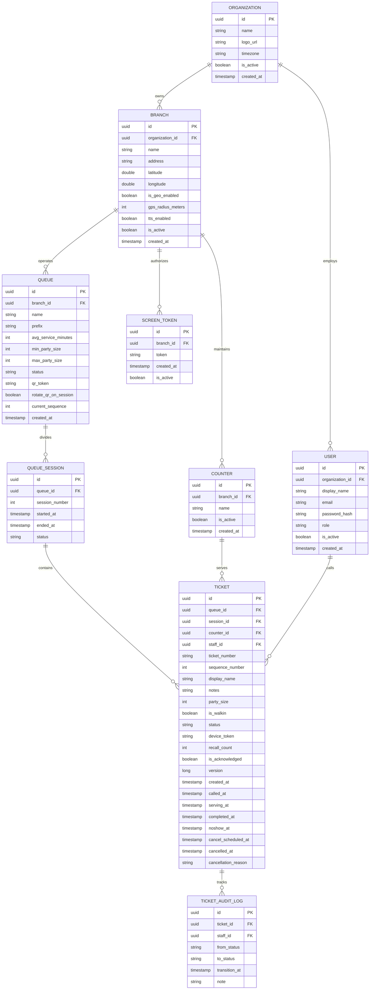

---

## 9.2 Đặc tả Chi tiết các Thực thể Dữ liệu

### 1. Thực thể `Organization` (Tổ chức / Doanh nghiệp Tenant)
| Thuộc tính | Kiểu dữ liệu | Bắt buộc | Ràng buộc & Quy tắc kiểm tra | Mô tả nghiệp vụ |
| :--- | :--- | :---: | :--- | :--- |
| `id` | UUID | Có | Khóa chính, sinh ngẫu nhiên v4 | Định danh duy nhất của tổ chức |
| `name` | String(100) | Có | Không rỗng, 2 – 100 ký tự | Tên thương hiệu/doanh nghiệp |
| `logo_url` | String(500) | Không | Định dạng URL hợp lệ, trỏ tới file ảnh | Logo hiển thị trên vé và TV |
| `timezone` | String(50) | Có | Mặc định: `Asia/Ho_Chi_Minh` | Múi giờ phục vụ tính toán ngày |
| `is_active` | Boolean | Có | Mặc định: `true` | Trạng thái hoạt động của Tenant |
| `created_at` | Timestamp | Có | Timestamp UTC tại thời điểm tạo | Thời điểm đăng ký tài khoản |

### 2. Thực thể `Branch` (Chi nhánh vật lý)
| Thuộc tính | Kiểu dữ liệu | Bắt buộc | Ràng buộc & Quy tắc kiểm tra | Mô tả nghiệp vụ |
| :--- | :--- | :---: | :--- | :--- |
| `id` | UUID | Có | Khóa chính | Định danh duy nhất của chi nhánh |
| `organization_id` | UUID | Có | Khóa ngoại trỏ đến `Organization.id` | Tổ chức sở hữu chi nhánh |
| `name` | String(100) | Có | 2 – 100 ký tự | Tên chi nhánh (ví dụ: Quận 1) |
| `address` | String(255) | Có | Địa chỉ thực tế | Vị trí thực tế của cửa hàng |
| `latitude` | Double | Có | Giá trị từ -90.0 đến 90.0 | Vĩ độ GPS phục vụ kiểm tra vị trí |
| `longitude` | Double | Có | Giá trị từ -180.0 đến 180.0 | Kinh độ GPS phục vụ kiểm tra vị trí |
| `is_geo_enabled` | Boolean | Có | Mặc định: `false` | Bật/tắt bảo vệ vị trí khi lấy số |
| `gps_radius_meters` | Integer | Có | Mặc định: 100, phạm vi: 30 – 500m | Bán kính cho phép lấy số quanh tọa độ |
| `tts_enabled` | Boolean | Có | Mặc định: `true` | Công tắc Bật/Tắt đọc giọng nói TTS trên TV Display |
| `is_active` | Boolean | Có | Mặc định: `true` | Trạng thái chi nhánh |
| `created_at` | Timestamp | Có | Timestamp UTC | Ngày tạo chi nhánh |

### 3. Thực thể `Queue` (Hàng chờ dịch vụ)
| Thuộc tính | Kiểu dữ liệu | Bắt buộc | Ràng buộc & Quy tắc kiểm tra | Mô tả nghiệp vụ |
| :--- | :--- | :---: | :--- | :--- |
| `id` | UUID | Có | Khóa chính | Định danh duy nhất của hàng chờ |
| `branch_id` | UUID | Có | Khóa ngoại trỏ đến `Branch.id` | Chi nhánh sở hữu hàng chờ |
| `name` | String(100) | Có | Tên phân loại (ví dụ: Bàn 1-2 người) | Tên hiển thị của hàng chờ |
| `prefix` | String(5) | Có | Chữ in hoa (1–3 ký tự), duy nhất/branch | Tiền tố số vé (ví dụ: `A`, `VIP`) |
| `avg_service_minutes`| Integer | Có | Mặc định: 10, số nguyên dương $\ge 1$ | Thời gian phục vụ trung bình (phút) |
| `min_party_size` | Integer | Có | Mặc định: 1, $\ge 1$ | Số người tối thiểu trong nhóm |
| `max_party_size` | Integer | Có | Mặc định: 20, $\ge min\_party\_size$ | Số người tối đa trong nhóm |
| `status` | String(20) | Có | Enum: `OPEN`, `PAUSED`, `CLOSED` | Trạng thái tiếp nhận khách |
| `qr_token` | String(64) | Có | Chuỗi ngẫu nhiên duy nhất cho Queue | Mã xác thực QR hiện hành (đổi khi bấm nút hoặc mở ca) |
| `rotate_qr_on_session`| Boolean | Có | Mặc định: `false` | Tự động đổi `qr_token` mới khi mở Ca/Phiên mới |
| `current_sequence` | Integer | Có | Mặc định: 0, tự tăng mỗi lượt vé | Bộ đếm số vé hiện tại trong phiên |
| `created_at` | Timestamp | Có | Timestamp UTC | Ngày tạo hàng chờ |

### 4. Thực thể `QueueSession` (Phiên hàng chờ - Quản lý Reset vé)
| Thuộc tính | Kiểu dữ liệu | Bắt buộc | Ràng buộc & Quy tắc kiểm tra | Mô tả nghiệp vụ |
| :--- | :--- | :---: | :--- | :--- |
| `id` | UUID | Có | Khóa chính | Định danh duy nhất của phiên |
| `queue_id` | UUID | Có | Khóa ngoại trỏ đến `Queue.id` | Hàng chờ thuộc phiên này |
| `session_number` | Integer | Có | Tự tăng theo từng hàng chờ (1, 2, 3...) | Số thứ tự của phiên làm việc |
| `started_at` | Timestamp | Có | Mặc định: `now()` | Thời điểm mở ca / reset số vé |
| `ended_at` | Timestamp | Không | Lưu khi bấm kết thúc ca | Thời điểm đóng phiên |
| `status` | String(20) | Có | Enum: `ACTIVE`, `CLOSED` | Trạng thái phiên làm việc |

### 5. Thực thể `Counter` (Quầy phục vụ)
| Thuộc tính | Kiểu dữ liệu | Bắt buộc | Ràng buộc & Quy tắc kiểm tra | Mô tả nghiệp vụ |
| :--- | :--- | :---: | :--- | :--- |
| `id` | UUID | Có | Khóa chính | Định danh duy nhất của quầy |
| `branch_id` | UUID | Có | Khóa ngoại trỏ đến `Branch.id` | Chi nhánh đặt quầy |
| `name` | String(50) | Có | Không rỗng (ví dụ: "Quầy số 01") | Tên hiển thị trên TV và vé khách |
| `is_active` | Boolean | Có | Mặc định: `true` | Trạng thái quầy đang mở hay đóng |
| `created_at` | Timestamp | Có | Timestamp UTC | Ngày tạo quầy |

### 6. Thực thể `User` (Tài khoản người dùng & Nhân viên)
| Thuộc tính | Kiểu dữ liệu | Bắt buộc | Ràng buộc & Quy tắc kiểm tra | Mô tả nghiệp vụ |
| :--- | :--- | :---: | :--- | :--- |
| `id` | UUID | Có | Khóa chính | Định danh duy nhất của người dùng |
| `organization_id` | UUID | Không | Khóa ngoại (Null nếu Super Admin) | Tổ chức của người dùng |
| `display_name` | String(100) | Có | Không rỗng, 2 – 50 ký tự | Tên hiển thị của nhân sự |
| `email` | String(100) | Có | Email hợp lệ, duy nhất toàn hệ thống | Email đăng nhập |
| `password_hash` | String(255) | Có | Chuỗi mã hóa BCrypt | Mật khẩu bảo mật |
| `role` | String(30) | Có | Enum: `SUPER_ADMIN`, `OWNER`, `MANAGER`, `STAFF` | Vai trò và phạm vi quyền |
| `is_active` | Boolean | Có | Mặc định: `true` | Trạng thái tài khoản |
| `created_at` | Timestamp | Có | Timestamp UTC | Ngày tạo tài khoản |

### 7. Thực thể `Ticket` (Vé chờ lượt)
| Thuộc tính | Kiểu dữ liệu | Bắt buộc | Ràng buộc & Quy tắc kiểm tra | Mô tả nghiệp vụ |
| :--- | :--- | :---: | :--- | :--- |
| `id` | UUID | Có | Khóa chính | Định danh duy nhất của vé |
| `queue_id` | UUID | Có | Khóa ngoại trỏ đến `Queue.id` | Hàng chờ chứa vé |
| `session_id` | UUID | Có | Khóa ngoại trỏ đến `QueueSession.id` | Phiên làm việc của vé |
| `counter_id` | UUID | Không | Khóa ngoại trỏ đến `Counter.id` | Quầy phục vụ vé này (khi được gọi) |
| `staff_id` | UUID | Không | Khóa ngoại trỏ đến `User.id` | Nhân viên trực tiếp gọi/phục vụ |
| `ticket_number` | String(20) | Có | Định dạng: `[Prefix]-[000]` | Số hiển thị (ví dụ: `A-025`) |
| `sequence_number` | Integer | Có | Tự tăng trong session (1, 2, 3...) | Số nguyên phục vụ sắp xếp FIFO |
| `display_name` | String(50) | Có | Bắt buộc nhập, 2 – 30 ký tự | Tên khách hàng xưng hô tại quầy |
| `notes` | String(255) | Không | Tùy chọn, tối đa 255 ký tự | Ghi chú của khách hoặc nhân viên |
| `party_size` | Integer | Có | Nằm trong khoảng Min/Max của Queue | Số lượng người trong nhóm |
| `is_walkin` | Boolean | Có | Mặc định: `false` (True nếu nhập tay) | Đánh dấu khách vãng lai không smartphone |
| `status` | String(20) | Có | Enum: `WAITING`, `CALLED`, `SERVING`, `COMPLETED`, `NO_SHOW`, `CANCELLED`, `EXPIRED` | Trạng thái vòng đời của vé |
| `device_token` | String(64) | Không | UUID v4 (Null nếu vé Walk-in) | Mã định danh thiết bị lưu LocalStorage |
| `recall_count` | Integer | Có | Mặc định: 0, tối đa 3 lần | Số lần nhân viên bấm gọi lại |
| `is_acknowledged` | Boolean | Có | Mặc định: `false` | True khi khách bấm "Tôi đang đến / Đã tới" |
| `version` | Long | Có | `@Version` JPA Optimistic Locking | Chống xung đột double-click & race condition |
| `created_at` | Timestamp | Có | Mặc định: `now()` | Thời điểm khách lấy số |
| `called_at` | Timestamp | Không | Lưu khi chuyển sang `CALLED` | Thời điểm nhân viên gọi số lần đầu |
| `serving_at` | Timestamp | Không | Lưu khi chuyển sang `SERVING` | Thời điểm bắt đầu phục vụ thực tế |
| `completed_at` | Timestamp | Không | Lưu khi chuyển sang `COMPLETED` | Thời điểm kết thúc phục vụ |
| `noshow_at` | Timestamp | Không | Lưu khi chuyển sang `NO_SHOW` | Thời điểm đánh dấu vắng mặt |
| `cancel_scheduled_at`| Timestamp | Không | Bằng `noshow_at + 15 phút` | Mốc thời gian kích hoạt hủy tự động |
| `cancelled_at` | Timestamp | Không | Lưu khi chuyển sang `CANCELLED` | Thời điểm vé bị hủy |
| `cancellation_reason`| String(50) | Không | `CUSTOMER_CANCEL`, `NO_SHOW_TIMEOUT_15MIN`, `STAFF_CANCEL` | Nguyên nhân hủy vé |

### 8. Thực thể `TicketAuditLog` (Lịch sử Chuyển trạng thái Vé)
| Thuộc tính | Kiểu dữ liệu | Bắt buộc | Ràng buộc & Quy tắc kiểm tra | Mô tả nghiệp vụ |
| :--- | :--- | :---: | :--- | :--- |
| `id` | UUID | Có | Khóa chính | Định danh bản ghi log |
| `ticket_id` | UUID | Có | Khóa ngoại trỏ đến `Ticket.id` | Vé được thao tác |
| `staff_id` | UUID | Không | Khóa ngoại trỏ đến `User.id` (Null nếu khách/hệ thống) | Người thực hiện hành động |
| `from_status` | String(20) | Có | Trạng thái trước khi chuyển | Trạng thái nguồn |
| `to_status` | String(20) | Có | Trạng thái sau khi chuyển | Trạng thái đích |
| `transition_at` | Timestamp | Có | Mặc định: `now()` | Thời điểm phát sinh sự kiện |
| `note` | String(255) | Không | Ghi chú thêm (ví dụ: Chuyển quầy) | Thông tin bổ trợ kiểm toán |

### 9. Thực thể `ScreenToken` (Khóa Bí mật Màn hình TV Display)
| Thuộc tính | Kiểu dữ liệu | Bắt buộc | Ràng buộc & Quy tắc kiểm tra | Mô tả nghiệp vụ |
| :--- | :--- | :---: | :--- | :--- |
| `id` | UUID | Có | Khóa chính | Định danh bản ghi token |
| `branch_id` | UUID | Có | Khóa ngoại trỏ đến `Branch.id` | Chi nhánh cho phép TV hiển thị |
| `token` | String(64) | Có | Chuỗi ngẫu nhiên bảo mật 64 ký tự, duy nhất | Chuỗi Secret URL cho Smart TV |
| `is_active` | Boolean | Có | Mặc định: `true` | Trạng thái hiệu lực của token |
| `created_at` | Timestamp | Có | Timestamp UTC | Ngày sinh mã token |

---

# 10. Business Rules

| Mã quy tắc | Tên quy tắc nghiệp vụ | Mô tả chi tiết quy tắc | FR liên quan | Điều kiện kích hoạt | Hành vi hệ thống kỳ vọng |
| :--- | :--- | :--- | :--- | :--- | :--- |
| **BRL-001** | **Nguyên tắc Cấp số Thứ tự FIFO** | Các vé trong cùng một hàng chờ được cấp số tự tăng liên tục và phục vụ theo nguyên tắc vào trước ra trước (First-In, First-Out). Định dạng vé: `[Prefix]-[Số 3 chữ số]` (Ví dụ `A-001`, `B-024`). | FR-008, FR-017, FR-025, FR-037 | Khách lấy số hoặc nhân viên thêm Walk-in | Lấy giá trị `current_sequence + 1`, sinh chuỗi vé hiển thị và lưu vào DB với trạng thái `WAITING`. |
| **BRL-002** | **Bảo vệ Vị trí Địa lý (GPS Radius)** | Khách hàng chỉ được phép lấy vé nếu khoảng cách tính theo đường chim bay từ vị trí GPS thiết bị đến tọa độ chi nhánh $\le$ bán kính cho phép (30m – 500m, mặc định 100m). | FR-007, FR-014 | Chi nhánh bật `is_geo_enabled = true` khi khách bấm lấy số | Tính khoảng cách Haversine. Nếu $> \text{gps\_radius\_meters}$ $\rightarrow$ Từ chối tạo vé, hiển thị thông báo khoảng cách thực tế và yêu cầu di chuyển lại gần cửa hàng. |
| **BRL-003** | **Đổi Mã QR Thủ công / Theo Ca (QR Token Revocation)** | Mặc định mỗi hàng chờ giữ nguyên 01 mã QR cố định. Khi quản lý/nhân viên bấm nút "Đổi mã QR mới" (hoặc bật tự đổi khi mở Ca mới), mã QR cũ lập tức mất hiệu lực và màn hình TV Display tự động cập nhật mã mới. | FR-013, FR-015 | Bấm "Đổi mã QR mới" hoặc mở ca mới khi bật `rotate_qr_on_session` | Sinh `qr_token` mới; gửi WebSocket cập nhật TV Display; mọi lượt quét token cũ bị báo lỗi `QR_CODE_REVOKED`. |
| **BRL-004** | **Công thức Ước tính Thời gian Chờ** | Thời gian chờ ước tính hiển thị cho khách thứ $N$ trong hàng đợi được tính theo công thức: <br>$$\text{Thời gian chờ dự kiến} = (\text{Số nhóm đang chờ phía trước}) \times \frac{\text{Thời gian phục vụ TB}}{\text{Số lượng quầy đang hoạt động}}$$ | FR-010, FR-020 | Khách mở hoặc cập nhật màn hình Live Tracking | Tính toán động dựa trên số quầy đang có nhân viên trực. Nếu không có quầy nào hoạt động $\rightarrow$ Hiển thị *"Đang tạm ngưng gọi số"*. |
| **BRL-005** | **Giới hạn Quy mô Nhóm khách (Party Size)** | Mỗi hàng chờ có thể thiết lập số lượng người tối thiểu và tối đa cho một lượt vé (Ví dụ: Bàn nhỏ: 1–2 người; Bàn lớn: 5–10 người). Khách hàng không thể chọn số lượng ngoài ngưỡng này. | FR-008, FR-016 | Khách hàng chọn số lượng người trên form check-in | Khóa các nút chọn ngoài phạm vi `min_party_size` đến `max_party_size`; nếu cố tình gửi request sai $\rightarrow$ Báo lỗi dữ liệu không hợp lệ. |
| **BRL-006** | **Giới hạn Gọi lại (Recall Limit & Cooldown)** | Nhân viên chỉ được nhấn gọi lại tối đa 03 lần cho một lượt vé. Khoảng cách giữa 2 lần nhấn gọi lại liên tiếp tối thiểu là 15 giây để tránh spam chuông thông báo tới khách hàng. | FR-026 | Vé đang ở trạng thái `CALLED` | Kiểm tra `recall_count < 3` và $\text{now} - \text{last\_recall} \ge 15$ giây. Nếu quá 3 lần $\rightarrow$ Vô hiệu hóa nút Gọi lại và yêu cầu Đánh dấu Vắng mặt. |
| **BRL-007** | **Cơ chế Đếm ngược 15 Phút & Tự động Hủy Vé Vắng mặt** | Vé bị đánh dấu `NO_SHOW` có thời gian ân hạn chính xác 15 phút kèm đồng hồ đếm ngược trên máy khách. Trong 15 phút, nhân viên có quyền bấm "Phục hồi vé". Hết đúng 15 phút không quay lại, hệ thống tự động hủy vé vĩnh viễn (`CANCELLED`). Khách bắt buộc phải quét mã QR lấy số mới từ đầu. | FR-029, FR-031, FR-032, FR-033 | Vé chuyển sang `NO_SHOW` | Đặt `cancel_scheduled_at = now + 15 phút`. Scheduled Job quét định kỳ: khi quá hạn $\rightarrow$ Cập nhật `CANCELLED`, gửi thông báo hủy và giải phóng Device Token. |
| **BRL-008** | **Chống Xung đột Đa tầng (Mutex & Optimistic Lock)** | Một lượt vé chỉ được phục vụ bởi duy nhất 1 nhân viên tại 1 thời điểm. Hệ thống chống xung đột cả khi nhiều quầy gọi đồng thời, bấm đúp 2 lần, hoặc khách hủy cùng lúc nhân viên gọi. | FR-025 | Bấm gọi đồng thời / bấm đúp / race condition | Áp dụng `SELECT ... FOR UPDATE SKIP LOCKED` trên PostgreSQL + `@Version` Optimistic Lock trên Entity Ticket. |
| **BRL-009** | **Chống Gian lận 1 Vé Active trên Mỗi Thiết bị** | Một thiết bị (nhận diện qua `device_token` lưu trong LocalStorage) chỉ được phép có tối đa 01 vé ở trạng thái Active (`WAITING`, `CALLED`, `SERVING`, `NO_SHOW`) trên cùng một hàng chờ. Chỉ được lấy vé mới khi vé cũ đã ở trạng thái kết thúc (`COMPLETED`, `CANCELLED`, `EXPIRED`). | FR-018, FR-019 | Khách quét mã QR khi đã từng lấy vé trước đó | Nếu thiết bị đang có vé Active $\rightarrow$ Tự động chuyển hướng về trang Live Tracking của vé cũ (Hành vi A). Tuyệt đối không sinh vé mới. |
| **BRL-010** | **Đặt lại Số Vé khi Mở Phiên Hàng chờ Mới** | Số thứ tự vé tự tăng của hàng chờ không tự động reset lúc nửa đêm mà được reset về `001` khi Quản lý hoặc Nhân viên bấm "Mở phiên làm việc mới / Mở ca mới" cho hàng chờ đó. | FR-010 | Người dùng bấm "Bắt đầu phiên mới (Reset số)" | Tạo bản ghi `QueueSession` mới, đặt `current_sequence = 0`, chuyển các vé chờ dở dang cũ sang `EXPIRED`. Lượt vé tiếp theo bắt đầu từ `[Prefix]-001`. |
| **BRL-011** | **Đồng hồ 2 Phút Không khóa Thao tác khi Gọi khách** | Khi vé ở trạng thái `CALLED`, Staff Panel đếm thời gian chờ khách ra quầy với mốc cảnh báo 2 phút. Đồng hồ chỉ là chỉ báo trực quan, không khóa thao tác của nhân viên. | FR-025, FR-029 | Vé chuyển sang trạng thái `CALLED` | Chạy bộ đếm 2 phút trên Staff Panel (đổi đỏ nếu quá 2 phút). Nhân viên có quyền bấm Vắng mặt (bắt đầu 15p trên máy khách) và mời khách khác bất cứ lúc nào. |

---

# 11. State Transition Specification

## 11.1 Sơ đồ Chuyển đổi Trạng thái Vé (Ticket State Diagram)

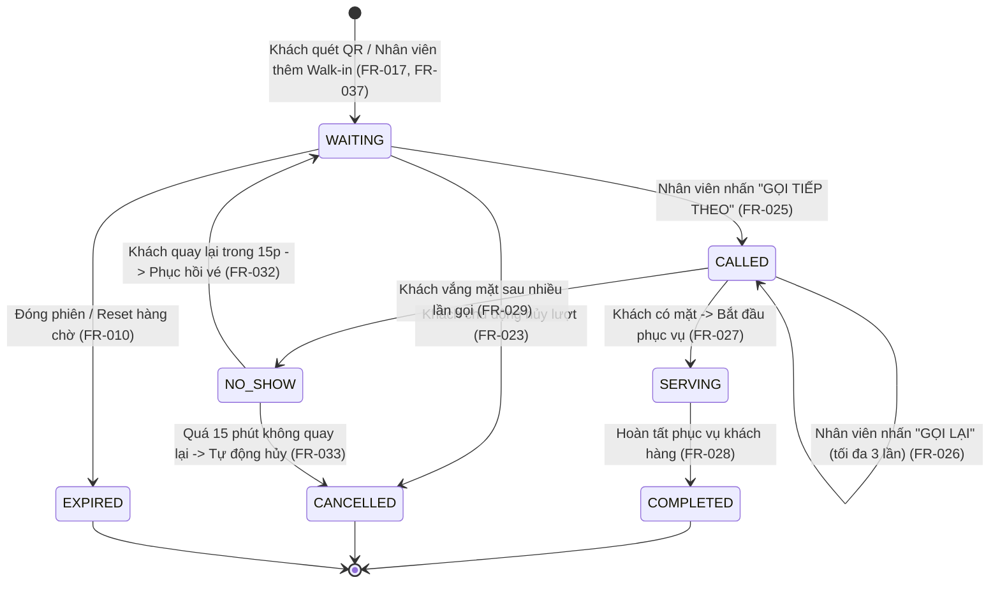

---

## 11.2 Ma trận Chuyển đổi Trạng thái Chi tiết

| Trạng thái nguồn | Trạng thái đích | Hành động kích hoạt (Trigger) | Tác nhân (Actor) | Điều kiện chuyển (Guard Condition) | Tác động phụ của hệ thống (Side Effects) |
| :--- | :--- | :--- | :--- | :--- | :--- |
| `[*]` | `WAITING` | Khách gửi form check-in hoặc NV tạo Walk-in | Customer / Staff | Hàng chờ `OPEN`; Thiết bị chưa có vé Active; Vị trí GPS hợp lệ (nếu bật) | Tăng `current_sequence`; Sinh Device Token; Gửi event WebSocket cập nhật danh sách chờ Staff Panel |
| `WAITING` | `CALLED` | Nhấn "GỌI TIẾP THEO" | Staff | Hàng chờ có vé `WAITING`; Nhân viên đã chọn quầy | Gán `called_at = now`, `counter_id`, `staff_id`; Rung/chuông máy khách; Chớp sáng & phát Ding Dong trên TV |
| `WAITING` | `CANCELLED` | Nhấn "Hủy lượt chờ" | Customer | Vé đang ở trạng thái `WAITING`; Xác nhận modal | Gán `cancelled_at = now`; Giải phóng Device Token; Đôn các khách phía sau lên 1 lượt |
| `WAITING` | `EXPIRED` | Bấm "Bắt đầu ca/phiên mới" | Manager / Staff | Có vé `WAITING` tồn đọng khi đóng phiên cũ | Gán `status = EXPIRED`; Thông báo phiên cũ đã kết thúc tới khách |
| `CALLED` | `CALLED` | Nhấn "GỌI LẠI" (Recall) | Staff | `recall_count < 3` và cách lần trước $\ge 15$ giây | Tăng `recall_count + 1`; Phát lại chuông trên máy khách và hiệu ứng trên TV Display |
| `CALLED` | `SERVING` | Nhấn "BẮT ĐẦU PHỤC VỤ" | Staff | Khách xuất trình vé hợp lệ tại quầy | Gán `serving_at = now`; Màn hình khách báo đang phục vụ; Bắt đầu bấm giờ phục vụ |
| `CALLED` | `NO_SHOW` | Nhấn "VẮNG MẶT" | Staff | Khách không có mặt sau các lần gọi | Gán `noshow_at = now`, `cancel_scheduled_at = now + 15p`; Bật đếm ngược 15p trên máy khách; Giải phóng quầy |
| `NO_SHOW` | `WAITING` | Nhấn "Phục hồi vé" | Staff | Khách có mặt; Thời gian hiện tại $< \text{cancel\_scheduled\_at}$ | Chuyển về `WAITING` ưu tiên đầu hàng; Dừng đếm ngược; Báo khách lượt đã phục hồi |
| `NO_SHOW` | `CANCELLED` | Scheduled Job phát hiện hết hạn | System | `now >= cancel_scheduled_at` (quá 15 phút) | Gán `cancelled_at = now`; Gửi Web Push báo hủy vé vĩnh viễn; Giải phóng Device Token để lấy số mới |
| `SERVING` | `COMPLETED` | Nhấn "HOÀN TẤT" | Staff | Đã phục vụ xong cho khách | Gán `completed_at = now`; Tính `wait_duration` & `service_duration`; Lưu vết báo cáo; Giải phóng quầy |

### Các chuyển đổi trạng thái BỊ CẤM (Invalid Transitions):
- Không thể chuyển từ `COMPLETED`, `CANCELLED`, `EXPIRED` sang bất kỳ trạng thái nào khác (Terminal States).
- Không thể chuyển trực tiếp từ `WAITING` sang `SERVING` hoặc `COMPLETED` (Bắt buộc phải qua bước `CALLED`).
- Không thể chuyển từ `NO_SHOW` sang `SERVING` mà không qua bước phục hồi `WAITING`.
- Khách hàng không thể tự hủy vé (`CANCELLED`) khi vé đã ở trạng thái `CALLED` hoặc `SERVING`.

---

# 12. Non-functional Requirements

| Mã NFR | Tên yêu cầu phi chức năng | Phân loại | Mô tả chi tiết | Tiêu chí đo lường (Metric) | Phương pháp kiểm tra | Độ ưu tiên |
| :--- | :--- | :--- | :--- | :--- | :--- | :---: |
| **NFR-001** | **Thời gian trễ Gọi số Thời gian thực** | Performance | Thời gian từ khi nhân viên nhấn "GỌI TIẾP THEO" trên Staff Panel đến khi điện thoại khách rung/chuông và TV phát âm thanh Ding Dong. | $\le 1.5$ giây trong điều kiện mạng di động 4G / WiFi tiêu chuẩn. | Đo đạc Timestamp log từ Client đến Server và WebSocket Broker. | Must Have |
| **NFR-002** | **Tốc độ Tải Trang Check-in** | Performance | Thời gian từ lúc mở liên kết mã QR trên điện thoại khách đến khi toàn bộ form lấy số SCR-06 sẵn sàng thao tác. | $\le 2.5$ giây qua mạng di động 4G (First Contentful Paint $\le 1.2$s). | Google Lighthouse Audit; WebPageTest trên mạng 4G giả lập. | Must Have |
| **NFR-003** | **Khả năng Chịu tải Cao điểm** | Scalability | Hệ thống xử lý mượt mà lưu lượng lớn trong khung giờ cao điểm tại các chuỗi nhà hàng, sự kiện lớn mà không bị nghẽn. | Đáp ứng $\ge 10.000$ lượt vé/ngày/chi nhánh; Chịu tải $\ge 1.000$ kết nối WebSocket đồng thời/server node. | Kiểm thử tải bằng JMeter / k6 với kịch bản mô phỏng đồng thời. | Must Have |
| **NFR-004** | **Độ sẵn sàng Hệ thống (Uptime SLA)** | Availability | Hệ thống SaaS hoạt động liên tục, hạn chế tối đa thời gian gián đoạn làm ảnh hưởng đến vận hành tại điểm bán. | Tỷ lệ sẵn sàng (Uptime) $\ge 99.9\%$ (Downtime không quá 43 phút/tháng). | Giám sát UptimeRobot / Prometheus & Grafana 24/7. | Must Have |
| **NFR-005** | **Tự động Phục hồi Kết nối Mạng** | Reliability | Khi mạng của khách hàng hoặc nhân viên bị chập chờn, hệ thống tự động tái lập kết nối WebSocket và đồng bộ lại trạng thái. | Tự động thử kết nối lại sau mỗi 3 giây; Đồng bộ lại state chuẩn trong vòng $\le 1$ giây sau khi có mạng. | Rút cáp mạng / Tắt mở chế độ máy bay khi đang chạy live test. | Must Have |
| **NFR-006** | **Tuân thủ Quyền riêng tư (Zero-PII)** | Data Privacy | Không thu thập, không lưu trữ bất kỳ thông tin nhận dạng cá nhân nhạy cảm nào (Số điện thoại, Email, Số CCCD) của khách hàng lấy số. | 100% không có trường lưu Số điện thoại khách trong database; Chỉ lưu Display Name. | Rà soát cấu trúc Database Schema và quét mã nguồn tĩnh (SAST). | Must Have |
| **NFR-007** | **Khả năng Tương thích Trình duyệt** | Compatibility | Hoạt động trơn tru trên mọi trình duyệt di động và máy tính bảng phổ biến mà không đòi hỏi cài đặt thêm tiện ích. | Tương thích 100% trên iOS Safari 14+, Android Chrome 90+, Samsung Internet 14+, Desktop Chrome/Edge. | Kiểm thử tương thích đa thiết bị bằng BrowserStack / Thiết bị thật. | Must Have |
| **NFR-008** | **Thiết kế Thích ứng Chuẩn Mobile (PWA)** | Usability | Giao diện tự động co giãn và tối ưu trải nghiệm chạm trên mọi kích thước màn hình nhỏ hẹp từ 320px. | Không có lỗi vỡ khung hình ngang; Vùng chạm nút tương tác tối thiểu $48 \times 48$px. | Kiểm thử trên iPhone SE (375px), Galaxy A (360px), iPad và Desktop. | Must Have |
| **NFR-009** | **Độ ổn định Màn hình TV Display** | Reliability | Màn hình TV Display chạy liên tục trong sảnh chờ của doanh nghiệp mà không bị treo, không tràn RAM hoặc văng trình duyệt. | Chạy liên tục $\ge 8$ tiếng không cần nhấn reload F5; Mức tăng bộ nhớ RAM trình duyệt $\le 15\%$ qua 8h. | Cắm chạy thực tế trên Smart TV / Android TV Box liên tục trong 12 giờ. | Should Have |
| **NFR-010** | **Tốc độ Xuất Báo cáo CSV** | Performance | Thời gian kết xuất và tải xuống file dữ liệu chi tiết vé cho khoảng thời gian 90 ngày (lên tới 50.000 bản ghi vé). | Thời gian sinh file và bắt đầu tải xuống $\le 30$ giây; Mã hóa UTF-8 BOM hiển thị chuẩn Tiếng Việt trên Excel. | Đo thời gian tải file CSV chứa 50.000 dòng dữ liệu thực tế. | Should Have |
| **NFR-011** | **Khả năng Đọc Mã QR Từ xa** | Usability | Mã QR in trên poster A4/A5 hoặc hiển thị trên màn hình TV phải được nhận dạng nhanh chóng bằng camera thường. | Quét được trong vòng $\le 1$ giây ở khoảng cách từ 1.5 đến 2.0 mét trong điều kiện ánh sáng phòng bình thường. | Dùng iPhone và Android camera thường quét thử từ các cự ly 1m, 1.5m, 2m. | Must Have |
| **NFR-012** | **Độ trễ Phát Chuông Âm thanh trên TV** | Performance | Độ trễ kích hoạt chuông "Ding Dong" qua HTML5 Web Audio API trên Smart TV Display khi có lệnh gọi số. | Âm thanh phát ra trong vòng $\le 500$ms kể từ thời điểm nhận WebSocket payload. | Đo thời gian bằng công cụ phân tích sự kiện âm thanh AudioContext. | Should Have |
| **NFR-013** | **Khôi phục Phiên qua LocalStorage** | Reliability | Khách hàng vô tình tắt tab hoặc đóng trình duyệt, khi mở lại liên kết hoặc quét lại QR vẫn giữ nguyên trạng thái vé. | Tỷ lệ phục hồi vé cũ đúng $100\%$ nếu vé chưa hoàn tất/hủy; Không bị mất vé khi reset trình duyệt. | Đóng ứng dụng Safari/Chrome trên điện thoại và mở lại liên kết. | Must Have |
| **NFR-014** | **Tính Mô-đun & Kiến trúc RESTful** | Maintainability | Mã nguồn Backend Java Spring Boot tuân thủ nguyên tắc Clean Architecture, phân tách rõ Controller, Service, Repository, DTO. | Đạt chuẩn RESTful Level 2/3; Swagger API Documentation tự động sinh đầy đủ 100% endpoints. | Rà soát kiến trúc mã nguồn và kiểm tra tài liệu Swagger UI. | Must Have |
| **NFR-015** | **Độ Tin cậy Bắn Sự kiện Webhooks *(Tạm dừng)*** | Reliability | *(Tạm dừng theo quyết định PO 26/11/2026)* Cơ chế retry Webhooks (3 lần Exponential Backoff). | Tự động thử lại tối đa 3 lần khi lỗi mạng. | Mô phỏng webhook endpoint lỗi 500. | Deferred |


---

# 13. Error Handling and Validation

## 13.1 Quy tắc Kiểm tra Dữ liệu (Input Validation Rules)

| Màn hình / Trường thông tin | Quy tắc kiểm tra (Validation Rules) | Hành vi khi vi phạm (Violation Behavior) |
| :--- | :--- | :--- |
| **SCR-06: Tên khách hàng (`display_name`)** | Bắt buộc nhập, từ 2 đến 30 ký tự, không được chỉ chứa khoảng trắng, loại bỏ ký tự HTML đặc biệt để chống XSS. | Viền ô nhập chuyển màu đỏ, hiển thị thông báo: *"Vui lòng nhập tên của bạn để nhân viên gọi số."* Nút submit bị vô hiệu hóa. |
| **SCR-06: Quy mô nhóm (`party_size`)** | Số nguyên dương, $\ge \text{min\_party\_size}$ và $\le \text{max\_party\_size}$ của hàng chờ tương ứng. | Ẩn hoặc vô hiệu hóa các nút chọn số lượng ngoài phạm vi. Báo lỗi nếu gửi payload sai. |
| **SCR-04: Tiền tố hàng chờ (`prefix`)** | Bắt buộc, từ 1 đến 3 ký tự in hoa (`A-Z`), không chứa ký tự đặc biệt, không trùng lặp trong cùng một chi nhánh. | Báo lỗi trực tiếp dưới ô nhập: *"Tiền tố chỉ gồm 1–3 chữ cái in hoa và không được trùng với hàng chờ khác trong chi nhánh."* |
| **SCR-02: Mật khẩu đăng ký (`password`)** | Tối thiểu 8 ký tự, phải bao gồm ít nhất 1 chữ cái và 1 chữ số. | Hiển thị thanh đo độ mạnh mật khẩu và ghi chú yêu cầu bên dưới ô nhập. |
| **SCR-02: Email đăng ký / mời nhân viên** | Định dạng email tiêu chuẩn RFC 5322, tối đa 100 ký tự. | Báo lỗi: *"Địa chỉ email không đúng định dạng."* |
| **SCR-09: Tọa độ GPS (`latitude`, `longitude`)** | Vĩ độ: $-90.0 \le \text{lat} \le 90.0$; Kinh độ: $-180.0 \le \text{lng} \le 180.0$. | Không cho phép lưu chi nhánh nếu tọa độ nằm ngoài dải hợp lệ. |
| **SCR-09: Bán kính GPS (`gps_radius_meters`)** | Số nguyên dương, phạm vi từ $30$ mét đến $500$ mét. | Khóa thanh trượt trong khoảng 30m – 500m. |

---

## 13.2 Danh mục Mã lỗi Hệ thống (Error Codes & Messages)

| Mã lỗi HTTP | Mã lỗi ứng dụng | Thông điệp hiển thị cho người dùng (User-facing Message) | Nguyên nhân phát sinh & Cách xử lý |
| :---: | :--- | :--- | :--- |
| **400** | `ERR_NAME_REQUIRED` | *"Vui lòng nhập tên khách hàng để lấy số."* | Người dùng để trống trường Tên khi gửi form check-in. |
| **400** | `ERR_PARTY_SIZE_INVALID` | *"Số lượng người trong nhóm không hợp lệ cho hàng chờ này."* | Khách chọn Party Size ngoài phạm vi Min/Max của Queue. |
| **403** | `ERR_OUT_OF_GPS_RADIUS` | *"Bạn đang ở cách cửa hàng [X]m, ngoài phạm vi lấy số ([Y]m). Vui lòng đến gần hơn."* | Khách quét mã check-in ngoài bán kính GPS cho phép. |
| **403** | `ERR_GPS_PERMISSION_DENIED`| *"Cửa hàng yêu cầu chia sẻ vị trí để lấy số. Vui lòng bật GPS trên trình duyệt."* | Khách bấm chặn quyền truy cập vị trí trên trình duyệt di động. |
| **409** | `ERR_ACTIVE_TICKET_EXISTS` | *"Bạn đang có lượt vé đang chờ phục vụ. Đang chuyển hướng..."* | Thiết bị gửi lệnh tạo vé mới khi đang có vé Active (Hệ thống tự redirect về vé cũ). |
| **410** | `ERR_QR_CODE_REVOKED` | *"Mã QR này đã được đổi mới hoặc hết hiệu lực. Vui lòng quét mã QR hiện tại."* | Khách quét ảnh chụp hoặc giấy in mã QR cũ sau khi quản lý đã bấm Đổi mã QR mới. |
| **409** | `ERR_CONCURRENT_CONFLICT` | *"Thao tác đã được xử lý trước đó. Đang đồng bộ lại trạng thái..."* | Nhân viên bấm đúp 2 lần hoặc xung đột Optimistic Lock `@Version`. |
| **423** | `ERR_QUEUE_PAUSED_CLOSED` | *"Hàng chờ hiện đang tạm đóng nhận khách. Vui lòng liên hệ nhân viên."* | Khách bấm lấy số khi hàng chờ ở trạng thái `PAUSED` hoặc `CLOSED`. |
| **429** | `ERR_RECALL_RATE_LIMITED` | *"Vui lòng đợi ít nhất 15 giây trước khi thực hiện gọi lại."* | Nhân viên bấm "GỌI LẠI" liên tục dưới 15 giây. |
| **400** | `ERR_RECALL_LIMIT_EXCEEDED`| *"Đã gọi lại tối đa 3 lần. Vui lòng đánh dấu Vắng mặt."* | Nhân viên cố tình gọi lại lần thứ 4. |
| **409** | `ERR_TICKET_ALREADY_CALLED`| *"Vé này đã được gọi bởi một quầy khác."* | Xảy ra khi có xung đột Mutex đa quầy (hệ thống tự lấy vé tiếp theo). |
| **410** | `ERR_NOSHOW_RESTORE_EXPIRED`| *"Vé đã quá thời gian ân hạn 15 phút và đã bị hủy tự động."* | Nhân viên bấm phục hồi vé đúng lúc vé vừa bị job ngầm hủy sau 15 phút. |

---

## 13.3 Xử lý Các Kịch bản Ngoại lệ Vận hành

### 1. Kịch bản Mất kết nối Mạng tại Bảng điều khiển Nhân viên (Staff Panel Offline Handling)
- **Tình huống:** Mạng WiFi tại cửa hàng bị rớt đột ngột khi nhân viên đang thao tác trên Staff Panel.
- **Hành vi hệ thống:**
  1. Trình duyệt phát hiện mất mạng (`window.addEventListener('offline')`) $\rightarrow$ Hiển thị thanh thông báo màu đỏ ở trên cùng: *"Mất kết nối mạng! Vui lòng kiểm tra WiFi. Hệ thống đang thử kết nối lại..."*
  2. Nút "GỌI TIẾP THEO" chuyển sang trạng thái disabled tạm thời để tránh phát sinh dữ liệu ảo không đồng bộ.
  3. Giao diện lưu trữ danh sách chờ hiện tại vào bộ nhớ tạm của trình duyệt để nhân viên vẫn có thể nhìn thấy tên và số vé đang xử lý dở dang.
  4. Khi có mạng trở lại: Hệ thống tự động thiết lập lại kết nối WebSocket, gửi request đồng bộ (`resync`) và tải lại trạng thái chính xác nhất từ máy chủ trong vòng $\le 1$ giây.

### 2. Kịch bản Khách hàng Từ chối Quyền Định vị GPS (GPS Permission Denied)
- **Tình huống:** Khách hàng vô tình nhấn "Không cho phép" (Block/Don't Allow) khi trình duyệt yêu cầu chia sẻ vị trí tại màn hình Check-in.
- **Hành vi hệ thống:**
  1. Hệ thống không làm trắng màn hình hoặc văng lỗi kỹ thuật.
  2. Hiển thị một trang hướng dẫn trực quan gồm 2 bước:
     - *Bước 1: Chạm vào biểu tượng ổ khóa hoặc cài đặt trang web trên thanh địa chỉ trình duyệt.*
     - *Bước 2: Chuyển quyền Vị trí (Location) sang "Cho phép" và nhấn nút "Thử lại".*
  3. Bổ sung nút lựa chọn phụ: *"Nếu bạn không thể bật vị trí, vui lòng liên hệ nhân viên tại quầy tiếp đón để được cấp số trực tiếp."*

### 3. Kịch bản Xung đột Đa quầy Gọi Đồng thời (Mutex Concurrency Conflict)
- **Tình huống:** Hai nhân viên tại Quầy 1 và Quầy 2 cùng nhấn nút "GỌI TIẾP THEO" tại cùng một mili-giây trên cùng một hàng chờ.
- **Hành vi hệ thống:**
  1. Backend xử lý qua câu lệnh SQL: `SELECT ... FOR UPDATE SKIP LOCKED`.
  2. Quầy 1 được cấp phát vé số $N$. Dòng bản ghi của vé $N$ bị khóa tức thì.
  3. Giao dịch của Quầy 2 tự động bỏ qua dòng vé $N$ đang bị khóa và lấy vé số $N+1$ kế tiếp.
  4. Cả hai nhân viên đều nhận được phản hồi thành công với hai số vé khác nhau. Tuyệt đối không bao giờ trả về lỗi 500 hay báo gọi trùng một vé.

### 4. Kịch bản Khách vô tình Đóng tab Trình duyệt hoặc Điện thoại Hết pin
- **Tình huống:** Khách đã lấy số nhưng vô tình tắt trình duyệt hoặc điện thoại sập nguồn.
- **Hành vi hệ thống:**
  1. Bản ghi vé của khách vẫn tồn tại nguyên vẹn trên máy chủ ở trạng thái `WAITING` và tiếp tục di chuyển trong hàng đợi FIFO.
  2. Khi khách bật lại điện thoại và quét lại mã QR của cửa hàng: Trình duyệt gửi `device_token` lưu trong LocalStorage $\rightarrow$ Hệ thống tự động nhận diện và mở lại ngay màn hình Live Tracking của vé cũ (FR-018).

---

# 14. Requirement Traceability Matrix (RTM)

Bảng ma trận truy vết yêu cầu đảm bảo 100% các yêu cầu nghiệp vụ từ BRD v1.2 được chuyển hóa thành các Functional Requirements, Use Cases, Màn hình, Non-functional Requirements và Business Rules tương ứng:

| Mã BR (BRD) | Tên Yêu cầu Nghiệp vụ | Mã FR (SRS) | Mã Use Case | Mã Màn hình | Mã NFR | Mã Quy tắc (BRL) |
| :--- | :--- | :--- | :--- | :--- | :--- | :--- |
| **BR-001** | Đăng ký & Hồ sơ Doanh nghiệp Multi-tenant | FR-001, FR-005, FR-006 | UC-001, UC-002 | SCR-01, SCR-02, SCR-11 | NFR-004, NFR-006, NFR-014 | BRL-009 |
| **BR-002** | Quản lý Danh sách Chi nhánh & GPS | FR-006, FR-007 | UC-002 | SCR-04, SCR-11 | NFR-007, NFR-014 | BRL-002 |
| **BR-003** | Phân quyền & Quản lý Nhân sự | FR-002, FR-003, FR-004 | UC-001 | SCR-02, SCR-11 | NFR-006, NFR-014 | – |
| **BR-004** | Thiết lập Đa Hàng chờ & Prefix | FR-008, FR-009, FR-010, FR-012 | UC-003, UC-004 | SCR-04, SCR-09 | NFR-004, NFR-011 | BRL-001, BRL-005, BRL-010 |
| **BR-005** | Thiết lập Quầy phục vụ (Counters) | FR-011, FR-024 | UC-003, UC-008 | SCR-04, SCR-05, SCR-11 | NFR-001, NFR-008 | BRL-008 |
| **BR-006** | Khách Lấy số Tự phục vụ (Bắt buộc Tên) | FR-016, FR-017, FR-018, FR-019 | UC-005 | SCR-06 | NFR-002, NFR-006, NFR-008, NFR-013 | BRL-001, BRL-005, BRL-009 |
| **BR-007** | Mã QR theo Ca & Đổi thủ công | FR-013, FR-015 | UC-004 | SCR-08, SCR-09 | NFR-009, NFR-011 | BRL-003 |
| **BR-008** | Xác thực Vị trí Địa lý (GPS Radius) | FR-007, FR-014 | UC-002, UC-005 | SCR-06, SCR-09 | NFR-007, NFR-008 | BRL-002 |
| **BR-009** | Nhập vé Khách Vãng lai (Walk-in) | FR-037, FR-038 | UC-013 | SCR-05 | NFR-008, NFR-014 | BRL-001 |
| **BR-010** | Màn hình Live Tracking Thời gian thực | FR-020, FR-023 | UC-006, UC-014 | SCR-07 | NFR-001, NFR-005, NFR-008, NFR-013 | BRL-004 |
| **BR-011** | Chuông báo & Đồng bộ 2 chiều Đã tới | FR-021, FR-022 | UC-006, UC-007 | SCR-05, SCR-07 | NFR-001, NFR-005, NFR-007 | – |
| **BR-012** | Hỗ trợ Lock Screen & Live Activities | (Phase 3 Spec) | – | SCR-07 | NFR-007 | – |
| **BR-013** | Staff Panel 1 Chạm & Đồng hồ 2 Phút | FR-025, FR-026, FR-027, FR-028, FR-029, FR-030 | UC-008, UC-009, UC-012 | SCR-05 | NFR-001, NFR-003, NFR-008 | BRL-001, BRL-006, BRL-008, BRL-011 |
| **BR-014** | TV Display, Ding Dong & TTS (Bật/Tắt) | FR-034, FR-035, FR-036 | UC-008, UC-013 | SCR-08, SCR-11 | NFR-001, NFR-009, NFR-012 | BRL-003 |
| **BR-015** | Thống kê Vận hành & Xuất file CSV | FR-039, FR-040 | UC-015 | SCR-03, SCR-010 | NFR-003, NFR-010 | – |
| **BR-016** | Open API & Webhooks *(Tạm dừng)* | FR-041, FR-042 *(Deferred)* | – | – | – | – |
| **Q&A-01** | Xử lý Vắng mặt Đếm ngược 15 Phút & Tự Hủy| FR-031, FR-032, FR-033 | UC-010, UC-011 | SCR-05, SCR-07 | NFR-001, NFR-005 | BRL-007 |
| **Q&A-02** | Reset Số vé khi Mở Phiên làm việc mới | FR-010 | UC-003 | SCR-04, SCR-05 | NFR-014 | BRL-001, BRL-010 |

---

# 15. Acceptance Criteria (Given – When – Then)

Dưới đây là 20 kịch bản kiểm thử then chốt được viết theo chuẩn **Given – When – Then (Gherkin format)** làm căn cứ nghiệm thu tính năng:

### AC-01: Đăng ký Tổ chức Mới thành công
- **Given:** Người dùng chưa có tài khoản, đang ở trang Đăng ký (SCR-02).
- **When:** Người dùng nhập Email hợp lệ, Mật khẩu $\ge 8$ ký tự, Tên tổ chức "Cà phê Sài Gòn" và bấm "Đăng ký".
- **Then:** Hệ thống tạo tài khoản vai trò `ORGANIZATION_OWNER`, tạo Organization mới, cấp JWT token và chuyển hướng người dùng vào Dashboard (SCR-03) trong vòng $\le 3$ giây.

### AC-02: Quản lý Tạo Tài khoản Nhân viên Trực tiếp
- **Given:** Owner đang đăng nhập, mở modal "Thêm thành viên" trong SCR-11.
- **When:** Owner nhập Tên "Trần Văn B", Email "nhanvien1@gmail.com", Mật khẩu "123456", chọn vai trò "Staff", chọn "Chi nhánh 1" và bấm Lưu.
- **Then:** Tài khoản nhân viên được lưu với `is_active = true`. Nhân viên có thể dùng email và mật khẩu đó để đăng nhập vào Staff Panel ngay lập tức mà không cần xác nhận email.

### AC-03: Lấy số Thứ tự Bắt buộc Nhập Tên Khách hàng
- **Given:** Khách hàng đang ở màn hình Check-in (SCR-06) của một hàng chờ đang `OPEN`.
- **When:** Khách hàng để trống ô Tên khách hàng và bấm nút "LẤY SỐ NGAY".
- **Then:** Form bị chặn submit, viền ô nhập Tên chuyển sang màu đỏ và hiển thị dòng chữ cảnh báo: *"Vui lòng nhập tên của bạn để nhân viên gọi số."*

### AC-04: Cấp vé Thứ tự Chuẩn FIFO và Lưu Device Token
- **Given:** Hàng chờ có tiền tố "A", số vé hiện tại vừa cấp là A-024.
- **When:** Khách hàng nhập tên "Nguyễn Văn C", chọn nhóm 2 người và bấm "LẤY SỐ NGAY".
- **Then:** Hệ thống tạo vé mới mang số `#A-025`, trạng thái `WAITING`, sinh mã UUID `device_token` lưu vào LocalStorage và chuyển khách sang màn hình Live Tracking (SCR-07).

### AC-05: Chống Spam – Tự động Chuyển hướng khi Thiết bị đang có Vé Active
- **Given:** Khách hàng đang sở hữu vé A-025 ở trạng thái `WAITING` trên điện thoại.
- **When:** Khách hàng mở lại camera quét lại mã QR của hàng chờ đó hoặc mở tab mới truy cập URL check-in.
- **Then:** Hệ thống kiểm tra thấy Device Token đang có vé Active, tự động chuyển hướng (Redirect HTTP 302) về trang vé A-025 mà không hiển thị form lấy số mới và không tạo thêm vé nào.

### AC-06: Chặn Lấy số khi Ngoài Bán kính GPS cho phép
- **Given:** Chi nhánh cấu hình bán kính GPS là 100m. Khách hàng đang đứng cách cửa hàng 250m.
- **When:** Khách hàng quét mã QR, chia sẻ vị trí và bấm lấy số.
- **Then:** Hệ thống từ chối tạo vé và hiển thị thông báo lỗi màu vàng: *"Bạn đang ở cách cửa hàng 250 mét, vượt quá phạm vi cho phép (100 mét). Vui lòng đến gần cửa hàng hơn để lấy số."*

### AC-07: Từ chối Quét Mã QR Cũ Sau Khi Đổi Mã Mới
- **Given:** Quản lý vừa bấm nút "Đổi mã QR mới" trên QR Studio (SCR-09). Khách hàng quét ảnh chụp màn hình hoặc giấy in mã QR cũ trước đó.
- **When:** Khách hàng gửi yêu cầu check-in với `qr_token` cũ.
- **Then:** Hệ thống từ chối xử lý, trả về mã lỗi `QR_CODE_REVOKED` và màn hình hiển thị: *"Mã QR này đã được đổi mới hoặc hết hiệu lực. Vui lòng quét mã QR hiện tại."*

### AC-08: Nhân viên Gọi Vé Tiếp theo (FIFO) & Đồng hồ 2 Phút (Không Khóa Thao tác)
- **Given:** Hàng chờ có vé WAITING A-001, A-002. Nhân viên đang trực tại Quầy 1.
- **When:** Nhân viên nhấn "GỌI TIẾP THEO" trên Staff Panel.
- **Then:** Vé A-001 chuyển sang `CALLED`, Staff Panel bắt đầu chạy đồng hồ 2 phút; nhưng ở giây thứ 20 nhân viên vẫn có thể bấm "VẮNG MẶT" (bắt đầu 15p trên máy khách) và gọi ngay vé A-002 nếu muốn.

### AC-09: Khóa Chống Xung đột Đa tầng (Multi-Counter & Double-Click)
- **Given:** Hàng chờ có vé A-010 và A-011 đang chờ.
- **When:** Nhân viên Quầy 1 và Quầy 2 cùng nhấn "GỌI TIẾP THEO" tại cùng một mili-giây (hoặc 1 nhân viên bấm đúp 2 lần liên tiếp).
- **Then:** Khóa `SKIP LOCKED` phân xử Quầy 1 nhận vé A-010 và Quầy 2 nhận vé A-011; khóa `@Version` chặn thao tác bấm đúp trùng lặp.

### AC-10: Đồng bộ 2 Chiều Xác nhận Đã tới giữa Khách & Nhân viên
- **Given:** Khách hàng nhận được thông báo vé được gọi đến Quầy 2 (`CALLED`).
- **When:** Khách bấm "TÔI ĐANG ĐẾN / ĐÃ TỚI" trên điện thoại; sau đó khi tới quầy, nhân viên bấm "BẮT ĐẦU PHỤC VỤ".
- **Then:** Khi khách bấm, Staff Panel hiện ngay badge xanh "Khách báo đã tới" (vẫn giữ `CALLED`); khi nhân viên bấm "Bắt đầu phục vụ", màn hình khách tự động đồng bộ chuyển sang trạng thái `SERVING` và tắt đồng hồ 2 phút.

### AC-11: Giới hạn Gọi lại Tối đa 3 Lần và Giãn cách 15 Giây
- **Given:** Vé đang ở trạng thái `CALLED`. Nhân viên vừa bấm "GỌI LẠI" lần 1.
- **When:** Nhân viên bấm "GỌI LẠI" tiếp ngay sau đó 5 giây.
- **Then:** Nút bấm bị vô hiệu hóa kèm thanh đếm ngược, hiển thị thông báo: *"Vui lòng đợi 10 giây nữa trước khi gọi lại."* Sau 3 lần gọi lại, nút chuyển hẳn sang trạng thái disabled.

### AC-12: Bắt đầu và Hoàn tất Phục vụ Khách hàng
- **Given:** Khách hàng đã có mặt tại quầy xuất trình vé `CALLED`.
- **When:** Nhân viên bấm "BẮT ĐẦU PHỤC VỤ", sau đó phục vụ xong bấm "HOÀN TẤT".
- **Then:** Vé chuyển tuần tự từ `CALLED` $\rightarrow$ `SERVING` $\rightarrow$ `COMPLETED`. Hệ thống ghi nhận chính xác thời gian chờ và thời gian phục vụ vào cơ sở dữ liệu.

### AC-13: Đánh dấu Vắng mặt Kích hoạt Đếm ngược 15 Phút
- **Given:** Vé đang ở trạng thái `CALLED`. Khách không xuất hiện.
- **When:** Nhân viên nhấn nút "VẮNG MẶT" trên Staff Panel.
- **Then:** Vé chuyển sang `NO_SHOW`, điện thoại khách nhận Web Push và màn hình Live Tracking bắt đầu đếm ngược từ 15:00 về 00:00; Quầy của nhân viên được giải phóng ngay để gọi vé tiếp theo.

### AC-14: Nhân viên Phục hồi Vé Vắng mặt trong Vòng 15 Phút
- **Given:** Vé A-015 đang ở trạng thái `NO_SHOW`, đồng hồ đếm ngược đang ở phút thứ 08:30. Khách quay lại quầy.
- **When:** Nhân viên tìm vé A-015 trong tab vắng mặt và bấm nút "Phục hồi vé".
- **Then:** Vé A-015 chuyển về trạng thái `WAITING` và được xếp lên vị trí đầu tiên của hàng chờ. Khách nhận thông báo vé đã được khôi phục.

### AC-15: Tự động Hủy Vé Vĩnh viễn sau Hết hạn 15 Phút
- **Given:** Vé B-005 đang ở trạng thái `NO_SHOW`. Khách không quay lại sau 15 phút.
- **When:** Đồng hồ đếm ngược chạm mốc 00:00 và tiến trình ngầm kiểm tra.
- **Then:** Vé B-005 tự động chuyển sang `CANCELLED`. Khách nhận thông báo vé đã bị hủy vĩnh viễn và phải quét mã QR lấy số mới. Bản ghi Device Token được giải phóng.

### AC-16: Khách hàng Chủ động Hủy Vé Đang chờ
- **Given:** Khách hàng đang có vé A-030 ở trạng thái `WAITING`.
- **When:** Khách hàng nhấn "Hủy lượt chờ" và xác nhận trên modal.
- **Then:** Vé chuyển sang `CANCELLED`, biến mất khỏi Staff Panel; các khách phía sau được đôn lên 1 lượt; thiết bị khách có thể tạo vé mới ngay lập tức.

### AC-17: Tiếp nhận Khách Vãng lai Thủ công (Walk-in)
- **Given:** Khách hàng lớn tuổi không có smartphone đến cửa hàng.
- **When:** Nhân viên nhấn "+ Thêm khách Walk-in", nhập tên "Bác Hùng", chọn nhóm 2 người và bấm Lưu.
- **Then:** Vé Walk-in được tạo theo thứ tự FIFO kế tiếp, xuất hiện trong danh sách chờ có icon Người đi bộ; nhân viên đọc số vé miệng cho khách.

### AC-18: Chuyển Lượt Vé sang Quầy Khác
- **Given:** Vé A-020 đang được phục vụ tại Quầy 1 nhưng cần chuyển sang Quầy 2 do lỗi thiết bị.
- **When:** Nhân viên Quầy 1 bấm "Chuyển vé", chọn "Quầy 02" và xác nhận.
- **Then:** Vé A-020 được gán sang Quầy 2, TV Display cập nhật A-020 hiển thị tại Quầy 2 và màn hình khách nhận thông báo di chuyển sang Quầy 2.

### AC-19: Màn hình TV Display Chớp sáng, Phát Chuông "Ding Dong" & Đọc TTS (Bật/Tắt)
- **Given:** TV Display đang mở qua Secret URL tại sảnh chờ và đã kích hoạt âm thanh lần đầu.
- **When:** Nhân viên Quầy 3 bấm gọi vé A-025 (Anh Nam) và Quầy 1 gọi vé A-026 ngay sau đó 1 giây (khi công tắc TTS đang BẬT).
- **Then:** TV chớp sáng thẻ vé, phát chuông "Ding Dong" trong $\le 500$ms rồi đưa vào Audio Queue đọc lần lượt *"Xin mời khách hàng số A-025, Anh Nam, đến Quầy 3"* xong mới đọc tiếp vé A-026 (không chồng tiếng). Khi gạt công tắc TTS sang TẮT, TV chỉ chớp sáng và phát chuông "Ding Dong".

### AC-20: Mở Phiên Hàng chờ Mới Đặt lại Số Vé về 001
- **Given:** Hàng chờ A đang có số vé cao nhất hôm nay là A-150.
- **When:** Quản lý chọn menu hàng chờ và bấm "Bắt đầu phiên mới (Reset số)".
- **Then:** Hệ thống khởi tạo Session mới, bộ đếm sequence đặt lại về 0. Lượt khách tiếp theo lấy số sẽ nhận vé mang mã `#A-001`. Dữ liệu 150 vé cũ vẫn được lưu trữ nguyên vẹn trong báo cáo.

---

# 16. Open Issues & Change Log

## 16.1 Open Issues (Các vấn đề chờ mở rộng trong Phase 3)

| Mã vấn đề | Nội dung nghiệp vụ / Kỹ thuật | Phương án đề xuất hiện tại | Trạng thái |
| :---: | :--- | :--- | :---: |
| **ISS-01** | **Tích hợp Apple Live Activities & Dynamic Island trên iOS** | Cần bổ sung máy chủ APNs (Apple Push Notification service) và viết widget ActivityKit cho ứng dụng iOS đóng gói wrapper trong Phase 3. Giai đoạn 1 & 2 sử dụng Web Push và màn hình Live Tracking tối ưu mobile web. | Đã lên kế hoạch Phase 3 |
| **ISS-02** | **Tích hợp Máy in Phiếu Nhiệt tại Kiosk (Thermal Printer)** | Một số phòng khám hoặc cơ quan hành chính có nhu cầu in phiếu giấy tự động qua máy in nhiệt LAN/Bluetooth cho người già. Sẽ xây dựng chế độ Kiosk Mode in tự động bằng Web Bluetooth / ESC-POS protocol trong Phase 3. | Chờ khảo sát thị trường |
| **ISS-03** | **Đa ngôn ngữ mở rộng (16 – 20 locales)** | Hiện tại hệ thống hỗ trợ song ngữ Tiếng Việt và Tiếng Anh hoàn chỉnh. Cần chuẩn bị file từ điển JSON i18n để mở rộng thêm Tiếng Hàn, Tiếng Nhật, Tiếng Trung, Tiếng Pháp trong giai đoạn quốc tế hóa. | Sẵn sàng hạ tầng i18n |
| **ISS-04** | **Thuật toán AI Dự đoán Thời gian chờ Thích ứng** | Thời gian chờ hiện tại tính theo công thức chuẩn BRL-004. Trong Phase 3 có thể áp dụng mô hình Machine Learning học tốc độ xử lý thực tế của từng nhân viên theo từng khung giờ trong tuần để dự báo chính xác hơn. | Nghiên cứu R&D Phase 3 |

---

## 16.2 Document Sign-off & Nhật ký Thay đổi

Tài liệu Đặc tả Yêu cầu Hệ thống (SRS) này đã được xây dựng và chuẩn hóa toàn diện 16 phần theo tiêu chuẩn quốc tế IEEE 29148:2018, bảo chứng tính khả thi kỹ thuật trên nền tảng **Java Spring Boot**, sẵn sàng bàn giao cho đội ngũ Lập trình (Dev), Thiết kế (UI/UX) và Kiểm thử (QA).

### Nhật ký phiên bản (Change Log Summary):
- **Phiên bản 1.0 (23/11/2026):** Khởi tạo khung tài liệu SRS hoàn chỉnh từ BRD v1.2 đã duyệt; xây dựng 5 chương đầu tiên.
- **Phiên bản 1.1 (23/11/2026):** Hoàn thiện 100% tài liệu từ Mục 1 đến Mục 16:
  - Cập nhật cấu hình Min/Max Party Size vào FR-008/FR-016.
  - Bổ sung quy trình và chức năng Reset phiên hàng chờ về 001 (FR-010, BRL-010).
  - Bổ sung chức năng và thông điệp khách xác nhận "Tôi đang đến" (FR-022, UC-007).
  - Đặc tả chi tiết thao tác chọn quầy trực ca (FR-024).
  - Bổ sung chức năng điều phối chuyển quầy / chuyển hàng chờ (FR-030, UC-012).
  - Hoàn thiện 15 Use Cases, 11 Màn hình UI/UX, Mô hình dữ liệu ERD, 10 Business Rules, Sơ đồ chuyển trạng thái State Diagram, 15 NFRs, Ma trận truy vết RTM và 20 Tiêu chí nghiệm thu Given-When-Then.
- **Phiên bản 1.2 (26/11/2026):** Đồng bộ với BRD v1.3 theo chốt nghiệp vụ mới của Product Owner:
  - Tạm dừng Module M11 (Open API & Webhooks: FR-041, FR-042) và bỏ Tab 3 trên SCR-11.
  - Thay Dynamic QR xoay 30s bằng QR cố định theo Queue + Nút "Đổi mã QR mới" (thủ công hoặc tự đổi theo Ca, `BRL-003`, `FR-013`, `FR-015`).
  - Bổ sung đồng hồ theo dõi 2 phút không khóa thao tác khi ở trạng thái `CALLED` (`BRL-011`, `FR-025`), khóa `@Version` chống bấm đúp (`BRL-008`), và đồng bộ 2 chiều xác nhận đến nơi (`FR-022`, `FR-027`).
  - Khôi phục Text-to-Speech (TTS) trên TV Display kèm công tắc Bật/Tắt và Audio Queue tuần tự (`FR-035`, `FR-036`, `SCR-08`, `SCR-11`).

---
*Tài liệu được hoàn thiện và bảo chứng kỹ thuật bởi Senior Business Analyst / System Analyst.*

